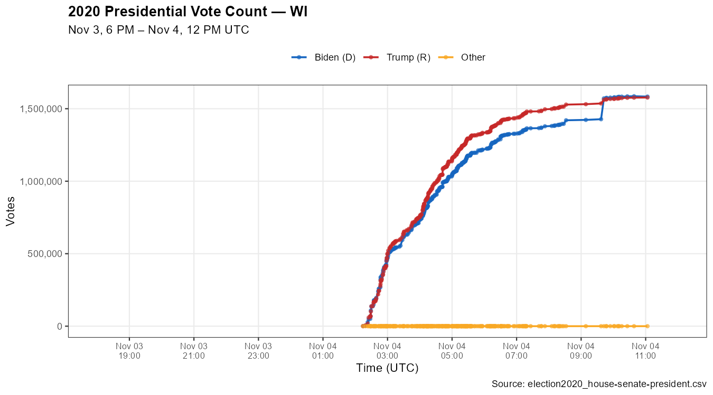
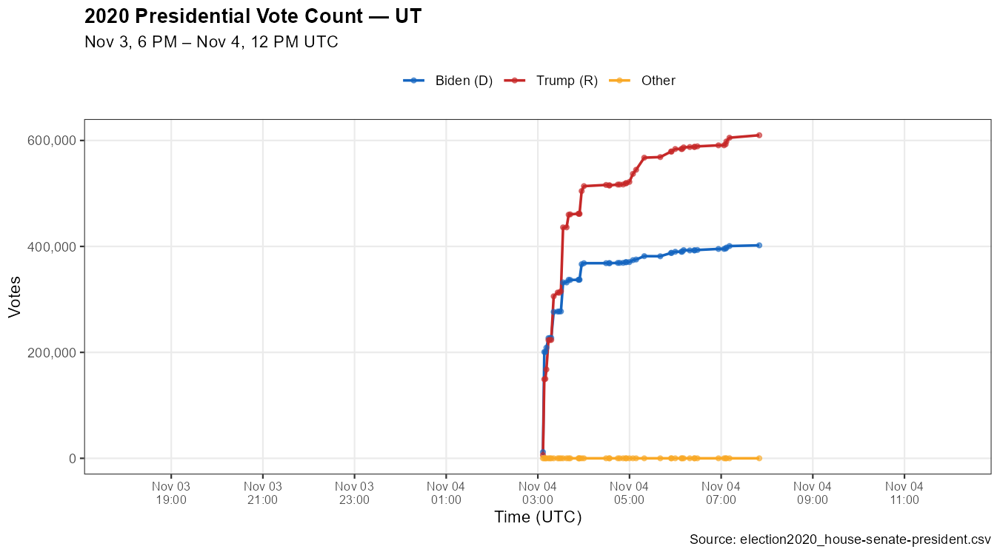
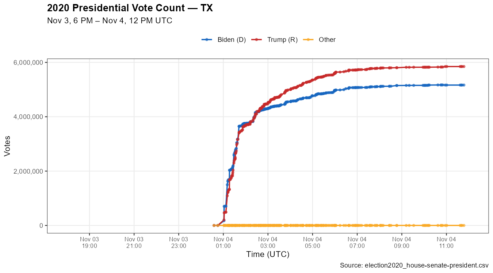
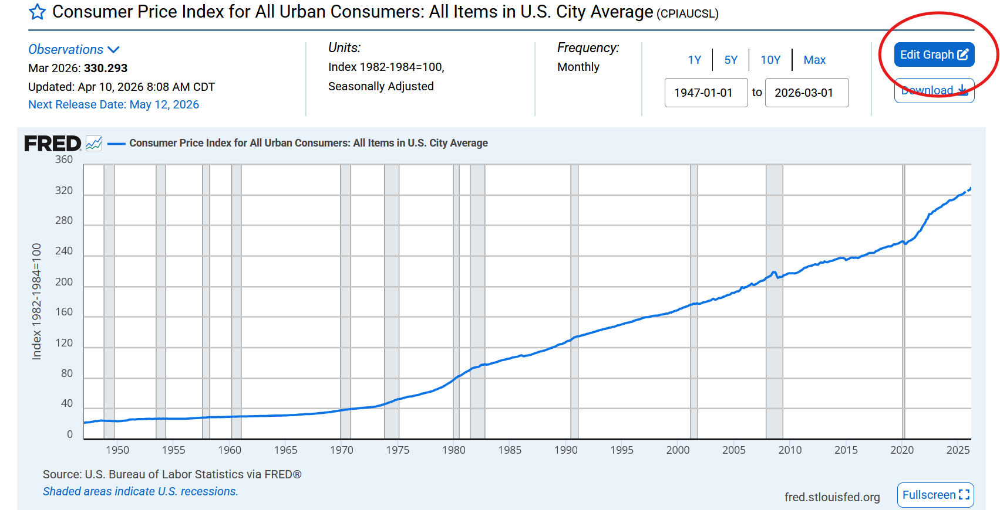
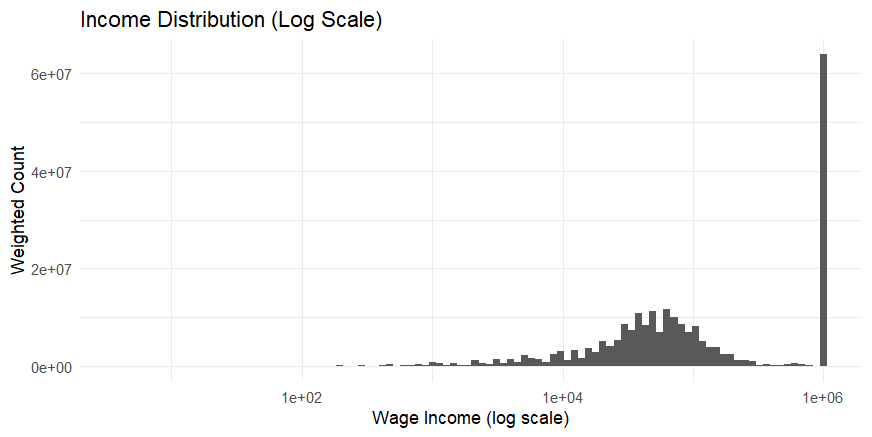
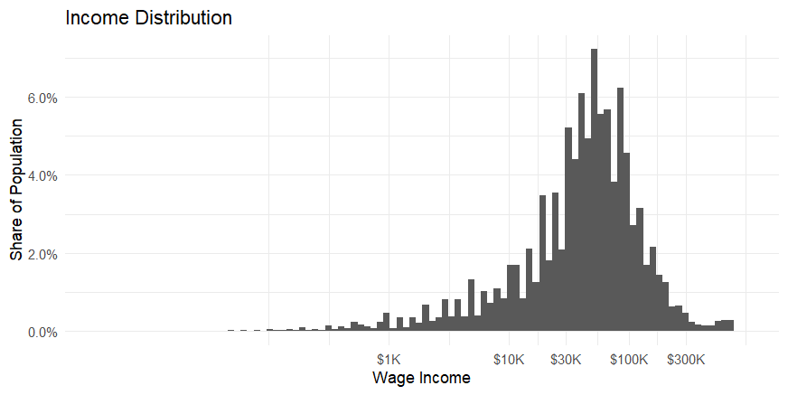

## On theory and empirical evidence {#on-theory-and-empirical-evidence}

Thinking is hard. Many, including me, have tried to systematize it so that conclusions follow cleanly from the evidence. While I will mostly not be trying to do that here, there are some key ideas worth discussing.

We generally wish to know if X causes Y, where X and Y are some arbitrary things we can observe in the world, e.g., we might want to know if lower sales taxes on a good cause lower prices. There are two things we can do in this situation. The simplest thing we can do is to take a purely empirical approach: find a case where sales taxes were cut and check to see if prices fell. Another thing we can do is use theoretical reasoning: apply a model like supply and demand and check to see what it suggests will happen.

The purely empirical approach has its problems. If at the same time that sales taxes were cut, the costs of supplying the good rose, the price might not fall even though the tax cut indeed caused the price to be lower than it otherwise would. This mental comparison between what happened and what hypothetically would have happened to Y without a change in X is called counterfactual reasoning. The problem of changes in X being associated with changes in other things that affect Y is generally known as "endogeneity."

I would expect you to consider the theoretical supply-and-demand approach strictly worse on first examination, a kind of fallback solution when we have no other way of dealing with the problem. An economist theorizing about cause and effect just sounds like a bad joke about economists always making assumptions.

But I think theory is underrated, since it's really just another form of empirical evidence. When we apply supply and demand to some market, without having any good empirical evidence from that specific market, it might seem like we're just fumbling around in the dark and making assumptions about how we'd like things to work. But supply and demand is a good model because it has been applied in large numbers of situations and provides a pretty good idea of how things work in general. Good theories are useful because they allow us to say: "We don't have all that much evidence from this particular case---there are only so many studies of rent control---but we have a *huge* amount of evidence from other markets that suggests that supply and demand works in general as an explanation for how prices and quantities move."

So theory is more than just a fallback. If a politician gets the bright idea to implement a tax on flying taxis, claiming they are a dangerous and noisy invention, no economists can point to a voluminous literature checking the effects of taxes on flying taxis. You could probably count the number of economics papers on the subject on one hand, if any exist at all. But the market for air taxis looks very similar to other markets: there are multiple buyers, multiple sellers, they do not appear to have coordinated into a cartel, and we'd expect the same supply and demand relationships to apply, with more air taxis on offer at higher prices and greater demand at lower prices. There are certainly imperfections in the perfectly competitive model, but it approximates reality.

## On language {#on-language}

Much of this text makes claims about what people are led to believe by statements rather than the best-case-scenario truth value of statements, either implicitly or explicitly:

- Is rent control "bad?" You can make a case either way largely because "rent control" covers a broad variety of policies, and goodness and badness are not well agreed upon.
- Is economics a science? Here we have a question that rests almost entirely on what counts as "science," and where the average person has a very malleable and poorly defined conception of it. We also have to decide on what counts as "economics," i.e., how to summarize the contents of the field. Anti-economists will simply pick out the worst examples, economists will pick out the best examples, and we'll all probably just bleat and moan at each other for a bit before giving up.
- Is clean energy a scam? Even in view of what I discussed in the text, you could make a case for it being a scam in the mere sense that the benefits have been exaggerated by some people (true) and this has probably led to marginally more clean energy than otherwise (true).

Something that worries me a little is that the criticism presented in this book will be taken as too binding on how people are allowed to express themselves. If you claim that economics is not a science and you are fairly confident that the recipients of your message will know exactly what you mean, there's a good chance that there's nothing wrong with what you're saying. They might hear you and think "Ah, of course---'science' is a very strict term after all. I wouldn't consider the study of any system that cannot be modeled based solely on fundamental forces in physics to be scientific."

But usually this isn't the case. If you spend a lot of time studying economics, you quickly find a lot of features that people expect in a science: rigorous empirical evidence, discussion of potential confounders, slowly shifting opinions among economists based on new evidence. So when someone says "economics isn't a science," they typically only gain favor with people who haven't spent much time studying economics. There are exceptions, and I'm sure there are notable and rigorous philosophers who believe economics isn't a science, but they believe that because they have a strict idea of what counts as science. My belief---one that I'm pretty confident in---is that the typical layman would say 'Yeah, economics is a science' if they spent some time hearing an economist talk about the work they do (unless they had some preconceived frustration with the field).

Now we can see the really biting issue with a lot of these disagreements. It would be easy to perform surveys of laymen to identify how they *really* interpret statements, and to see whether they are truly misled by them. We could survey people about how they interpret the statement "Economics isn't a science." To see if it misleads, we could show them various evidence from the field (like how empirical it has become[^n331] or how economists responded to new evidence on the minimum wage) and ask if they feel those facts are compatible with the statement.

So the core difficulty in many of these cases seems to be that we eventually hit a dead end where a survey could resolve the dispute, but no such survey exists. Participants all feel that their language is the *right* language, and no empirical test exists to determine who is right.

Or maybe that just *seems* to be the case, and the real difficulty is more subtle. If we instead took the statement "Economics is a science" and presented it to people, and then told them most economics papers in a nature paper[^n332] didn't replicate, asking "Is the statement compatible with that?" would yield a lot of "No" answers.

There's clearly a problem of summarization going on here, where there's a ton of evidence involved with any given question and providing an objective summary is very difficult, because the laypeople who will be receiving the message usually don't have strict definitions for the terms involved and lack familiarity with the subject. But I don't think it's ever impossible to give a fair summary. To continue with this hypothetical survey idea, if we included *all* of the evidence I just mentioned and gave people a variety of statements to choose from, I think the average answer would be something like "Economics is a pretty sciencey field, it seems, though there are some problems with it." If we snap back to reality for a moment, these surveys don't exist, so we just have to hope that everyone else has the same intuitions about how the typical person will interpret a given statement and whether that interpretation coheres with all of the available evidence. Which is really frustrating! It sucks! But oh well.

I try to take comfort in the fact that there are other people who care as much about these problems as I do, and most of them come to the same conclusions or are honest enough to at least say "yeah, you're right about all of these specific substantive claims about what we can observe, I just use words differently / have a moral disagreement / think we should communicate this differently / whatever."

But there *are* genuine full-throated liars out there, or at least people who shamelessly spread misinformation, which (optimistically) they share out of ignorance. There are a lot of cases in this book where the lies are transparent: Matthew Lynn's article about tariffs is a good example, and if we restrict the immigration discussion to the statement "All immigrants are a net fiscal drain," the statement is clearly false (and not usually the one people make---you can worm your way out of a contradiction by just dropping the word "all!") People who spread lies need to be called out for it; experts have a responsibility to do that.

## On why I bother with any of this and how I cope with it all {#on-why-i-bother-with-any-of-this-and-how-i-cope-with-it-all}

People can be frustrating, belligerent, foolish, incoherent, and most of all, *stubborn.* Why bother with pointing out someone is wrong about economics?

I generally don't focus on changing people's minds. That may surprise you. Instead, I follow a simple rule when engaging with others: if a fairly reasonable and level-headed person were observing my exchange with this person I disagree with, what would I need to say for them to think I have the right idea? Once I think I've done enough for them to be convinced, I feel free to disengage. And if there's no way this observer could be convinced, because my opponent has such good evidence, I might just decide they're right, and if I really messed up, I'll add to the mistakes page of my blog.[^n333]

The other thing I like to focus on is learning. Even if I'm feeling too hot-headed to possibly learn anything from my opponent---it happens to everyone---the time I spend doing research to create evidence-based arguments allows me to learn about the world and better myself. That's a good goal in and of itself.

So even if someone seems like a stubborn idiot, I think it's worthwhile to engage with them politely and without hurling insults. (I *do* insult people[^n334] when I think they're especially dumb, but almost never directly.) If you're wondering whether to challenge someone on a point, ask:

1.  Could I learn something from them? Would researching the question to reinforce my arguments teach me something? If so, you should do it.
2.  If I wouldn't learn something, is it possible that someone else could? Could even an observer of the conversation silently learn? If so, do it.
3.  If you answered no to the preceding questions, are you having a conversation with someone who is probably insane, about something you know a lot about, and is there probably nobody observing your frustrating struggle in a tiny corner of the internet? If that's the case, just drop it and find a better use of your time.

## Advice for critical readers: Check what the experts actually have to say {#advice-for-critical-readers-check-what-the-experts-actually-have-to-say}

If you disagree with much of this book, thank you for reading anyway. If you care about learning and converting others to your side, I'd like to make some recommendations.

If you sense what feels like an obvious flaw in your opponent's thinking, check to see if someone has covered that before, especially if it's an idea associated with experts. Experts almost always have identified whatever issue you've noticed and have some explanation for it. For example, you might pick up Modern Monetary Theory as an interesting idea to proselytize, and notice how economists just don't have an answer to it. Why don't they understand that the only real constraint on government spending is real resources available in the economy? But economists *do* understand that, at least beneath the phrasing used to talk about the subject.

To borrow a more extreme example from politics, suppose you're a big fan of Donald Trump and you see this famous graph on Twitter (here I'll be using the version I created with the raw data[^n335]):

{width="86%"}

It is easy to accept that this mysterious spike in votes is evidence of rigging. But if your news ecosystem only supplies you with information like the above graph, you have to put in effort to search for alternative explanations, like this article explaining that the "Biden bump" is just a reporting artifact[^n336] caused by lots of absentee ballots from Milwaukee being reported at the same time. And if you spent even more time, you'd learn that Milwaukee has been deep-blue for a while,[^n337] and that we knew absentee ballots skewed Democratic before the election,[^n338] making it even more easy to see why that "ballot dump" would favor Biden so much. On top of all that, other states saw discontinuities, too. Here is Utah:

{width="76%"}

A major discontinuity in the vote count occurred that favored Trump rather than Biden. There are other states that took a while to finish counting, too, like Texas:

{width="77%"}

So the features that seem exclusive to an important swing state and only explainable by fraud---lots of votes suddenly appearing, votes getting counted late into the night, one candidate appearing in the lead but being overtaken by the other---were not actually exclusive to Wisconsin.

I'm not really interested in re-litigating the 2020 Presidential race; the point is merely that oftentimes it seems that the experts can't explain something, but you must put in effort to see if they actually can. (Remember that AP News article I linked? I actually had to do *two* Google searches to find it, because my initial phrasing was off!)

One very fast way to get something closely approximating how an expert would respond to your claims is by throwing them at a large language model. Even Grok---sometimes treated with skepticism as a more biased and right-wing LLM---will usually provide a good answer. When I asked "Why did lots of votes for Biden suddenly appear late in the vote count for Wisconsin?" it quickly replied with an expert's answer. Expertise has never been this accessible; use it liberally.

## Additional advice for critical readers {#additional-advice-for-critical-readers}

Some criticisms that might be made:

I can't believe you're relying on Reddit/Substack/Someone on Twitter/Wikipedia for your sources. I can't believe you cited known horrible person John "Says Bad Things" Smith!

I cite sources like that when I think they're sharing good work. You would be better off criticizing the actual data cited by the user in question, or the academic work cited by the Substack author, or whatever it is that's being used. Similarly, I sometimes cite Wikipedia articles because Wikipedia articles themselves cite sources, and they provide a simple way to access those sources and see a summary of them. It would certainly be really odd if things became true or false depending on who was saying them.

I disagree with this thing that you said and I think your failure to address this issue is damning.

Well, I'll hear you out. Just message me. (See: Concluding thoughts, at the end of this book.)

I have my own interests and values in regards to politics, and often they influence my judgments about what's true or not. I can feel my own bias. It feels reasonable to extrapolate that this is true of other people too, and it's implausible that a profession like economics could escape the grasp of this deep-seated human problem.

There are always problems with seeking the truth. Maybe it's hard to measure something, or you're really not sure if your difference-in-differences study satisfies the parallel trends assumption. Maybe you're just too biased and the machinery of your brain isn't built for neutral truth-seeking.

But it's all the same. We have to try to get it done, somehow. We can always speculate about there being some problem we didn't notice, or extrapolate from instances of fraud or p-hacking and say: "If we've managed to spot *these* problems, what might we be missing?"

Well, then let's try to find what we're missing. You can do that, or you can become a radical skeptic and decide we can't know anything relevant to politics because human beings are just too inherently biased and flawed. But what you should definitely *not* do is give in to this instinct entirely and decide that you should "play the game" against everyone else, allowing yourself to become absorbed by your motivated reasoning instead of pushing back against it, because after all, how could anyone be better at it than you? Well, they will be, if you give up. So don't give up, and if you want to criticize the field of economics, make specific, evidence-based criticisms, just as economists do.

## Advice for readers using this book to argue {#advice-for-readers-using-this-book-to-argue}

Do not:

- Attempt to use the authority of economists to argue. This won't work, because the people you're arguing with typically don't care. It also distracts from the evidence, which is what matters.
- Throw graphs and tables at people without describing them. You'd be surprised how many people have trouble understanding graphs and tables.
- Get lost in your expectations. Sometimes, the argument you're arguing back against is interesting in some way and isn't easily defeated by regular pre-prepared counterarguments. (Good! They might have a point.) This seems to have happened to Derek Thompson---who I appreciate the work of; I enjoyed *Abundance*---when he replied[^n339] to an article arguing the effects of rent controls are complex, one I talked about in this book.

Do:

- Combine theoretical reasoning (why do you expect X to cause Y, given how the world works in other contexts?) with empirical evidence (has Y actually happened when we do X? Have we even tried X, or was it something similar, X~2~?)
- Read about econometrics[^n340] so you know how to use empirical evidence, and what problems might occur when we gather it.

## Help! Someone said something stupid about statistics and I don't know what to do. {#help-someone-said-something-stupid-about-statistics-and-i-don-t-know-what-to-do}

The first step is to restrain the "stupid" judgment temporarily, even if you're pretty pretty sure about it. The next step is to use the incredible modern tools at your disposal for working with statistics in order to check their claim. Anyone, no matter their expertise, should be able to follow my advice here.

Check if the statistics question is answered by FRED. There are three ways to do this: search directly via FRED's website,[^n341] indirectly by filtering a Google search with site:fred.stlouisfed.org,[^n342] and indirectly by asking a large language model.[^n343] But at that point, you should just ask it where to look in general. This could allow you to, for example, find PCE inflation data.

If your question isn't answered directly by FRED, there are two moves you might make, depending on your needs. There might be data on FRED that answers your question only if you modify it. For example, if you found CPI inflation data,[^n344] you might be wondering how to see the annual rate of inflation. (What's the big idea with this line going up???) You just need to use this button I've circled:

{width="94%"}

Select "Units" and then your preferred measure, like "Percent Change from Year Ago." You can use this same menu to add other lines to overlay over data. Click the "Add line" tab in the top right, and type a keyword or two for your data, like "PCE." Remember that there are often many datasets with similar names, and you should look them up to understand them.

Some more advanced questions are not answered by FRED. If you have such a question, it might be answered by IPUMS USA. If you visit their site,[^n345] you can create an account and then sign in. Click "Get data" or "Select data" from the home page[^n346] (they do the same thing), and then select the variables you would like to examine. This is one way to get raw income data for 2024, with which you can generate charts like this featured in [Chapter 9, Take 9](chapters/09-miscellaneous-bullshit.qmd#take-9). For data like that, you go to the "Person" tab and then "Income." Add your income data to your cart (it's free, they just call it a cart). Hit "View cart" when you have what you want. Select "Add more samples" and pick the years you would like to observe income data for. 5-year estimates are less current, but larger and more precise. Hit "Submit sample selections," then "Create data extract." You do not need to describe it if you don't want to; hit "Submit extract."

This next part is more confusing, but you'll be fine. Wait however long it takes for your extract to arrive. (It shouldn't take long; when I tested this while writing, it took less than a minute of waiting on the page.) Hit "Download .dat." That is your data. Under "Codebook," hit "DDI," and then right click the page that appears. Save the page. You will need that saved .htm file.

Hit "R" under "Command files" and you will find the code you need for opening the data. At this point, you should follow my guide to installing and using R,[^n347] a statistical programming language. If there is something you would like to do that I did not explain, you can ask a large language model[^n348] to write the code for you. This is often the most efficient way to get the job done. Be very specific about the names of the variables---ACS data from IPUMS should be familiar to them---and you will probably be fine.

Once you have placed an R script in the same folder as your data and the .htm file you saved, paste the code you find on the IPUMS website into the script. When you run it, you will discover that the .htm file is improperly named. Simply change the name of the file to the one that R is seeking. Make sure to change the extension in the name from .htm to .xml, too. This will allow you to open the data. At this point, a detailed description of the names of the dataframes and the variables you have is all a large language model needs to program whatever you would like to see. For example:

> I have IPUMS data open in R. There\'s a dataframe named \"data\" and it has variables \"YEAR\", \"SAMPLE\", \"SERIAL\", \"CBSERIAL\", \"HHWT\", \"CLUSTER\", \"STRATA\", \"GQ\", \"PERNUM\", \"PERWT\", and \"INCWAGE\". Write a script that generates a graph of the income distribution.

This resulted in the graph below. You should notice the problem, which I have kept for demonstrative purposes.

{width="94%"}

These models are not perfect and you should be prepared to spot issues. In this case, while the model dropped zero values, it did not drop special INCWAGE codes that look like very high incomes. You can simply ask for a script that fixes this problem (and makes the axes easier to interpret). Pass any errors back to the AI with copy and paste until they are gone.

{width="94%"}

Ideally, you could use a guide like mine to do this coding yourself, or find a graph created by someone else online---there usually is one---but having these tools at your disposal makes investigating statistical questions in economics a lot easier.

## On study-throwing {#on-study-throwing}

There is a trap that everyone should take care not to fall into when discussing controversial issues that we can call "study-throwing." If you move past the well-known logical fallacy of arguing from authority (strictly thought of as "experts believing statement P *proves* P"), you might accidentally pivot to study-throwing, the practice of simply summoning a study that gives you the conclusion you're arguing for and using it on your opponent like a magic spell. This is better, but it usually doesn't prove anything either.

Studies are good. They usually reflect lots of careful thought and evidence-gathering by the authors, and the usefulness of a study tends to improve if it is published in a top journal. Now consider this hypothetical exchange:

A: "Immigrants lower wages for native-born Americans."

B: "That's not true. Studies have proven it."

A: "What studies?"\

B: "A study by Mette Foged and Giovanni Peri,[^n349] they found that low-skilled immigrants make natives richer."

A: "They showed that the immigrants displaced the native-born and forced them to change jobs. Borjas[^n350] showed that low-skill immigrants hurt low-skill wages."

If you rely on study-throwing, you aren't trying to synthesize what we know. You are just trying to find something that you can use for a "Gotcha!"

If you want to have a productive conversation, remember to *synthesize* everything, not *select* something to throw. That means showing genuine consideration to the evidence offered by opponents. *All* of the evidence is often correct in some sense; you don't need to figure out which study is fake and which one is real. In the chapter on immigration, I deployed a more general framework for understanding how the effects of immigration might vary in different contexts. That is a better way to go about things.

But of course, most people can't internalize lots of models and rules like that, and need briefer summaries of how things work. That's typically what people are trying to get to when they throw studies, but they can never reach that goal because of the strategy they've chosen. My suggestion is to keep a cool head, ask clarifying questions of your opponent, and seek a general understanding of how what they're saying could be true rather than assuming that there must be something wrong with the study they threw at you.

## Concluding thoughts {#concluding-thoughts}

Writing this much about economics is difficult. If you think something contained in this book is misleading or outright wrong, please contact me over Substack[^n351] or X/Twitter.[^n352] I have a habit of fixing mistakes and sharing them.[^n353] An early copy of this book contained false statements about a paper by Borjas and Breznau because I copied a typo they had in their working paper that made their estimates smaller by an order of magnitude.

While writing this, I thought: Am I asking too much of critics of economics? Am I asking them to give up on everything and become too soft to get anything done? Don't interpret what I'm saying that way. There is one question I would like people such as Jostein Hauge and Oren Cass to think about more often before arguing that economics can't be objective or isn't a science: Does this encourage learning, or discourage it? Does this make people cynical or smart?

Pointing out issues with the field of economics can encourage learning and enhance our knowledge of the world. Consider this short essay by Rob Henderson[^n354] that appeared in the Wall Street Journal's *Free Expression* newsletter, "Social Science Has a Replication Problem." I will provide an excerpt (though the article is so short that you should just read it); this is what he says after writing about a Nature report[^n355] finding a \~50% replication rate in the social sciences:

> "Skepticism about replication isn't the only way people avoid engaging with research. Consider hindsight bias,[^n356] or the tendency to believe we already knew something once we heard it. It shows up in a familiar way. You describe a research finding. Someone replies, 'Did we really need a study for that?' The implication is that researchers waste time studying things that are obvious.\
>
> But 'obvious' is a slippery idea. It often means little more than this: I can come up with a story that fits the result after I've heard it."

He then provides an example about how easily World War II soldiers adjusted to their new conditions. A study found that soldiers from urban areas adjusted more easily. Seems obvious: they previously lived in more crowded conditions, so army life is easy to adjust to. But if they had found the opposite, we'd *still* say it was obvious: of course rural men, who lived in harsher conditions, had an easier time adjusting. He concludes the essay:

> "Abandoning trust in research leaves us with our intuitions. And our intuitions are prone to systematic error. We are good at explaining things after they happen. We are much worse at predicting them in advance. Research, even when it fails, forces us to confront that gap."

There are plenty of people in the world who provide constructive and insightful essays about the state of the social sciences. There are others who would rather make statements about economists being unobjective, and economics not being a real science. That won't encourage more learning and discovery. It neglects to provide any specific, actionable criticism of anything any economist believes, and misleads people about what are really unsubstantive differences between economics and other important sciences.

I'm not naive. I know that there will always be a market for the rebellious heterodox---they have a great appeal to public intuitions. But if that's where your intuition led you, and you sincerely care about the truth, I hope you'll use that as motivation to help everyone to make something better.

[^n331]: [x.com/StefanFSchubert/status/1925892166628348260?s=20](https://x.com/StefanFSchubert/status/1925892166628348260?s=20)
[^n332]: [stevestewartwilliams.com/p/should-we-trust-social-science-research](https://www.stevestewartwilliams.com/p/should-we-trust-social-science-research)
[^n333]: [jackonomics.substack.com/s/mistakes](https://jackonomics.substack.com/s/mistakes)
[^n334]: [reddit.com/r/badeconomics/comments/1l808py/economics\_is\_not\_a\_scien...](https://www.reddit.com/r/badeconomics/comments/1l808py/economics_is_not_a_science_is_the_worst_economics/)
[^n335]: [github.com/d0ntw84f8/election2020-timeseries-data/blob/main/house-s...](https://github.com/d0ntw84f8/election2020-timeseries-data/blob/main/house-senate-president/election2020_house-senate-president.csv)
[^n336]: [apnews.com/article/fact-checking-9647421250](https://apnews.com/article/fact-checking-9647421250)
[^n337]: [en.wikipedia.org/wiki/2012\_United\_States\_presidential\_election\_in\_W...](https://en.wikipedia.org/wiki/2012_United_States_presidential_election_in_Wisconsin#By_county)
[^n338]: [fivethirtyeight.com/features/why-pennsylvanias-vote-count-could-cha...](https://fivethirtyeight.com/features/why-pennsylvanias-vote-count-could-change-after-election-night/)
[^n339]: [x.com/DKThomp/status/2049888203948384703?s=20](https://x.com/DKThomp/status/2049888203948384703?s=20)
[^n340]: [jackonomics.substack.com/p/economics-is-a-science-part-2](https://jackonomics.substack.com/p/economics-is-a-science-part-2)
[^n341]: [fred.stlouisfed.org/](https://fred.stlouisfed.org/)
[^n342]: [fred.stlouisfed.org](http://fred.stlouisfed.org)
[^n343]: [gemini.google.com/app](https://gemini.google.com/app)
[^n344]: [fred.stlouisfed.org/series/CPIAUCSL](https://fred.stlouisfed.org/series/CPIAUCSL)
[^n345]: [usa.ipums.org/usa/](https://usa.ipums.org/usa/)
[^n346]: [usa.ipums.org/usa/](https://usa.ipums.org/usa/)
[^n347]: [jackonomics.substack.com/p/a-guide-to-r-for-people-who-want](https://jackonomics.substack.com/p/a-guide-to-r-for-people-who-want)
[^n348]: [chatgpt.com/](https://chatgpt.com/)
[^n349]: [aeaweb.org/articles?id=10.1257/app.20150114](https://www.aeaweb.org/articles?id=10.1257/app.20150114)
[^n350]: [nber.org/system/files/working\_papers/w21588/revisions/w21588.rev0.pdf](https://www.nber.org/system/files/working_papers/w21588/revisions/w21588.rev0.pdf)
[^n351]: [substack.com/@jackwhitcomb](https://substack.com/@jackwhitcomb)
[^n352]: [x.com/jack\_whitcomb\_](https://x.com/jack_whitcomb_)
[^n353]: [jackonomics.substack.com/s/mistakes](https://jackonomics.substack.com/s/mistakes)
[^n354]: [wsjfreeexpression.substack.com/p/social-science-has-a-replication](https://wsjfreeexpression.substack.com/p/social-science-has-a-replication)
[^n355]: [nature.com/articles/d41586-026-00955-5](https://www.nature.com/articles/d41586-026-00955-5)
[^n356]: [thedecisionlab.com/biases/hindsight-bias](https://thedecisionlab.com/biases/hindsight-bias)
