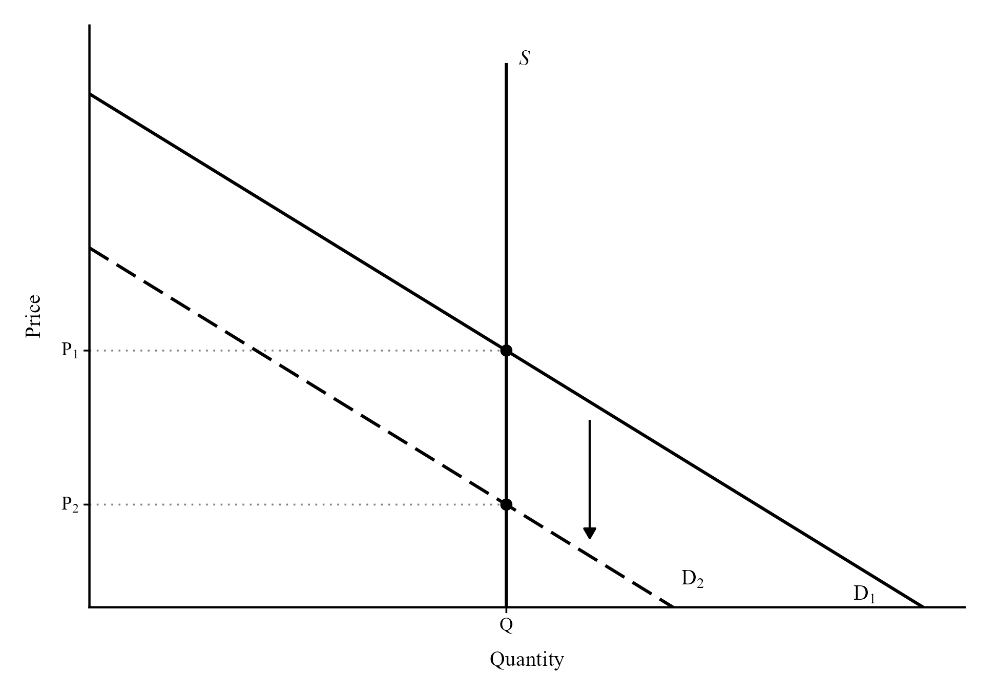
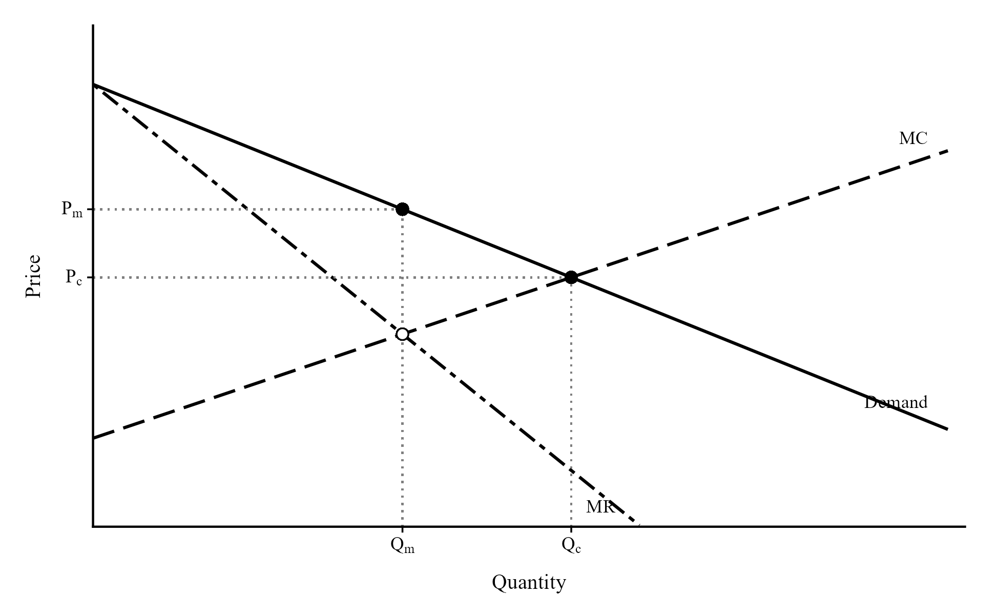
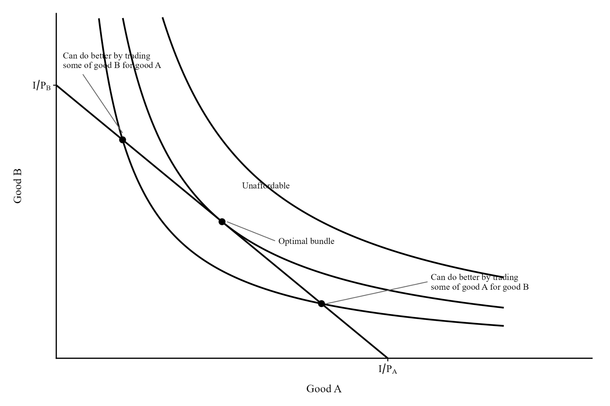
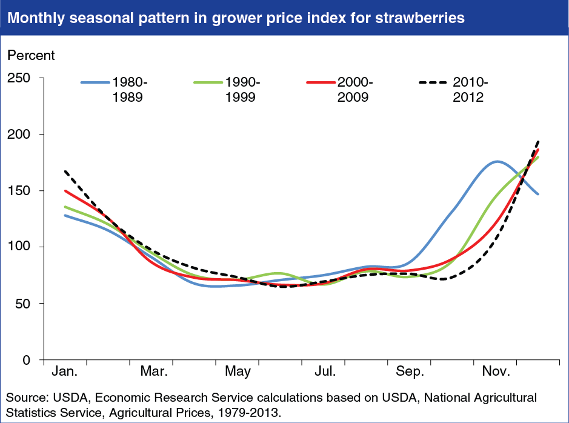

## Take 1: Economists are embedded in social systems, and thus can't be considered objective. {#take-1}

[Rating: D-tier]{.rating .tier-d}

Jostein Hauge frequently makes arguments to this effect:[^n297] "Economics is fundamentally political. Economics is shaped by ideologies, human values, competing interests, social norms, and political priorities. Be sceptical of economists who tell you that their field is 'objective', free from politics."

I expect people to mostly give this statement a weak and obviously false interpretation: that if a scientist is a human being with emotions and connections to other people, if their thoughts have consequences for the world, their judgments can't be objective. This belief necessarily leads to such extreme skepticism that the bearer can't have much scientific knowledge at all.

It is easy to see other examples. Medical scientists also have values, and are much more likely to be liberal Democrats.[^n298] They depend heavily on government funding through the National Institutes of Health. We might say that "Medicine is shaped by ideologies, human values, competing interests, social norms, and political priorities. Be skeptical of doctors who tell you that their field is 'objective', free from politics."

It would be easy to then motion to vaccine skepticism. If the studies checking the effectiveness of vaccines are created by political liberals, could scientists' conviction that they work, and their need to acquire government funding by bringing results, poison any evidence they produce?

Maybe it's all a sham, but I doubt it, and I don't think this kind of thinking is useful or brings you closer to the truth. Fabricating evidence is difficult. Doing it hundreds of times is even more difficult.

Is my analogy weak? In some ways, it is. Economics, unlike medicine, has government policy as one of its primary objects of study. We might worry that economists, having a position as government-funded elites, would tend to make their judgments as convenient to their own social position as possible.

That is not what the evidence suggests. Do they oppose the entry of high-skilled workers who might compete with and displace them? No, not in the slightest.[^n299] Despite being much more well-paid than others, they are honest about taxes and nigh-universally agree that raising taxes on the rich raises federal revenues.[^n300] For all the plausibility of the ideological self-interest theory of how economists think, it has little in the way of accurate predictions about what economists really believe.

Most of the time, it's not clear what the implications of Mr. Hauge's statement are for how to interpret the opinions of economists. With an eye to his other statements, we might take it to mean that economists are poisoned by free-market ideology that blinds them to evidence. Are they blinded, in this way, when they express that government-funded healthcare research is good for Americans and pays for itself?[^n301] This view also does little to explain why economists slowly changed their tune on the minimum wage, from deep skepticism in 2005 to limited opposition in 2015.[^n302] The simplest explanation is that emerging evidence of the kind documented in [Chapter 3](03-labor-economics.qmd) made them change their minds.

Rather than making the weaker claim, someone like Hauge might take their claim and switch it for a stronger one: economists can make mistakes because they're human. Why would anyone deny that? But unless you want to become a radical skeptic, the right move is to assume that most economists are fairly grounded in real-world evidence, even if flawed as humans are, and engage with their ideas on equal grounds. You shouldn't allow the political theory of economic thought to put steel walls around your mind and prevent you from learning from experts.

So I can only consider Hauge's claim to be misleading. Rather than generalizing about economists in a way that seems to make them uniquely flawed, it would be better to make a more qualified statement about, for example, how individual economists can have bad habits of re-framing evidence in a convenient light.

## Take 2: Economics can't be objective, since it's divided into schools of thought. {#take-2}

[Rating: F-tier]{.rating .tier-f}

When at times I hear people outside the field of economics discuss it, they seem to have a conception of the field that is strongly disconnected from what it's actually like. They seem to think that economics is split into various schools of thought that each has a unique story to tell about the world, with the list sounding something like "Classical, Neo-classical, Keynesian, Neo-Keynesian, Neoliberal, Austrian, Chicago, Marxist" perhaps with other schools thrown in like "Hayekian" or "Rothbardian." Then they smash these schools together like fun action figures. Pew, pew!

There are no separate schools of thought that disagree on the most important issues. That is reflected in any review of Kent Clark Center surveys of economists or other surveys. The disagreements that do occur often have clear roots in the wording of the question and often appear small on review of the comments made by those surveyed. Major issues in economics, like whether the central bank should generally cut rates during a recession induced by an aggregate demand shock, or the effects of tax cuts on government revenues, have little diversity of thought except on minor points. Economists will disagree on the precise revenue-maximizing rate of income taxation in a country without disagreeing that such a point is definitely less than 100%.

The most agreement occurs on points that feel too boring to mention, like how supply curves almost always slope upward. That simply means businesses in a competitive market are generally willing and able to supply more of a good if the price is higher. But these simpler points are more valuable than you might think. Evidence points to the same pattern with housing supply, with less housing being produced when prices are forced down, but surveys[^n303] reveal people often don't believe this, even when they believe it about other goods. It's invaluable that economists agree on simple, essential facts like these, even if they're simple and at first appear unenlightening.

It might be worthwhile to take a moment to look at the aforementioned schools of thought. Classical economics refers to the school of thought in political economy that prevailed in the 18^th^ and 19^th^ centuries, especially in Britain. Many of the ideas of classical economics came from Adam Smith's book The Wealth of Nations, which still forms the foundation for much of modern economics. It included passages describing supply and demand as well as the need for government intervention in certain areas, like the provision of national defense. The Great Depression and other historical developments led to significant revisions in macroeconomic thinking associated with classical economics.

The Austrian school of economics has its own share of contributions to the field, such as Friedrich Hayek's famed paper The Use of Knowledge in Society describing how, by happy accident, free markets and prices are able to solve the problem of allocating resources based on knowledge otherwise unavailable to a central planner. A central planner, for example, might not know that it would be more efficient to repair a cottage with wood nearby than with concrete from miles away. Prices paid by the cottage owner for wood and concrete make the problem obvious.

The Austrian school also included advocacy for the gold standard, in which the value of currency is tied to gold by a government promise to provide a fixed amount of gold for every unit of currency. Zero economists on the Kent Clark Center's panel[^n304] agreed that a return to this system would improve price stability or employment outcomes for the average American. The problems with the gold standard can be read about elsewhere (an argument from authority like this is a useful indicator, but it isn't conclusive); the point is that economists did not adopt this particular position that some Austrian economists, in particular Ludwig von Mises, believed in.

Including Marxist economics as a school of thought in economics seems to be a category error. There is no school of thought based around Marx providing answers to most of the questions of concern to modern economists, like "Do minimum wage hikes cause unemployment?" or "Does nominal GDP targeting improve the ability of central banks to provide price stability and mitigate recessions?"[^n305] Marx also never directly addressed the question of whether there should be a gold standard.

Solving empirical problems mostly requires good econometric work, and the Central Limit Theorem remains true regardless of your thoughts on Marx or the importance of class conflict. Marxists provide a larger narrative of historical progress, but economists are mostly disinterested in long-term historical patterns that have so far proven difficult to predict.

Here is economist Robert Solow, famed for the Solow model of economic growth, describing the issue:[^n306]

> "Economics is likely to be contaminated by ideology. For this reason, there are always dissenting fringes within academic economics. Marxism is only the most persistent. There is an Austrian persuasion (a sort of extreme individualism), there are post-Keynesians and neo-Ricardians, and there are many other people who just don't like what is going on in the mainstream. Nevertheless, there is usually a definite consensus---there is one now---and an accurate picture of the discipline would make that clear."

Of great relevance is the 1995 article "Where Is There Consensus Among American Economic Historians? The Results of a Survey on Forty Propositions."[^n307] Those surveyed were randomly selected from the Economic History Association. Two-thirds disagreed that the gold standard was effective at stabilizing prices and moderating business cycle fluctuations during the late 19^th^ and early 20^th^ centuries, with one-third agreeing, mostly "with provisos," i.e., with conditions attached to their agreement.

Notably, they overwhelmingly agreed that the passage of the Smoot-Hawley Tariff Act exacerbated the Great Depression, with 86 economists agreeing and 14 disagreeing. The idea that the field is divided into schools of thought might lead you to the mistaken belief that economists would be split on issues like these, perhaps with Keynesians supporting the passage of the act, or some other division I couldn't conceive of.

I'm not sure what, exactly, fuels ignorance on this issue. It may be that people expect too much of economists. Similar problems would arise if you had similar expectations about physicists, hoping they agree on every question you care about, rather than just those they have extensively studied. Physics does not lose its plausibility simply because many famous physicists disagree on whether God exists and created the universe.

Some might still be annoyed by the contrast between what I'm saying about the scientific nature of economics and the disagreement the field clearly has. If you asked 100 physicists whether hydrogen bonds explain the surface tension of water, it's unlikely that 14 of them would disagree.

The real problem is that political systems create a natural tendency for the issues of most concern to people to become those most difficult to solve, unlike other fields. Whenever governments are considering passing a bill into law, they weigh the costs and benefits. The US government considers an odd reweighting of the costs and benefits of a policy to the country as a whole, with less-populated states receiving more influence, for example. But in some cases, the benefits of a particular policy are so clear and so broad that it is quickly passed into law and never touched.

One good example is national defense. Very, very few people in the US spend time discussing the abolishment of the military. Economists have a clear explanation for why: the military provides a public good, national defense, which would not be provided if not for its existence, due to the free-rider problem. Without government funding, the military would struggle to convince people to pay them voluntarily, since everyone would prefer to let others foot the bill. So the military has always been there, and while its funding as a share of GDP has fallen slowly for decades,[^n308] it still remains. Any other policy with such clear benefits receives the same treatment. On these issues, few people ask economists for their opinion or look for a consensus.

Compare this policy to the minimum wage. Rather than benefiting everyone, the policy has clear winners and losers. The winners are most affected workers, while the losers are the workers who are left unemployed as a consequence, businesses who have to pay more for labor, and consumers who have to pay higher prices (though these effects are often small). It should be expected that at times economists disagree on the exact costs and benefits of the policy and whether it is good on net. What's unexpected is the level of agreement they really *do* have at times, with, for example, only one economist among 42 agreeing[^n309] that raising the federal minimum wage to \$15 per hour would substantially increase aggregate output in the US. Issues like the minimum wage, with winners and losers and complicated effects, are the issues the public most wants economists to provide clear answers and recommendations for.

Other sciences generally don't suffer from this problem. There is not much of a natural tendency for public attention to be pushed to the most difficult to resolve issues in physics, zoology, paleontology, or almost any other science. People are happy to enjoy fun science videos about physics concepts established a century ago, and expect only that the laws of physics don't suddenly fail while a plane is in flight. They don't think very often about the reason why[^n310] practically every government redistributes income when charity exists.

If the most elementary and well-agreed-upon ideas in economics were as interesting as those in physics, it might not be considered so easy to dismiss. Compare the equation of exchange in monetary economics, MV = PQ, to Newton's first law. Newton's first law tells you that an object in motion stays in motion, and it's surely obvious to physicists. Despite this, people are still amazed and confused when confronted with a situation where a man jumps on top of a moving vehicle.

It would be helpful for people to know that P = MV/Q, i.e., the price level is strictly determined by the money supply, the rate at which it changes hands, and how much we produce. This is an accounting identity, but despite the seeming obviousness of it, almost nobody outside of economics can give you this formula from memory. They do know that inflation was unusually high during the Biden administration, and expect economists to have known this would happen before the Biden administration's legislative agenda was passed. To create an analogy to physics, you might as well expect them to know the exact location of the jumping man after five seconds while only knowing the force of the jump and the weight of the man without the wind's direction or speed.

By this point, I think we're ready to move on. But if you still aren't convinced, you can examine the contents of this paper,[^n311] "Views among Economists: Professional Consensus or Point-Counterpoint?" by Roger Gordon and Gordon B. Dahl: "Based on our analysis, we find a broad consensus on these many different economic issues, particularly when the past economic literature on the question is large."

Here is perhaps the most relevant section:

> "The first question we face in the analysis is how to define differences in views among our panel members. Consider for example the responses to the question asking whether the Fed's new policies in 2011 will increase GDP growth by at least 1% in 2012. The responses were 41% 'uncertain', 37% 'disagree', and 17% 'strongly disagree'. Initially, we assume that these responses imply consensus, since no respondents 'agree' even though respondents differed in their extent of disagreement with the statement. By this definition, there is an extraordinarily high level of consensus among our Panel members. Only 6% of the responses in our data violate this definition of consensus, responding 'disagree' when the consensus is 'agree', or conversely. Similarly, for 32 out of the 80 questions, there are no such disagreements."

## Take 3: Economists can't make good predictions, especially about recessions. {#take-3}

[Rating: F-tier]{.rating .tier-f}

This take[^n312] comes from Professor Gad Saad, author of "Suicidal Empathy."

There are a few points worth making here. First, economists *can* make good predictions. It just depends on where you look in the field. Second, asking economists to predict recessions is too high of a bar. Finally, predictive content does not a science make.

Let's begin with the first point. This book is rife with empirical evidence for economic theory. [Chapter 2](02-housing.qmd), on housing, shows how alleviating supply constraints can lower the cost of housing, as suggested by a simple model of supply and demand. [Chapter 8](08-international-trade.qmd), on international trade, provides further evidence of supply and demand in action, with the burden of tariffs empirically tending to fall almost entirely on domestic consumers and producers, rather than foreign exporters. Any economist could predict that forbidding the sale of kidneys would cause a shortage, and indeed, the only country without a waitlist is Iran, which is coincidentally the only country with a regulated market for kidneys.[^n313] Wherever we look, we can find supply and demand in action.[^n314]

Probably the best predictions economists have made have been in auction theory.[^n315] Designing an auction can be harder than it looks. Participants can collude, reducing the final price of the auction. You can potentially avoid this with a hidden (or "sealed") bid auction, but this can lead to a "winner's curse" where the winner pays more than what they value the item at. This problem can in turn be solved by using the second-highest bid instead, but the New Zealand government quickly discovered an additional pitfall: the second-highest bid can be extremely small without a minimum bid. They found themselves selling a spectrum license to a firm that bid NZ\$100,000 for a mere NZ\$6. In the end, "By carefully designing rules to avoid the potential pitfalls of auctions, economists have helped the FCC raise more than \$23 billion since 1994, far exceeding the \$10 billion in revenue the Office of Management and Budget had originally projected." Knowing the rules of human behavior, and making predictions accordingly, can be very useful to a government.

As for the second point, not only would predicting recessions require predicting natural disasters like COVID-19, a credible prediction of a recession would influence whether and when the recession occurs. If, for example, economists managed to credibly convince the public that a stock market bubble was occurring, the bubble would immediately burst. Think of how banks would behave if economists credibly identified the proliferation of subprime mortgages---the spread of bundles of loans with a heightened risk of default, essentially---in 2005, rather than 2007. And if economists managed to become infectious disease experts and predicted COVID-19, governments would have taken early action to prevent the pandemic and the consequent recession.

Does this limitation on the predictive abilities of economists render their work non-scientific, at least partially? You might think so. In that case, you would have to cast much of meteorology and seismology out of the domain of the sciences. We remain unable to tell how many hurricanes will hit Florida next year, and unable to predict earthquakes in the slightest. I do not think that makes the study of either of these natural phenomena not worthwhile, or that these fields lack any scientific content. Even without predictive power, we can still develop some degree of explanatory power, identifying the mechanisms of a phenomenon so that we might better address it when it occurs. That allows earthquakes to be detected slightly early when they happen, and allows macroeconomists at the Federal Reserve to provide a better response to an economic crisis when it occurs.

In fact, even *explanatory power* is not necessary for scientific content! Sometimes, all that we can know is what the adequate response to a disease is, without knowing how that response helps or how the disease works. Migraines cause a lot of people great pain. We have a very limited understanding of what causes them, and while triptans are used to treat them, we do not know how they work. The empirical, scientific content is sometimes in the counterfactual reasoning: based on observation, patients will tend to be better off with the treatment than without it.

Perhaps your bar for scientific content is truly that high, and you would be willing to do away with much of meteorology, seismology, and medicine in your categorization of "science." But I am certain that most people would not. Given the wealth of evidence that economists *can* make good predictions, in certain areas, and the fact that predictive power is not load-bearing for a science, I would call this claim misleading, and certainly a moot point.

## Take 4: Economists always assume people are rational and competition is perfect, which is false. {#take-4}

[Rating: F-tier]{.rating .tier-f}

Plenty of people have made claims to this effect; an example is here.[^n316] **Most of the time the arguments are weak. I will address a stronger and more qualified argument from Paul Krugman later.

There are a few grounds on which this take is misleading. The first I will discuss is that what economists mean by rational is not as strict or unreasonable as what people expect. The second I will discuss is that economists *do* relax many assumptions of rationality, anyway. Criticisms did not go unheard. Some brief commentary will be made on the subject of competition as well.

Most people don't know what it really means for economists to assume people behave rationally. They might imagine that this conception of a person is constantly reflective, calculating, and precise in an unrealistic way. That is not what economists assume, at least not usually.

It is not clear what, exactly, is *meant* by rational, since the dictionary definition is "behaving according to reason and logic," which tells us little about the behavior of consumers and producers. We should simply look at things from the introductory, intermediate, and advanced microeconomic levels, exploring the assumptions made, and why they're made.

Beginners in economics are introduced to supply and demand, where the assumptions made are fairly innocuous. The supply curve shows a positive relationship between price and quantity, meaning that the more profitable it is to sell a good, the more eager producers are to sell. You can find an empirical estimate of an upward-sloping supply curve in [Chapter 2, Take 5](02-housing.qmd#take-5), and elsewhere. The demand curve, on the other hand, is described as having the opposite relationship, with consumers demanding more of a good as the price falls. Real-world demand curves, like real-world supply curves, are hard to estimate, but plenty of work has been done in this area,[^n317] and obviously the relationship between prices and quantities was found to be negative.

From these two relationships, students find that markets naturally tend to be drawn toward the point where supply and demand equilibrate. It is easy to see how if the price were so high that producers are willing to make a lot, but consumers are not willing to buy that much, they would tend to choose lower and lower prices until they stop wasting so many valuable resources making goods that people are unwilling to purchase at the going price. If the price were too low, similarly, it would tend to rise until suppliers are able to meet the strong demands of consumers. They would have little reason to keep it low, knowing that going a little higher would not completely deter consumers, and would make their business profitable. Various evidence for the real world working according to the textbook model is gathered in the attached endnote.[^n318]

Interestingly, some have challenged the introductory explanation of how prices are set on the grounds that in the real world, firms like Target simply add a standard markup above cost, rather than taking the going price. This is an understandable confusion, but the habits of businesses to set prices with a markup above cost do not really challenge the textbook model. The question is not "how does Target set its prices?", it is "how does Target set its prices when conditions change?" When, for example, demand falls, does Target cut its prices or introduce promotions to clear its inventory, rather than keeping the same markup above cost?

{width="94%"}

As it turns out, they do. Here's the Associated Press's Anne D'Innocenzio:[^n319] "Sales of big TVs and small kitchen appliances that Americans loaded up on during the pandemic have faded, leaving Target with a bloated inventory that it said must be marked down to sell." In the short run, supply is not perfectly elastic, so as the model predicts, suppliers cut prices to deal with an unexpected backwards shift in the demand curve.

But I must relent. Retailers tend to operate in an environment of limited competition, where there are few other stores to go to and it is costly for consumers to acquire information about alternatives. Economists are aware of this fact. It is not surprising that firms in this environment do not always act like price takers.

The assumption of perfect competition is the aspect of supply and demand people most frequently attack. Rather than wasting too much time on how that assumption plays into the model, a much quicker way to see what's really going on is to look at the monopoly model. In this model, there is one firm, and that firm is able to set the price of the good being sold. Like any firm, it will sell goods so long as it is profitable to, whenever marginal revenue exceeds marginal cost.

Because there is one firm and one price, the regular demand curve that might be derived no longer guides the equilibrium price. The marginal revenue curve does, which is different. If you think about the relationship between demand and the price the firm chooses, at a high price, they might sell to one consumer. But if they cut to a lower price to sell to the next one, they must cut the price charged to the *preceding* consumer. Thus, the extra revenue the firm gets from an additional sale is not equal to the demand curve. The marginal revenue curve is below the demand curve, like so:[^n320]

{width="89%"}

The firm sells at the white dot, where marginal revenue equals marginal cost. (Notice that this means if they moved right and sold an extra unit, the added cost would exceed the extra revenue brought in. They'd lose money.)

Why do I bring up the monopoly model? Because this is as imperfect as competition gets (though we could arrive at a worse situation for consumers by letting the monopolist set the maximum price for each consumer). The static picture is different, with prices being higher than with perfect competition, but despite this, it can be easily shown that many of the predictions of the competitive model still hold.

If we are modelling a forward supply shift due to new technology, the monopolist will likewise see its marginal cost curve shift forward, prices will fall, and quantities will increase. Similarly, prices and quantities generally rise when demand booms in the monopoly model, though the degree to which the demand increase turns into higher prices or higher quantities depends on the monopolist's marginal cost curve. If the government imposes a tax on the monopolist, some of it will pass through to consumers. The logic of relative elasticities determining the pass-through rate doesn't fully carry over, but many of the basic ideas do (e.g., a monopolist selling a fixed quantity would pay the full tax burden). Similarly, a subsidy passes through as a benefit, and a tax on consumers has the same effect as a tax on the monopolist. These are all predictions of the perfectly competitive model, though the sizes of the effects are influenced by the presence of a monopoly, and so is the static level of the price and quantity. There are other predictions that don't always hold, like the prediction that a price control will necessarily cause a shortage (under a monopoly such a control can raise the quantity sold), but a sufficiently stringent price control would still have the same effect.

I think the preceding paragraph should be sufficient to explain how perfect competition is an acceptable "spherical cow" in economics, a simplification made for pedagogical purposes. Most of the predictions of the model of supply and demand are things we would expect to happen even if the assumption of perfect competition is eviscerated. A market with imperfect competition, like the retail market occupied by Target, is still one where we would expect firms to respond to changes in costs with directionally parallel changes in their prices, where new taxes will affect production and pricing decisions, and where a price control will, under fairly realistic conditions, trigger a shortage.

At the intermediate microeconomic level, we might take "rationality" to refer to the consumption choice problems described by graphs like the one below.

{width="94%"}

I think it should be fairly obvious that economists don't believe people literally do this in their head---that would require calculus skills most of the population lacks---but who knows, my "I think" might not be so convincing to you.

Are the assumptions of this model unreasonable? I don't think so. It's fairly flexible, since the indifference curves can take a variety of shapes. We usually assume that the goods in question are both things the consumer likes, and that these things have diminishing marginal utility. That means that you get less enjoyment out of something the more of it you have. So, for example, you might like having two apples and two bananas, but if I offered you four bananas instead, you would prefer to keep what you have. The goods are thus imperfect substitutes. But students often get to do away with this assumption, such as by treating goods as perfect substitutes, or by treating them as perfect complements (resulting in simple L-shaped indifference curves).

The most unreasonable aspect, if we would have to pick one, is the part where the consumer optimizes. They exhaust their budget, which is fairly reasonable, but the model also tells you that they choose a very specific point on the graph as the optimal combination of goods---professors tell their students this is the point where the ratio of the marginal utility of good A to good B is equal to the ratio of their prices. This will typically require treating both goods as continuous quantities rather than discrete quantities, and setting up a Lagrangian to do the calculus.

It's possible to lose the general picture in the details, but I don't think the details are misleading, or that the mathematics dresses up a falsehood. When we look at what the math describes, what do we see? We see that consumers buy less of something when its price increases, and more of something else. If their income falls, they purchase less, and if their income rises, they purchase more. The model also provides the flexibility to change which goods they purchase more of when their income rises.

In everything that I've just described, I don't think there is some impossible level of rationality that doesn't approximate the way people really behave. Certainly people can make silly mistakes sometimes, perhaps buying two packages of hotdog buns and one package of hotdogs, but there would be little point in creating a model that accounts for the small risk of something like that happening. The map is not the territory, and that guarantees that the map isn't too large to fold and carry on your journey.

But maybe much of this is really bunk. Sometimes, I'm sure it doesn't work. Economists have shown a clear tendency to care about exactly those issues. There is no gaping hole in the field being ignored by everyone in it. If one were to simply open Gregory Mankiw's *Principles of Microeconomics* (6th edition), a textbook taught to undergraduate students, they would find a section titled "People Aren't Always Rational" on page 480. And hanging behind my desk as I write this, I have notes on Peter Maxted's paper "Present Bias Unconstrained: Consumption, Welfare, and the Present-Bias Dilemma." It models agents who, rather than behaving perfectly rationally (thinking of rationality in the looser sense we use in public discussion), behave with a bias toward the present. This is different from standard rational discounting, where an agent exponentially discounts future gains relative to present ones because present ones can be invested. Instead, a steep discount β is immediately applied to any future gain or loss, with exponential discounting applied in addition to the fixed β discount factor on future periods.

It is worthwhile to note that, because any economic theory must necessarily produce a great simplification of the workings of the brain, there are going to be lots of different theories that all imprecisely explain, and loosely predict, human behavior and its interaction with the world. It is easy to see how this can be the case. If we simply want to explain the pricing behavior Target exhibits for strawberries, one person might come up with the "sunlight theory:" Target decides to price strawberries lower when it's sunny outside. Another person might get in the weeds and find out that strawberry production is lower in the winter, and come up with a quantity-based theory, where they simply assume that prices will be higher when quantities are lower (essentially, modelling the market as one where we move up and down a demand curve). The two theories are clearly different, and one is more accurate than the other. Neither of them actually describes reality exactly as it is, but they both do a decent job of predicting strawberry prices:

{width="77%"}

It's commonly said that economists do not seek to describe reality with their theories, but to predict it. This is given as an excuse for assumptions that seem questionable. I think this takes things a little bit too far---certainly, it's very valuable to have a theory that's good at making predictions, even if the underlying assumptions are wrong, but economists are happy to change the assumptions when they make the model more accurate to reality. Typically, we would expect changing the assumptions to better reflect reality to make the predictions even better.

I mentioned that I would address stronger claims by Paul Krugman.[^n321] He is clear on the point that many economists are fully aware of a lack of rationality in human behavior. The disagreement within the field he accurately describes is over the importance of irrationality. His commentary is excellent, and I will provide some excerpts.

He writes about how financial economists at one point believed in some fairly strong form of the efficient markets hypothesis, where no clear patterns in prices can be exploited for money. That turned out to be wrong. And yet, as Krugman says,

> "the broader proposition that asset price movements are unpredictable, that patterns are subtle, unstable, and hard to make money off of, seems to be right. On the whole, it seems to me that considering the implications of rational behavior has done more good than harm to the field of finance."

As usual, rational behavior provides a good generalization about human behavior, even if it lacks precision to some degree.

Rationality has also caused problems in some areas of economics. The assumption that rational wage- and price-setters use all available information suggests that monetary policy can't play a stabilizing role, since the demand shock would be anticipated. Firms, for example, would observe the Fed loosening monetary policy, recognize that other firms will raise their prices as they do, and change nothing about how much they intend to produce or hire. Empirical evidence suggests otherwise, and modern models reflect that understanding---in particular, by introducing rigidities in price-setting (via the introduction of the infamous "Calvo fairy" that visits from time to time to allow firms to adjust prices).

As a general statement, "Economists always assume rationality" is just flat wrong. There is more than one model in the field, and variation in the usefulness and accuracy of rationality as an assumption. If you fear that economists have never adjusted these assumptions, you need to spend more time reading about economics.

## Take 5: Economists never check their claims against evidence. {#take-5}

[Rating: F-tier]{.rating .tier-f}

This book is full of examples of empirical evidence in economics. There is little point in having a dedicated section for this claim. But if you wish for a very solid example of this not being true, you might share this meta-analysis[^n322] looking at 64 different studies of whether immigration affects native wages.

## Take 6: Economics is all about justifying why the poor deserve to be poor. {#take-6}

[Rating: c'mon, man]{.rating .tier-c}

Do economists have this attitude, in general? That is not likely. *Poor Economics* by Duflo and Banerjee is all about fighting global poverty, and they were handed the economics Nobel for their work. The prevention and resolution of recessions is of primary importance in the field of macroeconomics, and given how poor a recession makes people---and how it can immiserate someone through no fault of their own---this task seems to be of little relevance to justifying poverty.

Typically, I would expect the speaker to not really mean "If you were to look at what economists do, it would all just be justifying why the poor deserve to be poor." It's more likely that they intend a claim like: "I disagree with some of the beliefs of economists and think their beliefs hurt the poor." But I think productive discussion could only be had by making this disagreement open, rather than packaging it behind what amounts to an insult. (I'm one of those losers who thinks being nice is often important, even though I'm willing to be insulting in exceptional cases.)

## Take 7: Economists think we should hire people to dig holes when a recession comes. {#take-7}

[Rating: F-tier]{.rating .tier-f}

I almost deposited this take in the "Miscellaneous bullshit" section, given how silly it is. It comes from an illustrative example John Maynard Keynes used in his *General Theory*. Here is the entire quote:

> "If the Treasury were to fill old bottles with banknotes, bury them at suitable depths in disused coalmines which are then filled up to the surface with town rubbish, and leave it to private enterprise on well-tried principles of laissez-faire to dig the notes up again (the right to do so being obtained, of course, by tendering for leases of the note-bearing territory), there need be no more unemployment and, with the help of the repercussions, the real income of the community, and its capital wealth also, would probably become a good deal greater than it actually is. It would, indeed, be more sensible to build houses and the like; but if there are political and practical difficulties in the way of this, the above would be better than nothing."

This was merely meant to illustrate the general principle that, when an aggregate demand shock has occurred, the downturn can be treated by raising aggregate demand through government employment programs and similar policies. Economists don't actually support doing this.

I see no good reason to spend much more time on this issue. If you wish to see the opinions of economists on a particular implementation of this idea, you can find a survey on the American Recovery and Reinvestment Act of 2009 here.[^n323] There is also a survey[^n324] on whether further reliance on automatic stabilizers would be superior to the status quo treatment for recessions, which was met with near-unanimous agreement.

## Take 8: Economists just use math to give bad ideas an air of legitimacy. {#take-8}

[Rating: C-tier]{.rating .tier-c}

*\*
Paul Romer coined the term "mathiness" to point out a style of writing that "lets academic politics masquerade as science."[^n325] I've written this section not to point to any particular misapplication of mathiness, but to provide a warning about the concept.

There is a natural appeal of the idea of mathiness to economists, but an even more natural appeal to people who are skeptical of economics. Once you have seen an economist deploy this idea, it is very easy to fall into the trap of believing *any* idea in economics that requires more than 5th grade algebra is sophistry designed to mystify the public and lend undeserved legitimacy to economics. This is especially easy to believe if the conclusion is counterintuitive or undesirable.

I cannot explain and justify all of the mathematics economists use, because that would require an incredible amount of work. Half the book would be occupied by an exposition of this point. If you encountered a claim of mathiness and turned to this section looking for help, you are out of luck, for the most part.

If you want to know if a claim of mathiness is accurate, you don't just need proficiency in math, like a mathematician, but also familiarity with the subject matter, like any economist specializing in whatever is under discussion. This makes it very hard to address potentially wrong claims of economists engaging in mathiness to obscure bad ideas. Sometimes the speaker will have a point, sometimes not. It's my least favorite rhetorical move, since it usually isn't accompanied by a careful explanation of why the math is wrong, and instead relies on listeners believing the claim based on their intuitions. Even worse, the speaker might not even point to any particular example of mathiness, and just vaguely hand-wave about how economists vaguely hand-wave. Not helpful!

There are two things that I can do. First, obviously, it's notable that the guy who coined the term mathiness himself uses mathematics that is opaque to people outside the field;[^n326] his point was not that math is bad, but that bad math is bad. Easy enough to call someone out for saying "See? Even famed economist Paul Romer agrees economists are full of it for using math!" No, that's not what he was saying.

The second thing I can do is provide a relatively easy-to-explain example of how math can be useful in economics, and a relatively easy-to-explain example of how it can be used to obscure a bad idea. That might prove useful in differentiating correct mathiness claims from the not-correct kind. It would also be redundant, because Romer already did that in his paper, which I endnoted. You should just read it and try to understand what he was actually saying. Thanks to the advent of large language models like ChatGPT[^n327] or Gemini,[^n328] it is easier than ever to get answers to whatever clarifying questions you might have about the math Romer explains in the paper, so I think you'll be fine. If you're on Windows, I recommend using the Snipping Tool to screenshot the math that confuses you and then paste it into the chatbox. (You can also apply these tools to any claimed instance of mathiness, but be careful to use neutral framing---"How is this author using math to hide their bad ideas?" may distort the answer an LLM provides, while "What is this author using math to do?" will not. You should also verify that the LLM's math is correct.)

## Take 9: Economists, high priests of our society, don't know what money is. {#take-9}

[Rating: F-tier]{.rating .tier-f}

This is another David Graeber[^n329] take, from here.[^n330] The response is pretty easy:

1.  There is a lot of work done by economists, described in this book, that involves measuring things with money.
2.  It's pretty clearly useful work. The things being analyzed (like tariffs, the minimum wage, or incomes over time) have material consequences.

We can conclude that whatever your gripe is here, it mostly doesn't matter for the kind of work economists do.

Even if we grant that, as Graeber claims, economists can't agree on the meaning of "value," that doesn't have any bearing on, for example, whether new auction rules developed by economists have helped governments raise money, or whether incomes (which people use to buy things!) have risen over time. Regardless of what money is, we know well enough that the US dollar exists, people get paid with it, and they use it to buy goods and services. We rarely need to know anything else for the sake of doing economics.

Much of the rest of the essay I linked is just standard nonsense already addressed elsewhere in the book (e.g. "those defending capitalism have long since given up arguing that it is a particularly good economic system, in the sense of one that has any possibility of creating widespread human happiness"), so I won't spend more time on this. If there's something more interesting and correct about what Graeber is saying that I've failed to address, I mostly don't care---the target here is people who use his ideas to throw stones at the economics profession from the glass house of their incoherence. There's not much I can do to stop anyone from swapping the bailey of "Grr, economists don't even know what money is!" for the motte of "There are some interesting things I have to say about money that mostly don't have consequences for other areas of analysis."

As an aside, I still find it odd how people believe economists are these well-respected figures. They are continually ignored, whether by cities enforcing zoning rules, Republicans blocking larger stimulus packages after 2008, Trump implementing tariffs, or the government maintaining a byzantine legal immigration system. They are ignored when Democrats propose price controls and needlessly inefficient tax schemes. The areas where economists make inroads seem to be more of a consequence of their rhetorical success and evidence-gathering capabilities than any obsequious attitude society supposedly has toward them. It would make far more sense to say something to the effect of: "There are certain issues people listen to economists on where I think they shouldn't (and here's why)." If only we could be so lucky.

[^n297]: [x.com/haugejostein/status/1899135213298405546](https://x.com/haugejostein/status/1899135213298405546)
[^n298]: [pewresearch.org/politics/2009/07/09/section-4-scientists-politics-a...](https://www.pewresearch.org/politics/2009/07/09/section-4-scientists-politics-and-religion/)
[^n299]: [kentclarkcenter.org/surveys/high-skilled-immigrants/](https://kentclarkcenter.org/surveys/high-skilled-immigrants/)
[^n300]: [kentclarkcenter.org/surveys/taxes/](https://kentclarkcenter.org/surveys/taxes/)
[^n301]: [kentclarkcenter.org/surveys/science-funding/](https://kentclarkcenter.org/surveys/science-funding/)
[^n302]: [cato.org/policy-analysis/making-sense-minimum-wage-roadmap-navigati...](https://www.cato.org/policy-analysis/making-sense-minimum-wage-roadmap-navigating-recent-research#introduction)
[^n303]: [papers.ssrn.com/sol3/papers.cfm?abstract\_id=4266459](https://papers.ssrn.com/sol3/papers.cfm?abstract_id=4266459)
[^n304]: [kentclarkcenter.org/surveys/gold-standard/](https://www.kentclarkcenter.org/surveys/gold-standard/)
[^n305]: [cato.org/blog/case-nominal-gdp-targeting-reply-fed-chair-powell#:~:...](https://www.cato.org/blog/case-nominal-gdp-targeting-reply-fed-chair-powell#:~:text=Nominal%20GDP%20targeting%20will%20restore%20balance%20and,aims%20to%20stabilize%20a%20nominal%20variable%20first.)
[^n306]: [txtify.it/https://www.nytimes.com/1988/03/20/books/the-wide-wide-wo...](https://txtify.it/https://www.nytimes.com/1988/03/20/books/the-wide-wide-world-of-wealth.html?pagewanted=2&src=pm)
[^n307]: [cambridge.org/core/journals/journal-of-economic-history/article/abs...](https://www.cambridge.org/core/journals/journal-of-economic-history/article/abs/where-is-there-consensus-among-american-economic-historians-the-results-of-a-survey-on-forty-propositions/A0B369E27B4B1BAFFD29AB83CC53B718)
[^n308]: [fred.stlouisfed.org/series/A824RE1Q156NBEA](https://fred.stlouisfed.org/series/A824RE1Q156NBEA)
[^n309]: [kentclarkcenter.org/surveys/15-minimum-wage/](https://www.kentclarkcenter.org/surveys/15-minimum-wage/)
[^n310]: [jackonomics.substack.com/p/giving-is-a-public-good-slightly](https://jackonomics.substack.com/p/giving-is-a-public-good-slightly)
[^n311]: [nber.org/system/files/working\_papers/w18728/w18728.pdf](https://www.nber.org/system/files/working_papers/w18728/w18728.pdf)
[^n312]: [x.com/GadSaad/status/1551598064464306176?s=20](https://x.com/GadSaad/status/1551598064464306176?s=20)
[^n313]: [economist.com/leaders/2006/11/16/psst-wanna-buy-a-kidney](https://www.economist.com/leaders/2006/11/16/psst-wanna-buy-a-kidney)
[^n314]: [jackonomics.substack.com/p/supply-and-demand-usually-works-a](https://jackonomics.substack.com/p/supply-and-demand-usually-works-a)
[^n315]: [stlouisfed.org/publications/regional-economist/january-1998/going-o...](https://www.stlouisfed.org/publications/regional-economist/january-1998/going-once-going-twice-sold-auctions-and-the-success-of-economic-theory)
[^n316]: [x.com/BowTiedBull/status/1271141891627573248?s=20](https://x.com/BowTiedBull/status/1271141891627573248?s=20)
[^n317]: [jaysonlusk.com/blog/2016/9/10/real-world-demand-curves#:~:text=Here...](https://jaysonlusk.com/blog/2016/9/10/real-world-demand-curves#:~:text=Here%20is%20a%20screenshot%20of,1925%20estimating%20demand%20for%20potatoes.)
[^n318]: [jackonomics.substack.com/p/supply-and-demand-usually-works-a](https://jackonomics.substack.com/p/supply-and-demand-usually-works-a)
[^n319]: [apnews.com/article/prices-holidays-shopping-2a8d45869e6c71cc26d7bb6...](http://apnews.com/article/prices-holidays-shopping-2a8d45869e6c71cc26d7bb6a222897df)
[^n320]: For further information, see: [socialsci.libretexts.org/Courses/HACC\_Central\_Pennsylvania's\_Commun...](https://socialsci.libretexts.org/Courses/HACC_Central_Pennsylvania%27s_Community_College/Principles_of_Microeconomic_%28M._Balic%29/09%3A_Monopoly/9.02%3A_The_Monopoly_Model)
[^n321]: [archive.nytimes.com/krugman.blogs.nytimes.com/2017/10/10/rationalit...](https://archive.nytimes.com/krugman.blogs.nytimes.com/2017/10/10/rationality-and-rabbit-holes/)
[^n322]: [ideas.repec.org/p/cpm/docweb/2202.html](https://ideas.repec.org/p/cpm/docweb/2202.html)
[^n323]: [kentclarkcenter.org/surveys/economic-stimulus-revisited/](https://kentclarkcenter.org/surveys/economic-stimulus-revisited/)
[^n324]: [kentclarkcenter.org/surveys/stimulus-and-stabilizers/](https://kentclarkcenter.org/surveys/stimulus-and-stabilizers/)
[^n325]: [paulromer.net/mathiness/Mathiness.pdf](https://paulromer.net/mathiness/Mathiness.pdf)
[^n326]: [paulromer.net/posts/2015/pdf/Endogenous.pdf](https://paulromer.net/posts/2015/pdf/Endogenous.pdf)
[^n327]: [chatgpt.com/](https://chatgpt.com/)
[^n328]: [gemini.google.com/app](https://gemini.google.com/app)
[^n329]: [x.com/RelearningEcon/status/2050232262814531784?s=20](https://x.com/RelearningEcon/status/2050232262814531784?s=20)
[^n330]: [davidgraeber.org/articles/note-worthy-what-is-the-meaning-of-money/](https://davidgraeber.org/articles/note-worthy-what-is-the-meaning-of-money/)
