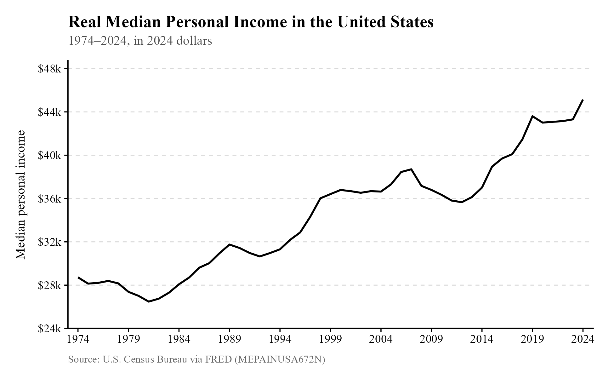
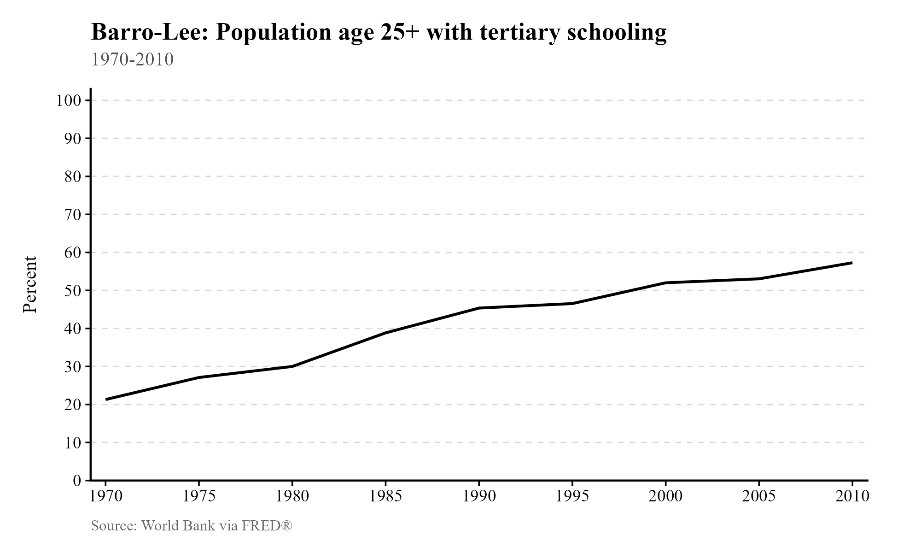
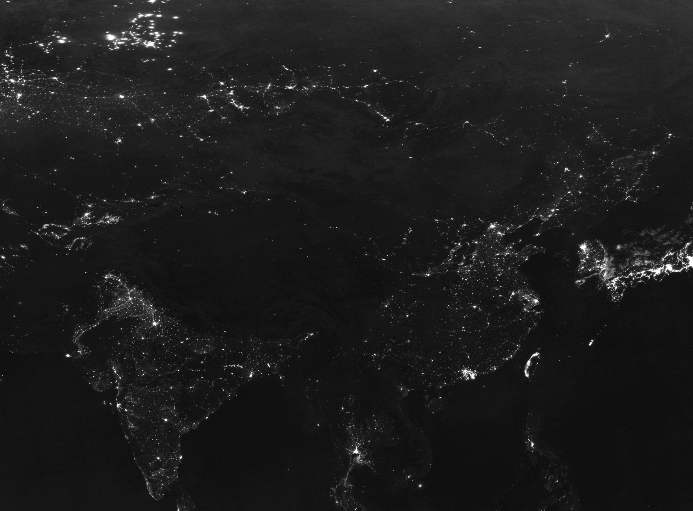
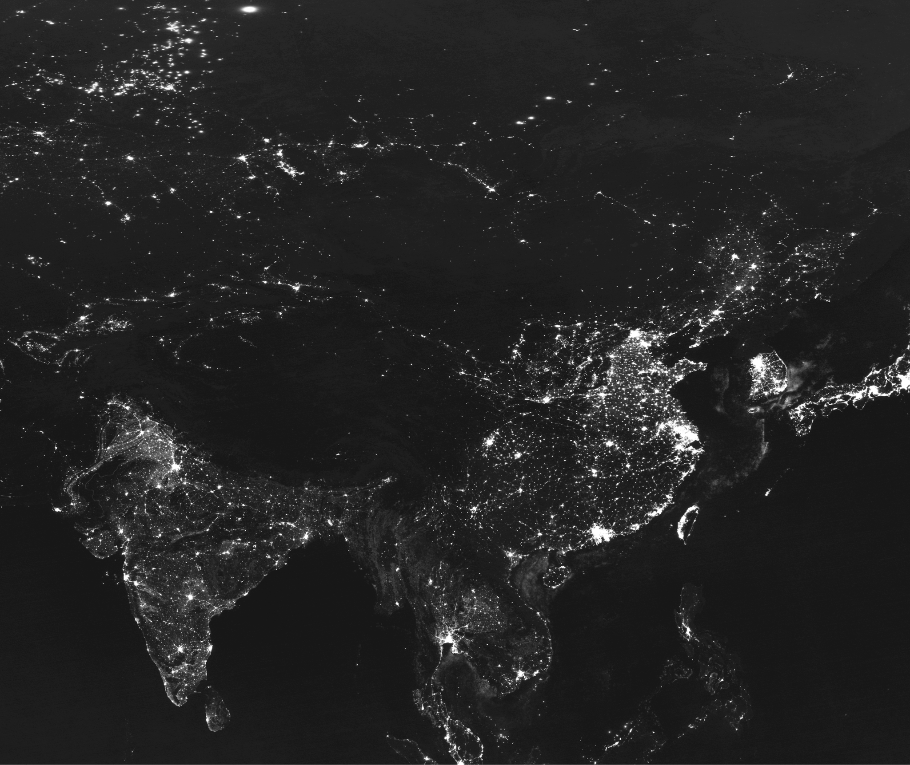
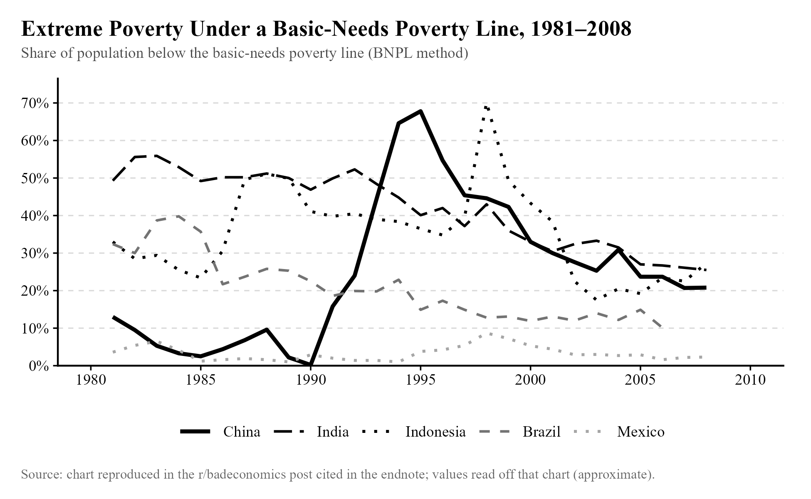
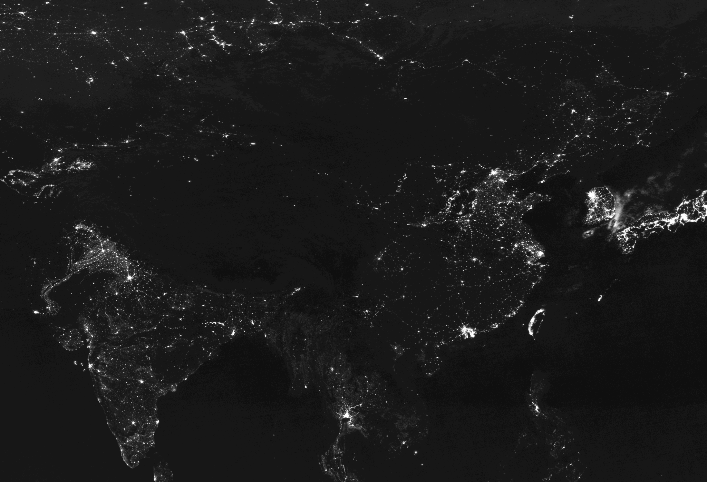
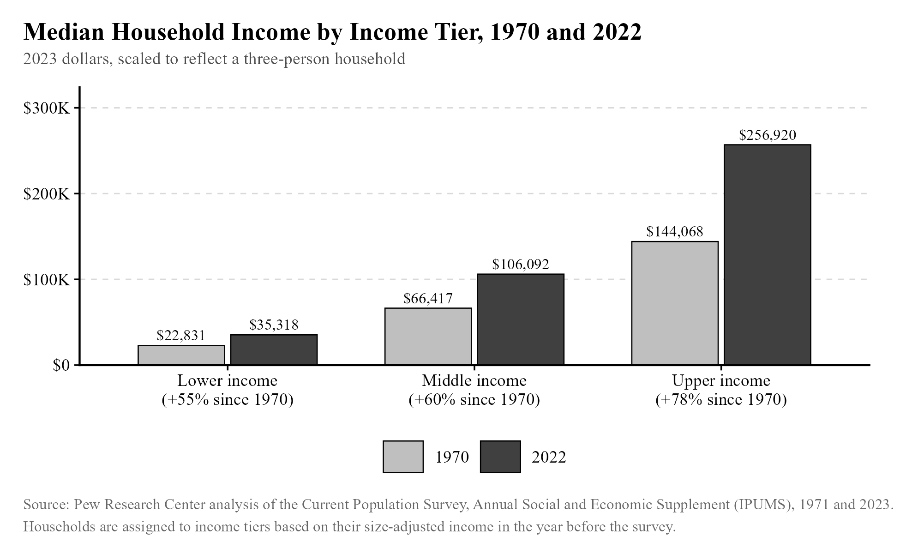
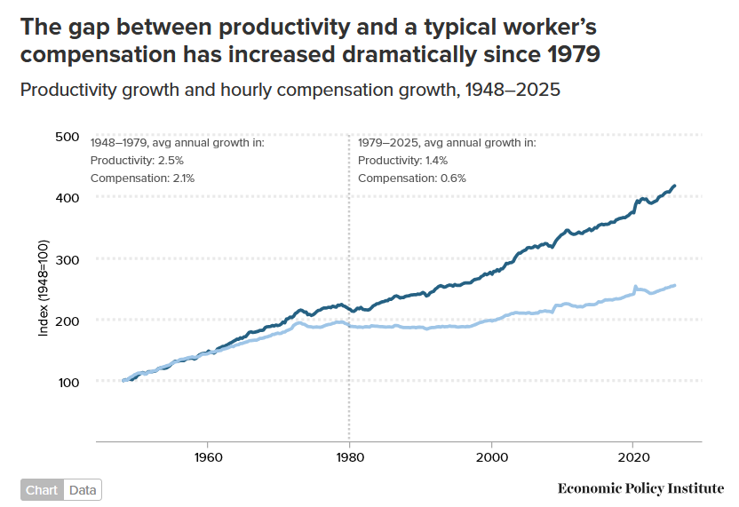
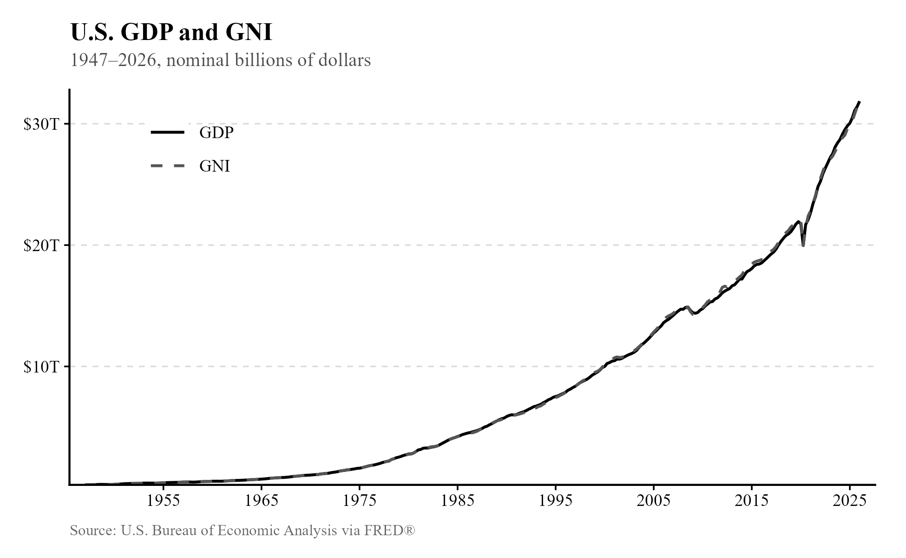
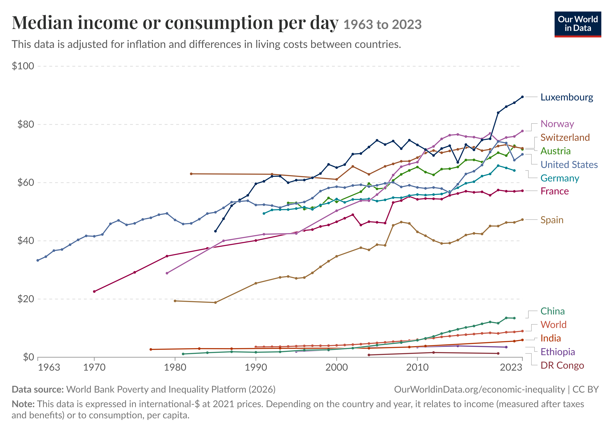

## Take 1: It was easier to get by in the past. {#take-1}

[Rating: F-tier]{.rating .tier-f}

Donald Trump's signature promise was to "Make America Great Again." In 2025, Senator Bernie Sanders[^n7] was---as he often has been---talking about how real wages were higher in 1973. The idea that life was materially better in the past pervades American thought. It's also made up.

The simplest way to address this idea is by pointing to the real median personal income[^n8] over time, available from the Federal Reserve Economic Database (or "FRED" for short). That chart can be seen below. "Real" means this is adjusted for inflation, while "median" is a measure of what's typical that looks at the middle of all earners ranked by income. If one neighbor makes \$400k, the other makes \$20k, and you make \$40k, the median is \$40k. That gives us an idea of "typical" that isn't skewed by the very rich. (For more on the median not being skewed, see [Chapter 9, Take 9](09-miscellaneous-bullshit.qmd#take-9).)

{width="94%"}

Real wages also show an upward trend, but slower.[^n9] (Wages exclude other forms of pay that are included in the median income.) Note that this is the median of those who are employed, so it doesn't account for changes in the employment rate. This is not a problem: labor force participation (for those who aren't old and retired or young and in education)[^n10] and the unemployment rate[^n11] look comparable to the past.

Many people will realize their mistake after seeing all of this, but the real median personal income is not a bulletproof graph. Here is one claim that people make to try to counter it: "That's adjusted with the Consumer Price Index. They don't include the cost of housing, so it doesn't capture real changes in living standards."

The CPI *does* include the cost of housing, but some people don't like the measure it uses, and mislead people by making the "technically correct" claim that it doesn't cover the cost of housing. While one could try to explain and justify the CPI measure (which I'll explain in a moment), listeners are more convinced by the claim that's easiest to explain. The most foolproof method is to show people how much easier it is to purchase a wide variety of goods. This allows us to avoid quibbles over the CPI, its measures, and how it weighs different goods.

Below, you can see a table describing how much more you can buy of a variety of goods,[^n12] assuming you made the typical income in the past and present. More specifically, we take the median *nominal* income (not inflation-adjusted, because we don't want to adjust for the cost of living twice) and divide it by the price of the good in each year. Then we see how much that figure has increased, as a percentage. If the wage on paper goes up by four times while the cost of a good only doubles, your real income in terms of that good has doubled. If this applies to most goods, real income has gone up in a more general sense, which is what the CPI-adjusted median income aims to capture. This breakdown simply makes things transparent and easy to source and understand.

Next to the name of each good, you can see the range of years over which we are measuring, since I couldn't always find data going back to 1974 (the earliest year for which we have our median personal income statistic). The measure of the price of a square foot of new housing takes the median price of a new home and divides it by the median square footage of a new home.

[{width="80%" fig-alt="Table: how much more the median American worker can buy of 18 goods and services, past vs. present. Most rose, from +0.68% (new housing) to +493% (washers); public college (-50%) and healthcare (-18%) fell."}](https://docs.google.com/spreadsheets/d/1q8NibyVtZLjKavaQqa1xUMTWUD52M_QEfAwrjtogzlM/edit?gid=0#gid=0)

This table simplifies in many ways. It doesn't adjust for the increased quality of a washer, a vacuum cleaner, or of a college degree, making these categories appear worse than they actually are. Since college is more of an investment than a form of consumption, what we should be looking at is some measure of the benefit of a college education (your earnings after graduation) minus its cost. As you'd expect, the net present value of a bachelor's degree has gone up greatly since the 1970s.[^n13] You may still question whether people can access this investment. Even if something is a good choice, people might not have the funds for it. This has generally not been true: more and more people have been able to access a college education over time. That's shown in the graph below.

{width="87%"}

None of this is to say that complaints are not permissible, or that expanding access to college even more shouldn't be a policy goal. We simply can't point to the rising cost of college as evidence that living standards are dropping.

If your fear is that debt service payments occupy so much of the modern consumer's income that real income net of such payments has not really risen, that is also not the case. While it is difficult to find data going back over the long term, consumer debt service payments as a percentage of income after taxes[^n14] ("disposable income") are down from 7.3% in early 2005 to 5.4% in late 2025. Our table tells us that college has become twice as expensive since the 1970s. If it stayed just as expensive as before, perhaps the debt burden would be 2.7% instead---that is assuming all of consumer debt is student loans, which is false, and produces an overestimate. That is not a substantial difference for the typical person, who saw more than a 50% increase in real income since 1974.

This leaves us two areas in which living standards have truly struggled: housing and healthcare. We'll see why housing has become more expensive later. For now, we can conclude that the claim that living standards have fallen is false. It's at least very misleading. The overwhelming majority of things Americans consume have become easier to access since the 1970s.

Since readers may be curious about the CPI measure of housing costs, I will explain that measure now. The Bureau of Labor Statistics (BLS) is responsible for calculating the CPI, and for renters, they include rent paid to landlords for shelter and included utilities, and any government subsidies the tenant pays to the landlord. The calculation for owner-occupied units is more interesting, and it's where people criticize the BLS. Instead of simply using what the owner pays on their mortgage, they use the "Owners' Equivalent Rent (OER)",[^n15] a calculation of what it would cost for someone else to rent their home in the current housing market. If the owner could hypothetically rent out their space for \$1,000/month, that's the number used by the BLS, not the \$1,200/month they're paying, or whatever number it is.

This means that if a home greatly increases in price, it does not necessarily raise the cost of housing in the CPI. The BLS only wants to include the cost of the shelter provided by the home, rather than anything else about it that might be valuable. As explained by researchers at Brookings, a think tank, this is fairly smart, since mortgage payments are relatively inconsistent, and can be disconnected from the cost of shelter:

> "For example, if a family buys a house for \$300,000 in 2024 and lives there for 10 years, their shelter consumption is not \$300,000 in 2024, and zero in subsequent years---nor is it their monthly mortgage payment, which will vary based on their down payment, the maturity of the loan, and the interest rate at the time they purchased the house. Rather, their shelter consumption is the amount they would have spent to consume the same amount of housing services provided by their owner-occupied home."

It is easy to mislead people by telling them the BLS ignores the cost of a home, since they technically do. But the calculation used here mechanically rises when housing becomes more expensive. If many more people want to live in an area, and we can't build any more homes, the price of housing will tend to rise. At the same time, because renting is a substitute for buying a house with a mortgage, demand rises for rental units, and the OER rises in tandem with the cost of housing---just not always to the same degree, because we want to exclude fluctuations in mortgage payments related to financial markets.

Perhaps you still don't like this measure, and think some other measure would be more accurate in some sense. You might dislike the way the BLS weighs some things over others, and you may even dislike the selection of goods I included in the table. That's alright; no measure of living standards can be perfect, since we're summarizing the livelihoods of many millions of people, each with their own preferences about what to buy and how much. But unless you have an unusually strong preference for owning a home in San Francisco, the increased accessibility of other goods---like apples, steaks, and car travel---overwhelms the frequent difficulty with accessing housing in the most desirable parts of the country.

Another weirdly common take is that the elimination of the gold standard in 1971 caused living standards to decline in the United States. Former United States Representative Ron Paul launched his career in politics because of this, and more recently, he warned we are nearing collapse because of it[^n16] (more than five decades later). He previously warned of an oncoming calamity 11 years ago,[^n17] which is suggestive of how predictive his claims are.

A similar, related take is that real wages are massively down if you measure them in gold. Indeed, if you measure the quantity of gold[^n18] one could purchase with the median income in 1974[^n19] (about 36.35 ounces), it's much greater than said quantity in 2024 (about 19.4 ounces). Why some people think this has any relevance to living standards, I have no idea. We can't eat gold or live inside it, and I doubt a further doubling in the price of gold would cut our living standards in half in any meaningful sense, as implied by this measure. If one is interested in using gold as a hedge against inflation and believes that activity to be of prime importance to the American people, you can simply hold a smaller quantity of gold as an asset. The only important question in the hedging case would be how much one expects the price of that gold to change over time, not the quantity that one was able to purchase. But I admit this trend is very troubling for American leprechauns.

## Take 2: Extreme poverty hasn't really declined worldwide. {#take-2}

[Rating: F-tier]{.rating .tier-f}

A little-known fact about the world is that, as terrible as it is, it used to be a lot worse. The total population living in extreme poverty has declined from over 2 billion in 1990 to less than a billion today. Much of this reduction in extreme poverty has occurred in China. The Chinese National Bureau of Statistics regularly surveys the population of China to identify changes in living standards, and this data is used by the World Bank to produce estimates of extreme poverty.[^n20] Because these improvements came in the wake of free market reforms in the 1980s, there is no shortage of people who challenge the decline and the underlying data in hopes of puncturing the success story of free market capitalism.

We could dive into the data gathering process and how poverty rates are calculated, but I have a much clearer form of evidence: the growing number of lights in China visible from space.[^n21] Because installing and running lights requires money, lights are tied to growing incomes. The following excerpt describes the results of estimating Chinese growth with this method:

> "They noted that official statistics reported that real GDP growth in China was about 122 percent over that period. In contrast, the night-lights data predicts that growth was 57 percent. Owyang and Shell wrote: 'This sizable gap suggests cumulative Chinese growth over the years could be overstated by as much as 65 percent.' They added that only Myanmar had a larger gap between the official and estimated numbers."

The decline in extreme poverty in China thus might be overestimated to some degree, but it is very real (since the growth estimate is still positive). It would certainly be strange to observe a huge increase in night lighting in China without any associated decline in poverty---how could one have money for lights, but not food and shelter?

Getting images that demonstrate this change was surprisingly difficult, but I found them here[^n22] from the Earth Observation Group. I couldn't believe how visible the change is. Here's an image of China from space in 1992:

{width="88%"}

This next one is from 2013:

{width="82%"}

Over 2.6 billion people are in this image. It's clear they're much better off today.

Believe it or not, there are people who don't believe all of this---in particular, anthropologist Jason Hickel.[^n23] Here is the Hickel picture of China in the 1990s: a huge spike in poverty followed by a slow decline.

{width="93%"}

Our imagery already suggests that this is very wrong, but this data ends around 2008, not 2013, so I should display an image of China from space in 1995 to compare to China from space in 1992. Here's 1992 again:

{width="90%"}

And here's 1995:

{width="92%"}

No ongoing economic collapse is visible. In fact, northern China appears slightly brighter to me, which is unsurprising for a period of economic growth. The Chinese certainly don't seem to have been struggling to pay their bills during this period. As explained elsewhere,[^n24] and as is evidently obvious here, the measure of poverty in China used by Hickel and his coauthors is very bad. The decline of poverty in India, China, and the world is as real as trends get.

## Take 3: The real poverty line for a family of four in the US is \$136,500. {#take-3}

[Rating: F-tier]{.rating .tier-f}

If you walked the streets of a typical American suburb, what share of people would be living in poverty? Would you guess 10%? Maybe a more pessimistic guess, like 30%? Based on Michael Green's infamous estimate of the poverty line[^n25] at \$136,500 for a family of four and the distribution of income in the US,[^n26] the real number is greater than 50%.

It's easy to find expert commentary explaining Michael Green's mistakes in calculating this number, but I believe the best way to dismiss it is to simply point out the absurd implication that most American families are impoverished. Food is so accessible that most Americans over 20 are overweight,[^n27] and a lack of access to clean water is almost unheard of.[^n28] The vast majority of Americans are not homeless, and as we saw, most Americans over 25 have a college degree. 91.7% of American households have a car,[^n29] and in 2024, 92% of Americans had health insurance.[^n30] It simply isn't true that most Americans are impoverished, so we should dismiss any estimate placing the poverty line for a family of four above the median income for a family of four, which is \~\$125k.[^n31]

I could defend the official poverty line, but my honest opinion is that while it's useful to draw a line somewhere and check if fewer and fewer people fall below it each year, the exact position matters little. We might find ourselves bickering over what counts as "real poverty" when the underlying distribution of material living standards is the same, regardless of what we define the word "poverty" to mean. Whether the real poverty line is \$40k a year or \$80k a year or some other number, the incomes of the bottom have tended to move in tandem with the middle, so even just tracking the middle will usually be enough to see whether poverty is declining. Below, you can see how the middle income tier grew only slightly faster than the lower income tier. Thus, it is usually enough to know what direction the median income is moving.

{width="92%"}

## Take 4: The gap between productivity and a typical worker's compensation has increased dramatically since 1979. {#take-4}

[Rating: D-tier]{.rating .tier-d}

The tendency for the arguments in this book to take the form of a motte-and-bailey is clearest here, in the graph below,[^n32] frequently shared on social media. The graph's claim has even been made by former president Joe Biden.[^n33]

{width="94%"}

I would expect many people seeing this chart to interpret it as meaning that while workers have become far more productive, they have not been paid in proportion to that contribution. That is not what it describes.

Simply put, the measure of productivity used here is productivity for the entire economy, and the measure of compensation is a measure of compensation for just *part* of the economy. As the footnotes reveal (often not included when the chart is shared): "Data are for compensation (wages and benefits) of production/nonsupervisory workers in the private sector and net productivity of the total economy. 'Net productivity' is the growth of output of goods and services less depreciation per hour worked."

A fact one should understand is that "productivity" and income are calculated in the same way. To get productivity, like with gross domestic product, one multiplies the prices of final goods and services by the quantities produced. All of those sales of goods and services turn into income, which is why gross national income and gross domestic product have moved together in the United States over time. They are almost exactly the same measure (gross national income also includes payments from assets in foreign countries owned by Americans).

{width="94%"}

Having revealed all of this, the speaker might pivot to the easier-to-defend claim: inequality has risen in the United States. That is all the chart reveals, and all it is capable of revealing, given the measures used. But then one wonders what the point of sharing this chart was, with these labels, if not to mislead people---you could easily share a chart that directly announces that it is about inequality, rather than hiding the real claim under the motte of productivity, which only an economist would understand to equate to income, at least usually.

One could argue that all of the *real* productivity gains were among non-supervisory workers, while managers made bank from being parasites. That's beside the point: the chart claims to reveal this fact without having a methodology capable of revealing that fact. There is no available measure that cleanly identifies the productivity of non-supervisory workers, separated from the productivity of managers. If a manager makes a sale, it is treated exactly the same way as when a worker makes a sale when GDP and other productivity measures are calculated.

The claim is thus "true" but very misleading. It would be far better to share a chart like the one I've included in the endnotes,[^n34] which is transparent about describing inequality, rather than a (supposedly distinct) productivity pay gap.

## Take 5: 60% of Americans live paycheck-to-paycheck. {#take-5}

[Rating: F-tier]{.rating .tier-f}

This claim has been repeated over and over again by Bernie Sanders[^n35] and his ilk, and even former governor of South Carolina Nikki Haley.[^n36] Given what has been shown so far, it may feel redundant to address it. We have already seen that living standards have almost unambiguously risen since the 1970s, and that most Americans are not impoverished. But it's worthwhile to provide some explanation of where this take comes from, and why it's incorrect.

This claim originated from a survey by fintech company LendingClub,[^n37] which refuses to release its methodology,[^n38] according to Noah Smith. Meanwhile, as Noah explains, the Fed *also* does a survey like this, except it's transparent about its methodology (and it isn't a payday lending company trying to advertise its services). They find that "In 2023, 54 percent of adults said they had set aside money for three months of expenses in an emergency savings or 'rainy day' fund---unchanged from 2022 but down from a high of 59 percent of adults in 2021." It cannot simultaneously be true that most adults can pay for three months of expenses and most adults cannot pay for one month of expenses. More likely, even more than 60% of American adults can cover a month of expenses.

To provide an analogy, if your own survey of Americans tells you that 80% of them are Republicans, and said survey was performed in rural Nebraska, it might be worthwhile to use a survey of the entire country performed by Gallup instead. (The real numbers,[^n39] if you're wondering, tell you that 27% of American adults are Republicans, 45% are independent, and 27% are Democrats as of 2025.)

This is one of the richest countries in the world.[^n40] Adjusted for purchasing power, the median American consumes more than seven times as much in goods and services compared to the median person in the world. It does not make sense to believe that most Americans are struggling.

{width="90%"}

[^n7]: [youtube.com/watch?v=lolm1jiIomo](https://www.youtube.com/watch?v=lolm1jiIomo)
[^n8]: [fred.stlouisfed.org/series/MEPAINUSA672N](https://fred.stlouisfed.org/series/MEPAINUSA672N)
[^n9]: [fred.stlouisfed.org/series/LES1252881600Q](https://fred.stlouisfed.org/series/LES1252881600Q)
[^n10]: [fred.stlouisfed.org/series/LNS11300060](https://fred.stlouisfed.org/series/LNS11300060)
[^n11]: [fred.stlouisfed.org/series/LNS14000060](https://fred.stlouisfed.org/series/LNS14000060)
[^n12]: [docs.google.com/spreadsheets/d/1q8NibyVtZLjKavaQqa1xUMTWUD52M\_QEfAw...](https://docs.google.com/spreadsheets/d/1q8NibyVtZLjKavaQqa1xUMTWUD52M_QEfAwrjtogzlM/edit?gid=0#gid=0)
[^n13]: [libertystreeteconomics.newyorkfed.org/2014/09/the-value-of-a-colleg...](https://libertystreeteconomics.newyorkfed.org/2014/09/the-value-of-a-college-degree/)
[^n14]: [fred.stlouisfed.org/series/CDSP](https://fred.stlouisfed.org/series/CDSP)
[^n15]: [brookings.edu/articles/how-does-the-consumer-price-index-account-fo...](https://www.brookings.edu/articles/how-does-the-consumer-price-index-account-for-the-cost-of-housing/#:~:text=Housing%20represents%20about%20one%2Dthird,measured%20separately%20in%20the%20CPI.)
[^n16]: [msn.com/en-us/news/insight/ron-paul-warns-us-system-near-collapse/g...](https://www.msn.com/en-us/news/insight/ron-paul-warns-us-system-near-collapse/gm-4DDC3A795B?gemSnapshotKey=4DDC3A795B-snapshot-3)
[^n17]: [wsj.com/articles/ron-paul-ads-warn-of-financial-crisis-1432245027?e...](https://www.wsj.com/articles/ron-paul-ads-warn-of-financial-crisis-1432245027?eafs_enabled=false)
[^n18]: [macrotrends.net/1333/historical-gold-prices-100-year-chart](https://www.macrotrends.net/1333/historical-gold-prices-100-year-chart)
[^n19]: [fred.stlouisfed.org/series/MEPAINUSA646N](https://fred.stlouisfed.org/series/MEPAINUSA646N)
[^n20]: [databankfiles.worldbank.org/public/ddpext\_download/poverty/987B9C90...](https://databankfiles.worldbank.org/public/ddpext_download/poverty/987B9C90-CB9F-4D93-AE8C-750588BF00QA/current/Global_POVEQ_CHN.pdf)
[^n21]: [stlouisfed.org/on-the-economy/2017/september/estimating-chinese-gdp...](https://www.stlouisfed.org/on-the-economy/2017/september/estimating-chinese-gdp-using-night-lights-data)
[^n22]: Images made utilizing DMSP nighttime lights data produced by the Earth Observation Group, Payne Institute for Public Policy, Colorado School of Mines (CC BY 4.0, creativecommons.org/licenses/by/4.0; cropped). [eogdata.mines.edu/products/dmsp/](https://eogdata.mines.edu/products/dmsp/)
[^n23]: Based on the chart featured here: [reddit.com/r/badeconomics/comments/1shzz7k/extreme\_poverty\_jason\_hi...](https://www.reddit.com/r/badeconomics/comments/1shzz7k/extreme_poverty_jason_hickel_and_the_phantom/)
[^n24]: [reddit.com/r/badeconomics/comments/1shzz7k/extreme\_poverty\_jason\_hi...](https://www.reddit.com/r/badeconomics/comments/1shzz7k/extreme_poverty_jason_hickel_and_the_phantom/)
[^n25]: [yesigiveafig.com/p/part-1-my-life-is-a-lie](https://www.yesigiveafig.com/p/part-1-my-life-is-a-lie)
[^n26]: [dqydj.com/household-income-percentile-calculator/](https://dqydj.com/household-income-percentile-calculator/)
[^n27]: [cdc.gov/nchs/fastats/obesity-overweight.htm#:~:text=Percent of adul...](https://www.cdc.gov/nchs/fastats/obesity-overweight.htm#:~:text=Percent%20of%20adults%20age%2020%20and%20older,United%20States%2C%201960%E2%80%931962%20Through%20August%202021%E2%80%93August%202023.)
[^n28]: [ourworldindata.org/clean-water](https://ourworldindata.org/clean-water)
[^n29]: [forbes.com/advisor/car-insurance/car-ownership-statistics/](https://www.forbes.com/advisor/car-insurance/car-ownership-statistics/)
[^n30]: [census.gov/library/publications/2025/demo/p60-288.html](https://www.census.gov/library/publications/2025/demo/p60-288.html)
[^n31]: [visualcapitalist.com/charted-median-income-by-household-size-in-the...](https://www.visualcapitalist.com/charted-median-income-by-household-size-in-the-u-s/)
[^n32]: [epi.org/productivity-pay-gap/](https://www.epi.org/productivity-pay-gap/)
[^n33]: [fee.org/articles/biden-the-capitalist-who-isn-t/](https://fee.org/articles/biden-the-capitalist-who-isn-t/)
[^n34]: [cbpp.org/research/poverty-and-inequality/a-guide-to-statistics-on-h...](https://www.cbpp.org/research/poverty-and-inequality/a-guide-to-statistics-on-historical-trends-in-income-inequality)
[^n35]: [x.com/search?q=from:SenSanders paycheck to paycheck&src=typed\_query](https://x.com/search?q=from%3ASenSanders%20paycheck%20to%20paycheck&src=typed_query)
[^n36]: [x.com/arindube/status/1753262472503460278?s=20](https://x.com/arindube/status/1753262472503460278?s=20)
[^n37]: [ir.lendingclub.com/news/news-details/2023/Nearly-60-of-Credit-Cardh...](https://ir.lendingclub.com/news/news-details/2023/Nearly-60-of-Credit-Cardholders-in-the-U.S.-Live-Paycheck-to-Paycheck/default.aspx)
[^n38]: [noahpinion.blog/p/paycheck-to-paycheck-and-five-other?utm\_source=sh...](https://www.noahpinion.blog/p/paycheck-to-paycheck-and-five-other?utm_source=share&utm_medium=android&r=42dkh1&triedRedirect=true)
[^n39]: [news.gallup.com/poll/15370/party-affiliation.aspx](https://news.gallup.com/poll/15370/party-affiliation.aspx)
[^n40]: [ourworldindata.org/grapher/daily-median-income](https://ourworldindata.org/grapher/daily-median-income)
