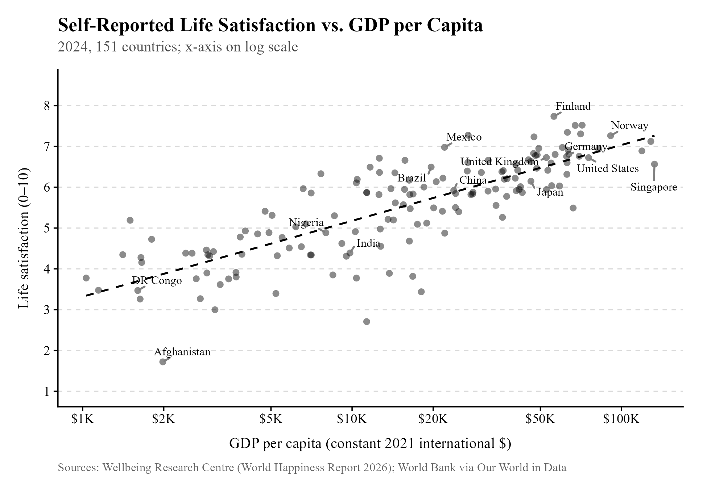
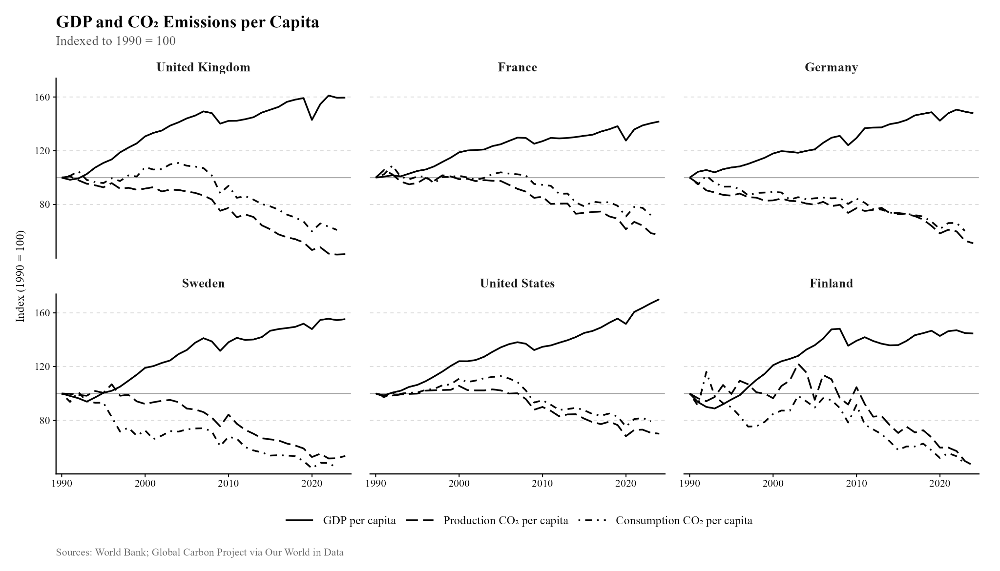
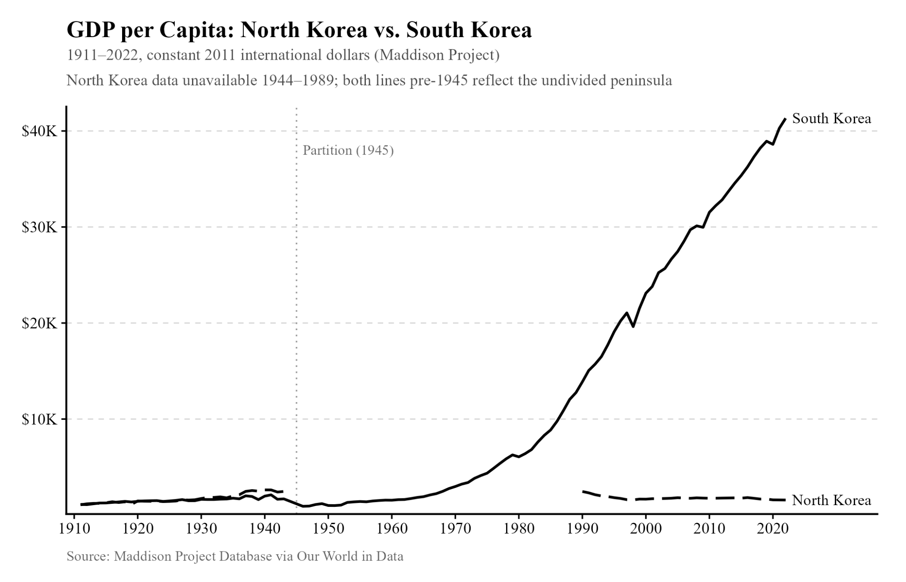
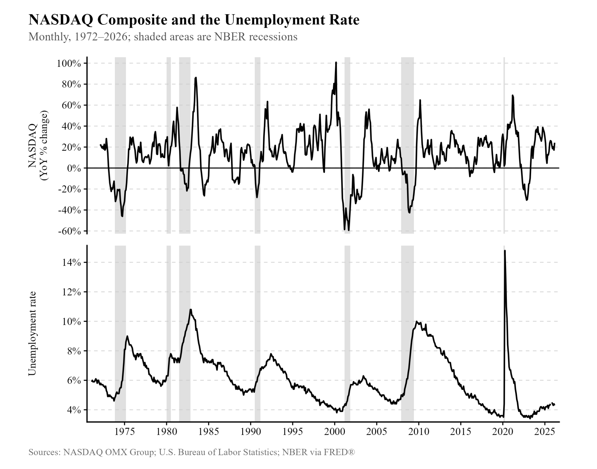

## Take 1: GDP is a useless measure. Economists don't consider people's happiness, or the environment. {#take-1}

[Rating: F-tier]{.rating .tier-f}

Below, you can observe the correlation between self-reported life satisfaction and GDP per capita.[^n158]

{width="87%"}

The relationship is clear, though not perfect. Being a poor country does not guarantee that your people will be especially unhappy. However, being a rich country does appear to guarantee that they will be mostly happy. Economic growth within countries is also associated with happiness.[^n159]

Are economists transparent about the limitations of GDP as a measure? If you study economics, they certainly are. As economist Gregory Mankiw states in his macroeconomics textbook, "A large GDP does not ensure that all of a nation's citizens are happy, but it may be the best recipe for happiness that macroeconomists have to offer."

Of course, GDP does not consider the effects of economic growth on the environment, and many countries grow at an environmental expense, since fossil fuels provide much of the energy the world uses to produce things. Fortunately, this relationship eventually disappears, and today, many of the wealthiest countries in the world do not need to pollute their environments to stay rich. This is true even if you account for these countries importing goods from countries that pollute.[^n160] Below, you can see rising incomes and declining per capita CO2 emissions in various countries.

{width="94%"}

The United States and Europe, which make up most of the population of the developed world, remain above-average in terms of carbon dioxide emissions per capita.[^n161] But it is clear that this does not need to remain true for them to remain rich.

## Take 2: It's impossible for GDP to grow forever. {#take-2}

[Rating: D-tier]{.rating .tier-d}

This claim is made to look much more obvious than it really is. GDP, to be clear, is the market value of all final goods and services produced in a country in a given year. If a country makes 10 nails and 10 hammers, and nails cost \$1 while hammers cost \$10, GDP is 10\*1 + 10\*10 = \$110. Notice, now, that if a tinkerer realizes that half a nail is just as effective as one nail, they can double nail production without using any more resources by splitting nails in half. That grows GDP, which becomes 20\*1 + 10\*10 = \$120.

This is how innovation often works in the real world: they grow the economy by allowing companies to economize on some input. Here is an excerpt from a 1994 Scientific American article[^n162] on the aluminum can:

> "\[\...\] today's can weighs about 0.48 ounce, down from about 0.66 ounce in the 1960s, when such containers were first constructed. Yet the can industry is not standing pat on its achievement. Strong economic incentives motivate it toward further improvements. Engineers are seeking ways to maintain the can's performance while continuing to trim the amount of material needed. Reducing the can's mass by 1 percent will save approximately \$20 million a year in aluminum (and make still easier and even less meaningful the macho gesture of crushing an empty can with a bare hand)."

GDP does not just grow by using more resources. It also grows through new ideas. Better engineering of aluminum cans and other objects allows the country to do more with less. Often, the ability to do more with less is used to make more, growing the size of the economy and the level of GDP per capita. That means more goods for each individual. Indeed, while in 1975 a can of coke could be purchased for \~0.0026%[^n163] of the median income,[^n164] in 2024 the figure was \~0.00155%. That's economic growth in action.

Is it conceivable that we will eventually run out of ideas that allow us to economize, and thus face the bottleneck of our planet's finite resources? Of course. But compare the statement "GDP can't grow forever on a planet with finite resources" to "GDP can't grow forever because we'll eventually run out of ideas." A clear motte and bailey in action. If you plan to argue for this point, be transparent about how difficult it is to prove what you seek to prove. It's not obvious that growth can't last forever.

## Take 3: North Korea and Cuba are poor because of sanctions. {#take-3}

[Rating: F-tier]{.rating .tier-f}

One of the greatest puzzles of economics is why some countries are rich and others poor. The most popular explanation is probably institutions: essentially, the laws that govern a country dictate its incentives, and hence its economic future (though the concept of "institutions" is more expansive than what the laws are).

The divergence between North Korea and South Korea is a kind of golden child of institutionalists, as advocates of this theory are called, since it provides a simple and compelling example of their thesis playing out in real life. They have a common genetic and cultural history, but their institutions diverged after 1945. Their economic fortunes also diverged:[^n165]

{width="100%"}

While the North Korean government made free enterprise illegal (and unfortunately made it hard for us Westerners to estimate their GDP per capita),[^n166] the South Korean government was relatively business-friendly, with state-led industrialization occurring during the dictatorship of General Park Chung Hee in the 1960s.[^n167] Northern state-owned enterprises, unlike state-backed enterprises in the South, did not face many consequences for failure. The North also suffered from the closure of its economy to the rest of the world, with the government hoping to produce everything within its own borders. Both countries had foreign allies, but after the end of the Cold War, much of the support the North received from the Soviet Union and China disappeared.

An open-and-shut case, it seems. A similar story can be told about Cuba, which while neighboring one of the wealthiest countries in the world has managed to choke out its own economy. But some challenge this story.

Over the period from 1950 to 2008, visualized above, the United States enforced an embargo against North Korea under the Trading with the Enemy Act of 1917, banning almost all American trade with the country. A similar embargo has been enforced on Cuba since 1960. Could it be that these restrictions are the *real* source of North Korean and Cuban economic struggles?

The apparent ability of a United States trade embargo to choke a country's growth is inconsistent. For one, Cuba has not had nearly as much trouble with growth as North Korea has. From 1970 to 2020, Cuban real GDP per capita[^n168] grew 1,389%, from \$645.10 per person to \$9,605.30 per person. The institutionalist explanation shows its strength here: while it is officially a communist state, much like North Korea, it is much more friendly to free enterprise. To condense a complicated picture, North Korea scores 5.9/100 on the Economic Freedom of the World Index,[^n169] while Cuba scores 27.8/100.

It is worthwhile to provide some details, rather than relying on magic burger freedom indices with objectivity opponents question. Virtually all industries are state-owned in North Korea,[^n170] while in 2025, Cuba's private sector became larger than its public sector for the first time.[^n171] So, despite both of these countries being held up as examples of American repression driving stagnation, they are all you need to demonstrate the primacy of institutions. It is easy to grow in spite of an American trade embargo if you do more to embrace free enterprise. We can only hope that both countries become more free and open with time---Cuba still has plenty of room for improvement, and North Korea has dug itself about as deep an economic hole as a government can dig.

## Take 4: Imports reduce GDP. {#take-4}

[Rating: Super F]{.rating .tier-superf}

It is incredible how far this idea has gotten. It appeared in the Wall Street Journal, Bloomberg, CNBC, the Washington Post, the New York Times,[^n172] and it even appeared in a Bureau of Economic Analysis report![^n173] Experts cannot be trusted 100% of the time (though 99% isn't half bad).

Gross *domestic* product only counts production within a country, and thus imports are wholly irrelevant. You may be confused by this formula:

GDP = C + I + G + (X - M)

which appears to show imports (M) being subtracted. The problem is that imports are also counted in consumption, C. If they are counted in consumption, then subtracted later in the formula, their impact on the final number is nil.

This is probably one of the silliest ideas featured in this book. It's comparable to looking at Einstein's famous equation E = mc^2^ and assuming it means that matter is made out of energy, and maybe we can convert between them if we throw baseballs hard enough. Despite this, it is also one of the ideas that has received the most endorsement by otherwise intelligent people. Truly baffling.

## Take 5: The stock market is fake. {#take-5}

[Rating: D-tier]{.rating .tier-d}

There is a decent correlation between the stock market and the unemployment rate, visible when you examine their movements during a recession. This is shown below.

{width="93%"}

Almost every time the stock market crashes, the unemployment rate rises. As the unemployment rate goes back down, the stock market recovers. A similar pattern occurred during the Great Recession. The relationship mostly didn't persist during the COVID-19 recession due to its unusual characteristics and the government's rapid response.

If the stock market is fake or entirely irrelevant, this relationship must be somewhat mysterious. Because stock is ownership in companies, and companies perform poorly in recessions, there is a natural relationship between the health of the economy and the health of the stock market. It's not perfect, that much should be clear, but the stock market clearly has some real-world relevance.

It's also notable that because 62% of Americans own stock,[^n174] stock market returns have some direct relevance for the wellbeing of Americans. The stock market just has a bad reputation because it's possible for the stock market to do especially well without the typical American doing especially well: per FRED,[^n175] 50.2% of corporate equities and mutual fund shares are owned by the top 1%.

## Take 6: The Great Recession was caused by evil bankers. {#take-6}

[Rating: B-tier]{.rating .tier-b}

In 2007, the United States began to slowly tumble into its worst economic downturn since the Great Depression. The unemployment rate[^n176] rose from 4.6% in June of 2007 to a peak of 10% in October of 2009. Real GDP per capita fell by 5% from the fourth quarter of 2007 to the second quarter of 2009. And even once the crisis resolved, the US entered a period of slow and painful recovery---the real median personal income in the US fell by \~3% from 2009 to 2012, and annual growth in real GDP per capita did not hit 2% again until 2015.

In short, it was a terrible, horrible, no good, very bad time, so understanding why it happened is important. People outside of the economics profession have had fun coming up with their own ideas. I don't know about you, but I hate fun! So does every economist. Let's explore the standard ideas about why the Great Recession occurred, and the very non-standard and clearly wrong ones.

Here is a brief summary of the description of the financial crisis from Gregory Mankiw's *Macroeconomics* (11ed), which should provide a fair summary of how the profession views its causes:

1.  The United States experienced a real estate bubble during the 2000s. Lax lending standards led to large numbers of people being offered loans with small down payments, even though they were often quite risky to lend to. Paying these mortgages allowed people to build equity in their house (their share of the home's value that they own), but once housing prices fell, the value that they owned fell while the mortgage stayed the same. People started to fail to meet mortgage payments.
2.  Banks that had lent to homeowners or purchased loans that had been made found that the homes they owned were now worth far less, and the loans on those homes weren't being paid back. This made lots of these banks insolvent, meaning their assets (loans, which are valuable to the bank) couldn't cover their liabilities (money they had been granted by other institutions for various purposes).
3.  Seeing the crisis unfold, entities with uninsured deposits (think loans they granted) at banks began to fear that said bank would become insolvent and wouldn't be able to return their money. They rushed to get it back. To try to meet these obligations, banks sold off their assets as quickly as they could. As this happened, the value of the assets being sold went down even more. While trying to meet their obligations and avoid the crisis, banks also reduced lending to avoid taking on even more risky borrowers. Fear spread---the collapse of the firms Bear Stearns and Lehman Brothers made people wonder who was next.
4.  A credit crunch occurred. With banks holding back on further lending, small businesses found it hard to finance investments in capital like new equipment, or purchases of new inventory.
5.  Demand for goods and services declined, and output fell---a recession.
6.  Falling demand reinforced the collapse of home prices and insolvencies at banks.

That is the standard story, albeit with some details missing. What explanations have been offered outside the economics profession?

One popular story---perhaps *the* popular story---says that the financial crisis was engineered by firms like Goldman Sachs who massively profited from creating the bubble and the chaos that ensued when the bubble burst. The government bailout that followed then gave them even more free money, or so the story goes. A popular example of this comes from a Rolling Stone article written by Matt Taibbi.[^n177]

Some of this story is right. Goldman Sachs really did knowingly sell bad mortgages to other organizations. Here is a quote from a Justice Department article from 2016,[^n178] "Goldman Sachs Agrees to Pay More than \$5 Billion in Connection with Its Sale of Residential Mortgage Backed Securities:"

> "This resolution holds Goldman Sachs accountable for its serious misconduct in falsely assuring investors that securities it sold were backed by sound mortgages, when it knew that they were full of mortgages that were likely to fail," said Acting Associate Attorney General Stuart F. Delery. "This \$5 billion settlement includes a \$1.8 billion commitment to help repair the damage to homeowners and communities that Goldman acknowledges resulted from its conduct, and it makes clear that no institution may inflict this type of harm on investors and the American public without serious consequences."

It was a pretty big hit, comparable in size to their net earnings of \$7.4 billion that year. Their stock[^n179] didn't get back to its high in 2007 until 2017, and didn't consistently exceed that level until after 2020.

Goldman Sachs was also among the first companies to start selling off its mortgage-backed securities,[^n180] near the end of 2006, and promptly shorted the market to turn a profit. (More specifically, they paid other firms a stream of premiums in return for promising to pay *them* lots of money if and when a default occurs. This is called a credit default swap.) They had information from Senderra, a subprime mortgage lender partially owned by Goldman, informing them of an unprecedented level of defaults and fraud. In fact, this wasn't entirely private information: "The mortgage industry was already rife with talk of loose underwriting standards and borrower fraud \[by December 2006\]."

But the crisis was not deliberately engineered to turn a profit for firms like Goldman. Their choice to aggressively short the market was a unique one, not an industry-wide choice that you would expect if the financial sector had deliberately inflated a bubble with the intention of making bank on the crash. It was an unusual choice even *within*[^n181] Goldman:[^n182]

> Two top Goldman mortgage traders, Michael Swenson and Joshua Birnbaum, discussed in their 2007 performance self-evaluations the "very profitable year" and "extraordinary profits" that came from shorting the mortgage market that year. One bragged about "aggressively" entering into "efficient shorts in both the RMBS and CDO space," while the other reported that "**contrary to the prevailing opinion**" that the firm needed only to "get close to home," he "concluded that we should not only get flat, but get VERY short."

Most importantly, Goldman Sachs did not even originate the massive amounts of overvalued subprime mortgages. The top subprime lenders[^n183] mostly weren't Wall Street banks. Goldman Sachs financed these bad loans on the belief that they weren't bad, then turned tail and ran when they figured out what was going on.

The correct version of this take is that *lenders* knew what they were doing, made bank, and a lot of them got away with it. But none of them are individually responsible for the crash.

Take, for example, Angelo Mozilo. He was the CEO of Countrywide Financial, one of the largest originators of subprime loans, which were then packaged as mortgage-backed securities and sold to companies like Goldman Sachs. They were able to create so many of these subprime loans only by "falsely assuring investors that Countrywide was primarily a prime quality mortgage lender that had avoided the excesses of its competitors."[^n184] That's according to the SEC, which filed securities fraud charges against Mozilo. Mozilo spoke of a profitable subprime product as "toxic" in an internal email, and in an act of insider trading based on his knowledge of expected poor performance, he "exercised more than 5.1 million stock options and sold the underlying shares for total proceeds of nearly \$140 million, pursuant to written trading plans adopted in late 2006 and early 2007."

What happened to Mozilo in the end? Mostly nothing. He paid \$67.5 million in fines to the SEC, and was permanently banned from serving as an officer or director of a public company. Countrywide paid \$20 million of that fine, and Mozilo never admitted wrongdoing.

While I would happily spend more time on this issue, I sense that you get the big picture. The Great Recession was not deliberately engineered by anyone in the financial sector. The financial crisis that lay at the heart of the recession was caused less by an organized group and more by large numbers of people handing out loans to people who posed a significant risk of default, and then making bank by selling ownership of these loans to others. Income usually wasn't checked at all; sometimes W-2s were fabricated.[^n185] Sadly, there's no single witch to burn in response to this.

## Take 7: Recessions are good, because they allow the economy to be pruned of bad investments. {#take-7}

[Rating: B-tier]{.rating .tier-b}

I was going to come down hard against this idea, but there are decent versions of it that are pretty much correct.

The basic story is pretty easy to understand. Different companies have different levels of productivity. When an aggregate demand shock occurs and the economy slips into a recession, the survival of a firm will be related to how productive it is, with less productive firms dying out more often. Resources like labor and capital that were previously used by these firms can then be used by more productive firms, and the economy as a whole becomes more productive.

Under certain conditions, this is pretty much right, but there are important exceptions to pay attention to. Here is a relevant excerpt:[^n186]

> "The cleansing effect of recessions has been motivated by the view that during recessions, low productivity firms are forced to shut down as they become no longer profitable; this would then allow resources to be reallocated towards more productive firms. \[\...\] The implicit assumption that markets select the most productive firms has been challenged by several empirical studies showing that firms' probability of exit depends not only on their productivity but also on their access to credit. In the presence of credit frictions, firms that exit are not necessarily the least productive firms."

This is one problem that appears to have occurred during the Great Recession, which was a financial crisis as well as a recession. Our conclusion that a recession shifts resources towards high-productivity firms requires that the recession does not cause any changes that also harm high-productivity firms. If those firms face credit constraints that are exacerbated by the recession (i.e., problems acquiring loans), it might not be so useful to society, since the selection effect might be overwhelmed by the broader harms. This paper[^n187] looks at the cleansing effects of past recessions, and finds that while past recessions did have this effect, in the Great Recession, they found that "the intensity of reallocation fell rather than rose and that the reallocation that did occur was less productivity enhancing than in prior recessions."

I'm very uncertain about any conclusions that I can draw here, due to my lack of familiarity with this particular issue, and just wanted to provide you with some resources and some clarification of the thinking here. I think it's worth saying that the unemployment rate reached an absurd height during the Great Recession even *with* government intervention, and anyone arguing that it was needed to prune bad investments still has to make the case that subjecting the public to a second Great Depression is worthwhile for the purpose of long-run growth, or that juicing the economy doesn't actually affect the unemployment rate.

[^n158]: [ourworldindata.org/grapher/gdp-vs-happiness](https://ourworldindata.org/grapher/gdp-vs-happiness)
[^n159]: [ourworldindata.org/happiness-and-life-satisfaction](https://ourworldindata.org/happiness-and-life-satisfaction)
[^n160]: [ourworldindata.org/co2-gdp-decoupling](https://ourworldindata.org/co2-gdp-decoupling)
[^n161]: [ourworldindata.org/co2-emissions](https://ourworldindata.org/co2-emissions)
[^n162]: Hosford & Duncan, "The Aluminum Beverage Can," Scientific American, September 1994.
[^n163]: [geekspin.co/how-much-coke-cost-every-decade-since-1886/](https://geekspin.co/how-much-coke-cost-every-decade-since-1886/)
[^n164]: [fred.stlouisfed.org/series/MEPAINUSA646N](https://fred.stlouisfed.org/series/MEPAINUSA646N)
[^n165]: [ourworldindata.org/grapher/gdp-per-capita-maddison-project-database...](https://ourworldindata.org/grapher/gdp-per-capita-maddison-project-database?tab=line&country=PRK~KOR)
[^n166]: [oecd.org/en/publications/north-korea-the-last-transition-economy\_82...](https://www.oecd.org/en/publications/north-korea-the-last-transition-economy_82dee315-en.html)
[^n167]: [en.wikipedia.org/wiki/Park\_Chung\_Hee#:~:text=Park Chung Hee (Korean...](https://en.wikipedia.org/wiki/Park_Chung_Hee#:~:text=Park%20Chung%20Hee%20%28Korean%3A%20%EB%B0%95%EC%A0%95%ED%9D%AC,until%20his%20assassination%20in%201979.&text=Park%20began%20a%20series%20of,with%20costs%20to%20labor%20rights.&text=This%20era%20also%20saw%20the,Hyundai%2C%20LG%2C%20and%20Samsung.)
[^n168]: [data.worldbank.org/indicator/NY.GDP.PCAP.CD?locations=CU](https://data.worldbank.org/indicator/NY.GDP.PCAP.CD?locations=CU)
[^n169]: [en.wikipedia.org/wiki/List\_of\_sovereign\_states\_by\_economic\_freedom](https://en.wikipedia.org/wiki/List_of_sovereign_states_by_economic_freedom)
[^n170]: [britannica.com/place/North-Korea/Economy](https://www.britannica.com/place/North-Korea/Economy)
[^n171]: [reuters.com/world/americas/first-time-decades-cubas-private-sector-...](https://www.reuters.com/world/americas/first-time-decades-cubas-private-sector-outweighs-state-2025-07-29/)
[^n172]: [noahpinion.blog/p/why-do-econ-journalists-keep-making](https://www.noahpinion.blog/p/why-do-econ-journalists-keep-making) ; [noahpinion.blog/p/imports-do-not-subtract-from-gdp](https://www.noahpinion.blog/p/imports-do-not-subtract-from-gdp)
[^n173]: [bea.gov/news/2025/gross-domestic-product-1st-quarter-2025-advance-e...](https://www.bea.gov/news/2025/gross-domestic-product-1st-quarter-2025-advance-estimate)
[^n174]: [news.gallup.com/poll/266807/percentage-americans-owns-stock.aspx](https://news.gallup.com/poll/266807/percentage-americans-owns-stock.aspx)
[^n175]: [fred.stlouisfed.org/series/WFRBST01122](https://fred.stlouisfed.org/series/WFRBST01122)
[^n176]: [fred.stlouisfed.org/series/UNRATE](https://fred.stlouisfed.org/series/UNRATE)
[^n177]: [rollingstone.com/politics/politics-news/the-great-american-bubble-m...](https://www.rollingstone.com/politics/politics-news/the-great-american-bubble-machine-195229/)
[^n178]: [justice.gov/archives/opa/pr/goldman-sachs-agrees-pay-more-5-billion...](https://www.justice.gov/archives/opa/pr/goldman-sachs-agrees-pay-more-5-billion-connection-its-sale-residential-mortgage-backed)
[^n179]: [finance.yahoo.com/quote/GS/](https://finance.yahoo.com/quote/GS/)
[^n180]: [reuters.com/article/world/is-this-the-inside-info-that-triggered-go...](https://www.reuters.com/article/world/is-this-the-inside-info-that-triggered-goldmans-mbs-big-short-idUS4014561534/)
[^n181]: [propublica.org/article/goldman-sachs-big-short-persuasive-emails-se...](https://www.propublica.org/article/goldman-sachs-big-short-persuasive-emails-senate-subcommittee)
[^n182]: [propublica.org/article/goldman-sachs-big-short-persuasive-emails-se...](https://www.propublica.org/article/goldman-sachs-big-short-persuasive-emails-senate-subcommittee)
[^n183]: [publicintegrity.org/inequality-poverty-opportunity/the-roots-of-the...](https://publicintegrity.org/inequality-poverty-opportunity/the-roots-of-the-financial-crisis-who-is-to-blame/)
[^n184]: [sec.gov/enforcement-litigation/litigation-releases/lr-21068a](https://www.sec.gov/enforcement-litigation/litigation-releases/lr-21068a)
[^n185]: see pgs. 160 and 164: [govinfo.gov/content/pkg/GPO-FCIC/pdf/GPO-FCIC.pdf](https://www.govinfo.gov/content/pkg/GPO-FCIC/pdf/GPO-FCIC.pdf)
[^n186]: [res.org.uk/mediabriefing/the-cleansing-effect-of-recessions-average...](https://res.org.uk/mediabriefing/the-cleansing-effect-of-recessions-average-firm-productivity-is-boosted-but-by-less-when-financial-conditions-are-tight/#:~:text=Nevertheless%2C%20there%20is%20a%20still,issue%20of%20the%20Economic%20Journal.)
[^n187]: [ideas.repec.org/a/ucp/jlabec/doi10.1086-682397.html](https://ideas.repec.org/a/ucp/jlabec/doi10.1086-682397.html)
