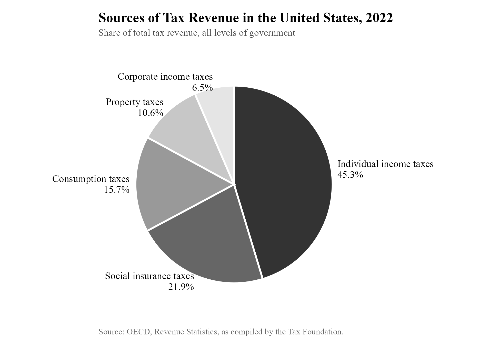
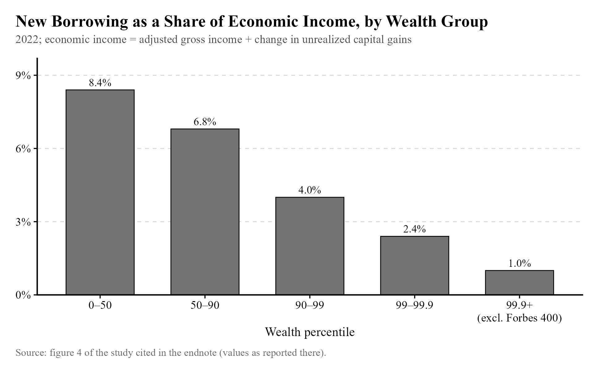
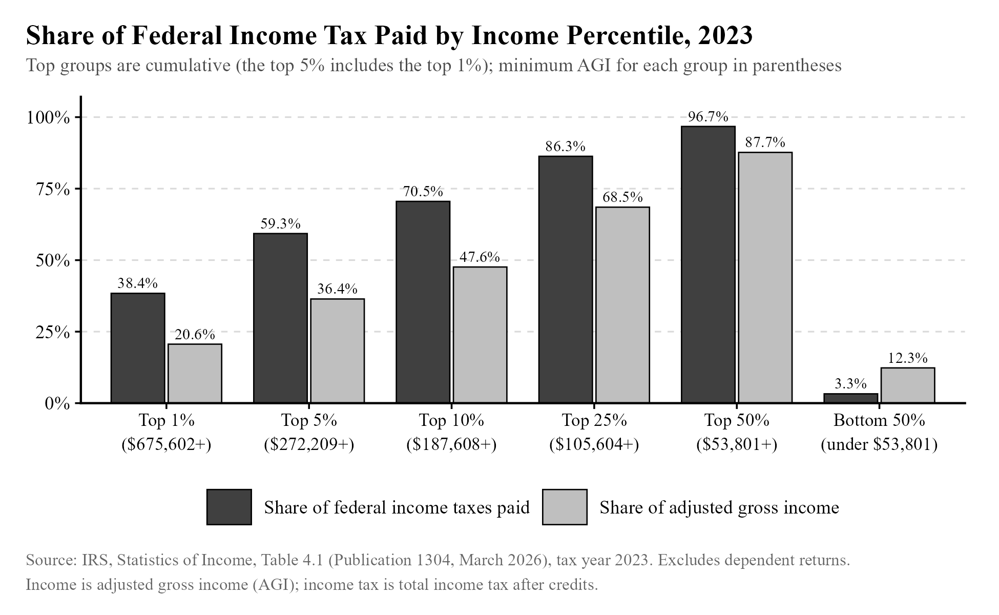
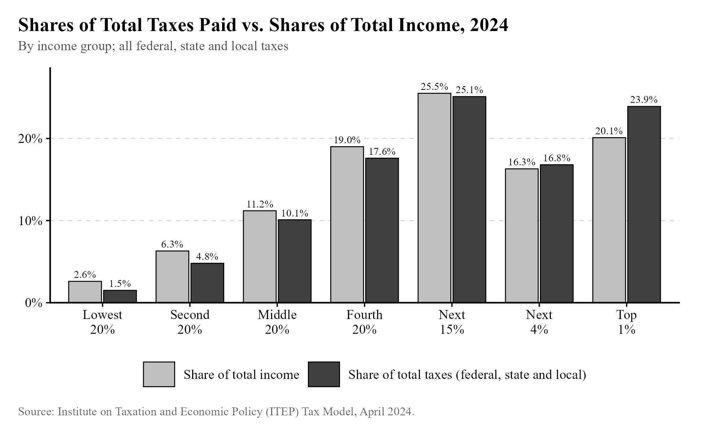
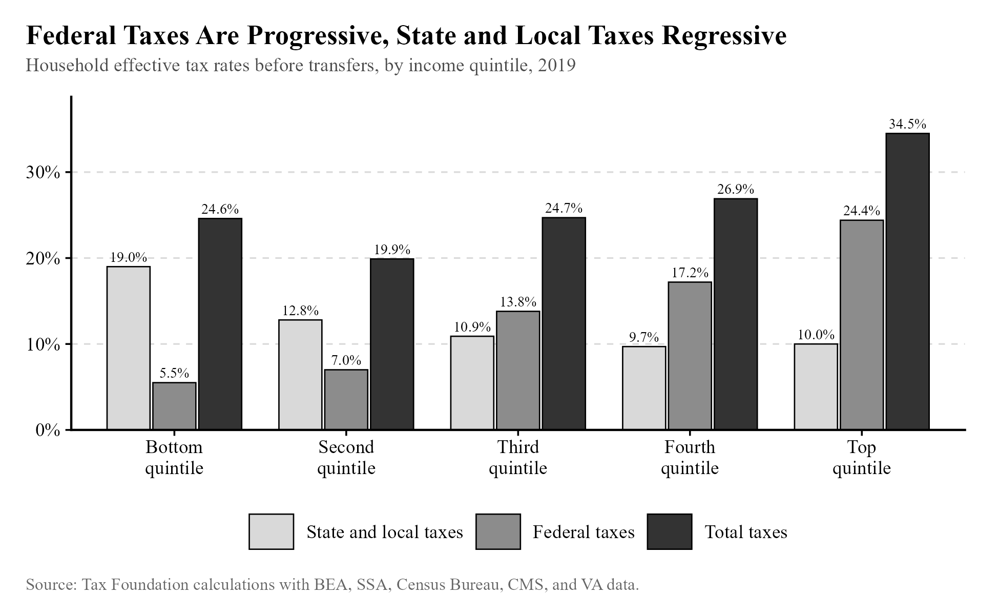
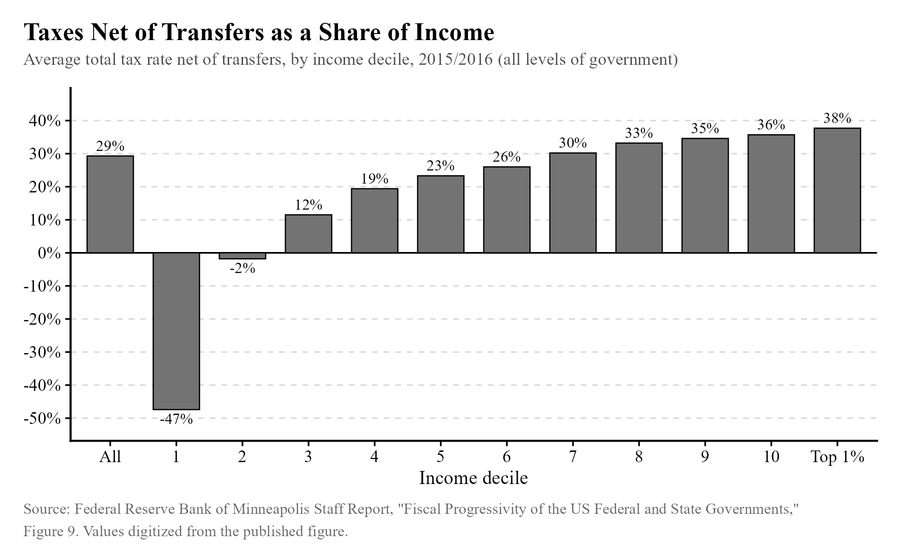
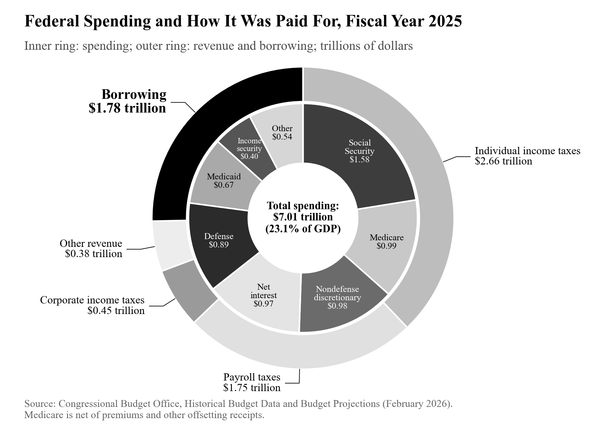
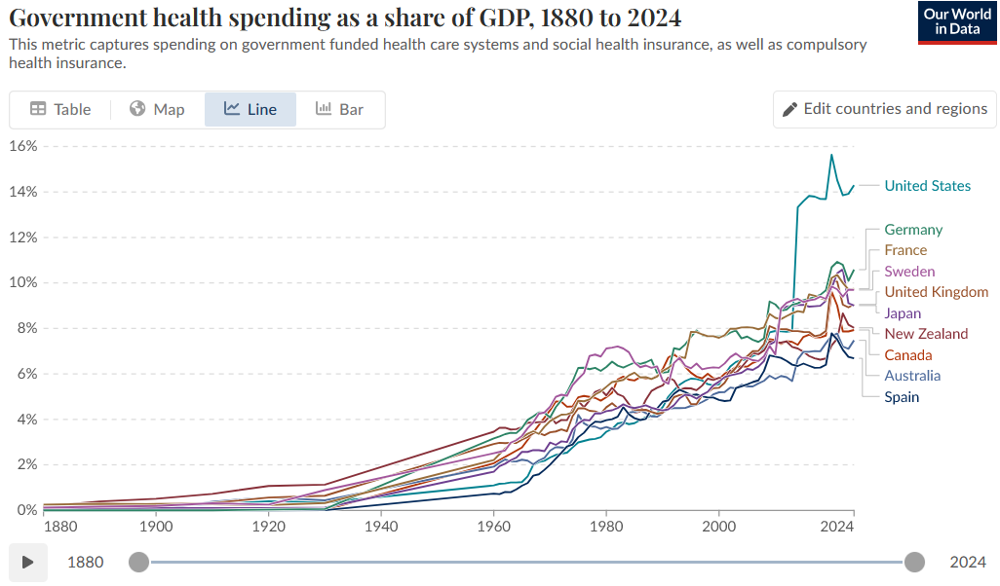
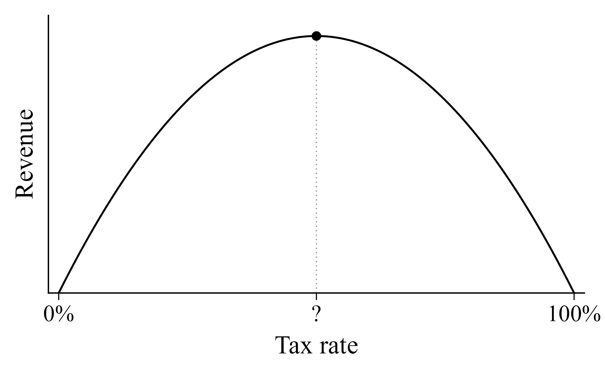
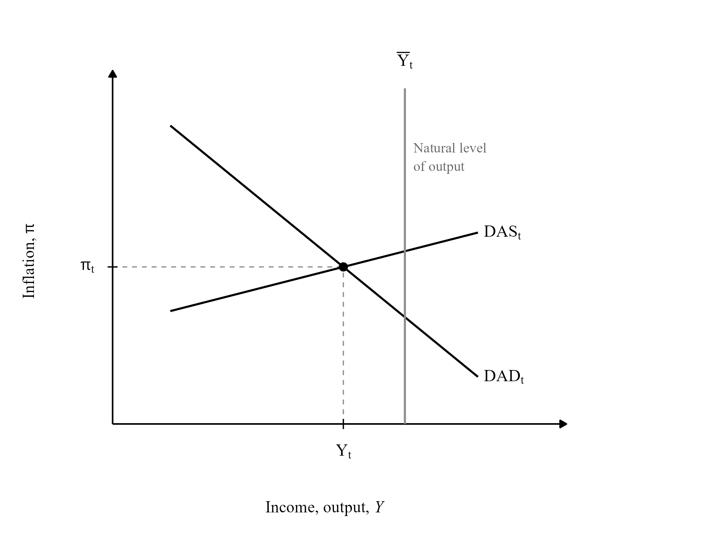

## Take 1: The rich don't pay any taxes. {#take-1}

[Rating: B-tier]{.rating .tier-b}

In *The Atlantic*, Rogé Karma wrote "Buy, Borrow, Die: How to be a billionaire and pay no taxes."[^n204] This loophole is written about frequently[^n205] by left-wing activists. It is quite good for dodging taxes. The core of the problem is that when a valuable asset like stock is passed on to an heir at death, all capital gains up to that point are no longer taxable. That means that billionaires, who are typically compensated through stock, can fairly easily use their stock for consumption of things like mansions and yachts without having to pay taxes on the stock as a form of income.

While this is fairly interesting and mostly correct, it is slightly misleading. Below, you can see a pie chart of all taxes collected in the United States,[^n206] both state and federal.

{width="93%"}

Compensation through the appreciation of stock value, combined with the loophole just described, allows an individual to avoid capital gains taxation (since it is eliminated at death) and income taxation (since stocks owned by founders since the birth of their company are not counted as income). However: (1) corporate taxes affect the profits of a company, and thus the value of the stock, (2) property taxes must still be paid on any mansions or other properties the billionaire owns, (3) consumption taxes must still be paid by the billionaire on almost anything they consume, (4) social insurance and individual income tax burdens also affect the profitability of a company and, thus, the value of stock used as compensation. The loophole does not let you dodge *all* taxation.

It's also worthwhile to note just how rare this strategy is. I'm sure there are plentiful examples of the ultrarich employing the "Buy, Borrow, Die" strategy, but the top 1% of earners don't appear to borrow all that much[^n207] as a percentage of their income, including new unrealized gains:

{width="91%"}

A related take is that the rich don't pay more taxes than those poorer than them as a share of their income (e.g., as shared in this endnoted source[^n208]). This is... slightly true. Federal taxes paid as a percentage of earnings show great progressivity:[^n209]

{width="95%"}

and if you include *all* taxes, including state and local, you get this:[^n210]

{width="93%"}

which only looks kinda progressive. This analysis was also performed by the Tax Foundation,[^n211] and their findings were similar, but look more progressive:

{width="86%"}

Most importantly, the tax system isn't the only thing that matters. If the government takes the same percentage of income from everybody and then hands out lots of money to the poor, you *do* have a progressive system, even a very progressive one, despite the tax system lacking progressivity on its own. That is the case in the US.[^n212] Below, you can see how the bottom 20% of earners receive more in benefits than they pay in taxes.

{width="76%"}

Basically, three things are true at once, and people get confused about them because they often aren't specific enough:

1.  The federal tax system is very progressive.
2.  Federal and state taxes combined don't show much progressivity, since many states use regressive taxes like sales taxes that take a larger share of a poorer person's income.
3.  The entire system, including government spending, is clearly progressive and benefits poorer people more than anyone else.

So I think it'd be accurate to say the US tax system is barely progressive, but it's wrong to say we don't tax the rich more than the poor and middle class, and very misleading on the whole to talk about the current system that way. It's also worth noting that the ITEP analysis includes investment income that has already been taxed, so it underestimates the level of progressivity.

## Take 2: While other countries spend money on healthcare, the US spends its money on war. {#take-2}

[Rating: D-tier]{.rating .tier-d}

This claim has been made by, for example, Jostein Hauge,[^n213] an assistant professor at Cambridge. Senator Bernie Sanders has made claims to this effect as well,[^n214] though they are not as misleading. Below, you can see a chart[^n215] of federal revenues (exterior of the chart) and spending (interior of the chart).

{width="95%"}

The defense area, as you can see, is not even as large as the area representing Medicare spending, and much smaller than Medicare and Medicaid combined. Medicare and Medicaid spending represented about 5.5% of GDP, lower than the UK's \~8% of GDP[^n216] spent on its government-funded national healthcare service, the NHS. This is not surprising, given that the NHS covers everyone while Medicare and Medicaid only cover the old and the poor.

Our World in Data also has a graph[^n217] comparing government spending on healthcare as a percentage of GDP across countries and over time:

{width="94%"}

I did not lead with this graph because it seems to have some kind of measurement issue. There is a mysteriously large jump in the United States occurring in 2014, which does not appear to be explained by any large increase in spending on Medicare or Medicaid.

Our World in Data also has data on military spending as a percentage of GDP.[^n218] The US stands out, though it is far from first place: it stands in 20th place among all countries of the world, spending 3.4% of its GDP on the military, and among developed countries (in this case I will use countries exceeding 0.8 on the HDI[^n219]), it stands in tenth place.

I am thus inclined to consider this claim misleading, but half true. It is true that the United States spends an unusual amount on its military. The claim is misleading, however, because it is not suggestive of the fact that the United States federal government spends more on healthcare than on the military, and appears to spend a comparable amount of money on healthcare compared to other countries.

## Take 3: We need to cut taxes to raise federal revenues. {#take-3}

[Rating: C-tier]{.rating .tier-c}

If you stop to think about it, it's pretty straightforwardly true that the income tax rate that maximizes revenues is not 100%. If the government took *everything* you make, you simply wouldn't work---not unless you were forced to. You'd probably just leave the country.

This concept is usually described as the Laffer curve, named for economist Arthur Laffer. It has a bad reputation among Democrats due to its association with Republican politics. Here it is, visually:

{width="91%"}

At some point (one we will treat as unknown, not 50%), revenue is maximized. The exact revenue-maximizing point is going to depend on a variety of things, especially the type of tax imposed. We would expect the revenue-maximizing point to be higher for a property tax than for an income tax, since a property tax is much harder to dodge. In fact, the graph above is not totally generic---it seems that a 100% tax rate would necessarily result in no revenues, but it is easy to imagine a 100% or even a 150% property tax (how cruel!) that collects *some* revenue because some property owners would find it too costly or undesirable to move.

Written in this generic fashion, the Laffer curve has never been "debunked." There is merely disagreement over exactly where the revenue-maximizing point is. (What would it mean for revenues to *always* rise when the tax rate goes up? How could that even be possible?) It should also be said that, especially in the short term, a 100% income tax rate would likely generate some revenues as well, though it would almost certainly destroy the economy. The curve may also look more interesting than I've depicted it (perhaps there are multiple "peaks" where revenue falls if you move a little in either direction, called *local maxima*).

If one knew the revenue-maximizing income tax rate (or, to be more specific, the revenue-maximizing income tax structure, specifying the brackets and the rates for each), you could use that information to soundly debunk any misplaced idea that an income tax cut would raise revenues for the federal government. Such a bulletproof estimate does not exist, but there are good estimates of the revenue-maximizing top income tax rate that I can provide. This issue provides another good example of how many questions in economics have a "window of sanity." We may not know the exact revenue-maximizing rates, but we can enclose our thoughts on where it *could* be within reasonable bounds based on empirical work done by economists.

I think it is very revealing that in 2024, the Cato Institute published "Top Tax Rates Are Already on Wrong Side of Laffer Curve in at Least Ten States."[^n220] The logical implication, of course, is that they think top tax rates are *not* past the revenue-maximizing point in up to 40 states! But of course, "How could you possibly think the revenue-maximizing point is lower than *Cato*, a libertarian think tank, believes it to be?" is not a very strong argument beyond being rhetorically useful---I think there should be a name for this kind of fallacy---and we should take a moment to explore where their estimates actually come from.

The estimate Cato uses is a combined (i.e., including federal, state, and local taxes) top marginal income tax rate of 49%. Revenue-maximizing rates are calculated using estimates of the elasticity of taxable income with respect to the net-of-tax rate. A review of 11 articles by Aparna Mathur, Sita Slavov, and Michael Strain found an average elasticity of 0.7, meaning that when the share someone keeps from an extra dollar falls by 1%, taxable income falls by 0.7%. These elasticities are used by Cato to calculate the revenue-maximizing rate using a fairly simple formula:

$$\mathit{revenue}\mathit{maximizing}{\mathit{rate} = \frac{1}{1 + {1.48 \ast \mathit{elasticity}}}}$$

where 1.48 is the Pareto parameter of top incomes.

If you have taken calculus before, you should be familiar with maximization problems. This shouldn't be too difficult to understand once the assumptions are made clear. (If you *haven't* taken calculus before, I'll still try to make this easy by describing each step verbally.)

The elasticity, written e, is defined as the change in taxable income z (as a proportion of taxable income) *per* the proportionate change in the share of income that is *not* taxed, 1 - τ, where τ is the tax rate:

$$e = \frac{\mathit{dz}/z}{d{{({1 - \tau})}/{({1 - \tau})}}}$$

Simplifying, a greater e means a stronger behavioral response to taxation and a lower revenue-maximizing tax rate. We can use this formula to derive the revenue loss when the tax rate rises. It should be fairly clear---I hope---that the change in the *average* taxable income z~m~ (again, as a proportion of itself) is the elasticity times the change in the share of income that is not taxed:

$${\frac{\Delta z_{m}}{z_{m}} = e}\cdot\frac{{- \Delta}\tau}{1 - \tau}$$

This holds purely by definition (look at the definition of e, and multiply both sides by the denominator). So when tax rates rise, the change in the average taxable income (from people being discouraged from working) is:

$$\Delta{z_{m} = z_{m}}\cdot e\cdot\frac{{- \Delta}\tau}{1 - \tau}$$

which follows by simply multiplying both sides by the average income. How much revenue is lost when this behavioral response occurs? Well, the government is only collecting a certain share of the income, so it's only that share of the change in taxable income that is lost. We multiply both sides by the tax rate τ to get this:

$$\mathit{Revenue}\mathit{change}\mathit{per}{\mathit{person} = \tau}\cdot z_{m}\cdot e\cdot\frac{{- \Delta}\tau}{1 - \tau}$$

To get the total loss to the government, we simply multiply by the number of people in the bracket, N\*:

$$\mathit{Total}\mathit{revenue}{\mathit{change} = N^{\ast}}\cdot\tau\cdot z_{m}\cdot e\cdot\frac{{- \Delta}\tau}{1 - \tau}$$

There is a separate, mechanical *increase* in revenue from raising the tax rate (obviously), which is not represented here. When the top marginal tax rate rises, that mechanical effect raises revenues while the number represented in the formula above depresses them. Below the peak of the curve, the mechanical gain in revenues exceeds the revenue loss. When the peak occurs, these two effects cancel out---they are equal. So we can find the revenue-maximizing tax rate if we can write down the mechanical effect that increases revenues, add it to the total revenue change formula just described, and set the sum equal to zero.

The mechanical effect is easy to write. The increase in revenues from the change in τ will be the number of taxpayers in the bracket N\* times the average income minus the bracket threshold z\*, multiplied by the change in the tax rate:

$$\Delta{M = N^{\ast}}\cdot{({z_{m} - z^{\ast}})}\cdot\Delta\tau$$

If you add the formula for ΔM to the formula for the total revenue change from a tax hike and set the sum to zero, after a moment of doing some algebra (feel free to do this yourself, but I don't suppose it will help much), you arrive at this formula:

$$\tau = \frac{1}{1 + \frac{z_{m}\cdot e}{z_{m} - z^{\ast}}}$$

where we would usually attach a star to τ to indicate this particular τ is the revenue-maximizing one. Typically, the denominator is simplified by writing z~m~/(z~m~-z\*) as a constant *a* called the Pareto parameter, giving us τ\* = 1/(1+ae). Cato's calculations rely on the observation that *a*, the ratio of the average income in the top marginal tax bracket to the difference between that income and the bracket threshold, is about 1.48.

Now that we understand how to leap from an elasticity to the revenue-maximizing rate, we need to find out how the elasticity is estimated and why estimates of this elasticity vary. One should note that there is not one elasticity to rule them all; we'd expect it to differ over varying time horizons. In the language of mathematics, the elasticity is a function of other things like the time horizon under consideration, so the picture provided by the preceding formula for the revenue-maximizing rate is somewhat incomplete.

There are a number of difficult problems with estimating the elasticity, many of which are described by Emmanuel Saez in his 2004 paper.[^n221] Perhaps the most important issue is that the estimated elasticity based on observed changes in pre-tax income depends critically on what we assume about the trend of incomes over time. Suppose we want to estimate the elasticity based on changes in pre-tax income after a tax cut. If pre-tax income rises after the cut, we *could* attribute this to the tax cut, and estimate the elasticity using that change. But that ignores the fact that incomes tend to rise over time anyway. The time trend proves critical in Saez's estimates. Here is an excerpt:

> "When no time trend is included in the regression of log income on log net-of-tax rate, all the growth in top incomes is attributed to the decline in top rates, and the elasticity obtained is extremely large 1.83 (.37). In contrast, including a time trend produces a much smaller, although still sizeable, elasticity .71 (.22) because part of the rise in top incomes is attributed to a secular rise. Adding an additional time square control further reduces the elasticity to 0.5 (0.18)."

Thus, debate over the question of "How fast is inequality really rising?" naturally ties itself into debate over this elasticity, reinforcing the corresponding opinions! I think this is remarkable, but I will focus on the actual evidence rather than getting too skeptical.

There are a few things that I think are worth taking away from this kind of empirical work. First, identifying the real elasticity is very difficult. There are plenty of questions in economics that lend themselves well to natural experiments, but because these tax changes usually occur at the level of entire nations, performing that kind of analysis is much more difficult. (If you were to use another country as a point of comparison to try to guess how pre-tax incomes would change over time if not for the tax cut, there would be unobserved differences between the countries that could be driving differences after the tax cut. The control group is too different.)

Second, when researchers try to adjust for issues like the trend in incomes over time, the elasticity does tend towards a range of what we can call reasonable estimates. If we take the short-run elasticities included in a review[^n222] by the American Enterprise Institute, they range from 0 to 3.1, average around 0.7, and the middle 80% fall in the range \[0.2, 1.3\]. Mind you, aggregating in this way is speaking very loosely about the literature; these estimates come from various reforms, time horizons, and income brackets, and I have converted estimates given by AEI as a range to single numbers by taking the center of those ranges. These estimates are still informative, since they reinforce the already strong theoretical case for a Laffer curve peak (almost all of them suggest the behavioral response is real). Because these estimates apply to varying income ranges, we sadly cannot use the relatively simple formula I previously described to get the revenue-maximizing rate or a range of estimates for that rate.

If we use the elasticity estimates for the very rich that AEI included (from just two studies), the implied estimated top rate that maximizes revenue is somewhere in the range \[34%, 46%\] in the short run and \[53%, 63%\] in the long run, compared to the current combined top marginal rate of 46% provided by Cato. But that brings us to the third point: identifying the long-run elasticity is extremely difficult and essentially impossible at this point in time. If by lucky chance a natural experiment occurs over the span of decades that allows for a comparison, we will know, but for now we do not. Any statement made about this elasticity should be made with a great deal of humility; claims of great confidence about the long-run growth enhancing effects of tax cuts for the highest earners are bad economics, though possibly not wrong.

Some historical notes should be made concerning the effects of tax cuts on revenues. We cannot make confident causal claims about the long-run revenue impacts of the Reagan or Bush Jr. tax cuts, since that would require observing the investment and labor market decisions that would have been made in the counterfactual cases where these tax cuts were not passed. However, available observations generally don't suggest these tax cuts raised revenues, e.g. as described near the bottom of page 160 of this endnoted study[^n223] of the Bush Jr. era tax cuts. I advise the reader not to attempt to infer the effects of these tax cuts using graphs of the deficit over time, since the effects of other things generally overwhelm and obscure any effect that could appear to casual observation. It is also worthwhile to note that revenue maximization is not necessarily the goal of society, and that the revenue-maximizing rate is only worthwhile to discuss due to its clear policy implications under certain conditions.

In the end, this take is granted a rating of C-tier. There are plausible cases---like in California, for example, which has especially high taxes---where a tax cut for the highest earners would raise revenues. But it is easy to run away with this idea and apply it anywhere and everywhere without a second thought and with far too much confidence. Empirical estimates reinforce the theoretical idea that the Laffer curve peaks somewhere, but where, we cannot say, except that it is almost assuredly not at a top marginal rate of 20% or 90% or some other silly number.

## Take 4: Modern monetary theory shows us that debt doesn't matter. {#take-4}

[Rating: D-tier]{.rating .tier-d}

The supposed ability of modern monetary theory to show that deficits and debt don't matter has made it a darling of the political left, with representative Alexandria Ocasio-Cortez[^n224] being one of many to endorse it as an explanation for how we can pay for legislation like the Green New Deal. But of all the takes in this book, this one has perhaps the largest gap between the motte and the bailey. Stephanie Kelton, popularizer of Modern Monetary Theory (MMT) through her book *The Deficit Myth,* seems to spend a fair bit of time pushing back[^n225] on misinterpretations of her ideas, which don't appear to ignore obvious truths of economics.

For example, when economists were surveyed about MMT, Kelton did not agree with the phrasing[^n226] of the statements they were asked about, suggesting that she doesn't exactly disagree with their judgment. Speaking with NPR,[^n227] she was clear that MMT is not about printing money to create prosperity or ignoring the effect of money creation on inflation, as in Zimbabwe or Weimar Germany, with prices multiplying by over a hundred times in a year. What Kelton understands, and what is sufficient to counter-argue against the worst instincts of what we can call her "fake fans," is that the government's ability to bring people benefits depends on the real resources available in the economy---money magic doesn't change that. Sometimes, we really *can't* afford it, even if the government can always come up with the money for it.

So what is MMT, really? The biggest ideas in MMT appear fairly old and well-known to the economics profession. Here is a relevant snippet of a summary of Abba Lerner's "functional finance:"[^n228]

> "If aggregate demand exceeds aggregate supply at full employment output the government should increase taxes or cutback government purchases or transfer payments. The increase in tax in this case is not to raise revenue but to decrease consumer demand by taking away buying power from consumers."

Another idea contained in MMT, explained by Scott Fullwiler,[^n229] is that "For MMT'ers, concerns that a nation cannot 'afford' to put idle capacity to use through tax cuts or appropriately targeted spending are akin to a person with his/her shoes tied together concerned that he/she can't run." The constraints on the government's ability to spend, in a situation of high unemployment, are entirely legal, not real. That is essentially the picture received by macroeconomics students in introductory textbooks. Below, you can see a figure from Mankiw's *Macroeconomics* (8ed, pg. 422). It describes a situation in which the economy is below its natural level of output, with lots of unused resources, and where one could increase output with minimal impact on inflation by raising aggregate demand.

{width="65%"}

I am not the first to show how MMT appears to be old news dressed up in new language. Matt Bruenig[^n230] has made a similar argument:

> "If you understand the MMT private language or have a couple of hours available to talk to an MMT advocate and slowly peel back the layers of obfuscation they like to use, you realize that 'taxes don't fund spending' is not saying we don't need to raise taxes to expand the welfare state. Rather, it is saying that, in their idiosyncratic way of categorizing things, the necessary taxes do not 'fund the welfare state,' but merely 'offset the inflation caused by the money creation that funds the welfare state.'"

I will thus dedicate the rest of this section to addressing some more specific claims made by Fullwiler that are not the main thesis of MMT.

1\. The supply and demand model of loanable funds is incorrect. While it suggests that higher demand for loanable funds raises interest rates and diverts money to the loanable funds market by raising the return on lending, in reality, the supply of loanable funds is perfectly elastic because banks can create loans without needing reserves.

This is essentially true, but slightly misleading. Banks *can* create money without first receiving money from consumers that they then lend out. Treating them as if they cannot is one of the many simplifications of Econ 101. Thus, increased demand for loanable funds does not mechanically raise the interest rate---not in the short run. Banks don't need to raise the interest rate to attract more reserves for lending. But in the long run, the Econ 101 picture is essentially correct. The supply of loanable funds is not the money the banks lend out, but the resources we choose to save and invest rather than consume immediately.

If we imagine a situation where the demand for loanable funds rises---say, new technology makes firms want to invest more, so they take out more loans---eventually the increased demand for loanable funds is going to hit the wall of real resources. Firms will bid up the price of the finite resources that are available until the marginal product of capital is equal to the real interest rate (which is the price they must pay to acquire more of said capital with borrowed money). That can happen if the increase in lending leads to inflation, reducing the rate of return on new projects, or if banks raise interest rates. In spite of the fact that banks can lend as much as they'd like, they would raise interest rates in the presence of inflation. (Recall that the real interest rate is approximately the nominal interest rate minus the rate of inflation.)

2\. The interest on the national debt for a sovereign currency issuer under flexible exchange rates is a policy variable---not a market-set rate---or at the very least *could be* if the government so desires.

This is pretty much right. For context, in order to fund the government (or, in the language of MMT, in order to siphon enough money out of the economy to prevent inflation), the government issues Treasury bonds ("T-bonds") that are the inverse of a loan. If you buy a bond from the government, they will pay you back some larger sum of money later. When the government runs a deficit, it issues a proportionate amount of T-bonds and other "Treasuries" to cover it. The sum of all financial instruments like T-bonds that the government has sold and thus owes is known as the national debt.

Many people fear that the national debt is too large, and that if we do not eliminate the budget deficit, lenders to the government (purchasers of Treasuries) will lose faith in its ability to pay them back and demand higher rates. That will then make financing government spending too difficult and force the government to default on its obligations, failing to pay back the T-bonds (and collapsing the global financial system). Apocalypse!

The MMT view, simplified, says that if the government wants a lower interest rate on T-bonds, and investors currently aren't willing to pay for them at that rate, the Fed can simply buy them from the open market to nudge them into doing it by pushing bond prices higher. If investors know the Fed will buy from them, they'll take the T-bonds anyway. (The Fed could hypothetically buy them directly from the Treasury to increase demand for T-bonds, but is not legally allowed to, so we have to go this roundabout direction instead.) The only constraint in this situation is inflation triggered by the Fed buying all of those bonds and putting tons of money into the economy. You don't get default, but you *do* get a nasty spell of inflation, depending on the current state of the economy (if unemployment is high, as it was after the Great Recession, buying all of those treasury bonds and injecting money into the economy won't cause as much of a problem).

I'm simplifying, but a worthwhile mention is that issuing bonds to cover the deficit isn't quite how it works in the MMT view. The Federal Reserve has an interest rate target, and when the government is running a deficit, the extra money leads to additional reserves at banks. Those reserves would drive down interest rates without some kind of intervention, so the government issues bonds and siphons the money out of the financial system.

If all of this feels very confusing to you, don't worry about it. The prescriptions of MMT are pretty much the same as the mainstream ones in this case. I admit that there's some appeal in taking a more literally correct view of monetary policy and the debt, but the general idea I've gleaned from MMT is that they think people focus too much on the thermometer and too little on the temperature. I pretty much agree, but I *like* the thermometer. It's useful. If the target temperature is 70 degrees Fahrenheit and it reads 120, something is wrong with your AC and you shouldn't leave your kid in the car.

## Take 5: Governments are like households. We need a balanced budget amendment to keep the government's finances in check. {#take-5}

[Rating: D-tier]{.rating .tier-d}

A desire for a balanced budget has been an ever-present force in American politics. In the 1990s, Ross Perot became one of the best-performing third party candidates since the inception of the Democratic and Republican parties, largely by riding a wave of discontent over the government's finances. And in the 2010s, after the Great Recession, Republican officials like House Speaker John Boehner spoke of how "Every family in America has to balance their budget. Washington should, too."[^n231]

Under a balanced budget amendment---we're going to start with the literal version rather than a more sensible one---the government always spends as much as it collects in taxes. If an aggregate demand shock a la the Great Recession occurs, usually, automatic stabilizers like unemployment insurance and Medicaid kick in as income and employment fall. That helps counteract the aggregate demand shock, and it usually creates a greater government deficit. With a balanced budget amendment, the government would be forced to either raise taxes or cut spending to cover the cost. This would nullify much of the effect of the automatic stabilizer on aggregate demand, depending on exactly how the government raises taxes and cuts spending.

Basically, new government fiscal policies would have a procyclical bias. When a recession occurs, they would tend to pass laws that make it worse by raising taxes and cutting spending. When a boom period occurs, they would tend to pass laws that enhance it by cutting taxes and raising spending (think of how having fewer poor people would cut Medicaid costs and mechanically turn a neutral budget into a surplus). The remaining policy lever would be monetary policy, and the Fed would bear the weight of counteracting any recessions. This could be very bad if the Fed cuts rates as much as it can and hits the zero lower bound. By that point, there would be nothing the government can do to fix the problem, and in the worst case scenario you'd have a Great Depression that the government has legally forbidden itself from solving.

The difference between a household and a government, which an unending desire for a balanced budget ignores, is that usually a household's spending doesn't have a strong feedback effect on the income it collects. That is not true of governments. When aggregate demand collapses, like with the Great Depression or the Great Recession, output falls and unemployment rises. We'd like it if these problems were self-correcting, but during the Great Depression, this kind of fix turned out to be painful and slow. It is easy to see how this is the case once you recognize that if too many people are unemployed, there simply isn't enough spending to motivate investment in business activity. That means that interventionist, Keynesian fiscal policy has a role to fill, at times, in getting people back to work, either through government projects, unemployment insurance, tax cuts, or some other deficit-financed stimulus. That's good for reducing suffering, and it's also necessary if you want the tax base to be large enough to balance the budget.

So *please* support an "un-balanced budget amendment" instead. Professor Alex Tabarrok[^n232] has argued for such an amendment, which would require the government to run a surplus during good times and a deficit in bad times. This has the benefit of being counter-cyclical while at the same time requiring some degree of fiscal responsibility. Germany and Switzerland have already implemented such amendments as "debt brakes," and while they are controversial among economists, such a change would not be nearly as destructive as a balanced budget amendment.

[^n204]: [theatlantic.com/economy/archive/2025/03/tax-loophole-buy-borrow-die...](https://www.theatlantic.com/economy/archive/2025/03/tax-loophole-buy-borrow-die/682031/)
[^n205]: [inequality.org/article/why-is-elon-musk-supporting-donald-trump-tax...](https://inequality.org/article/why-is-elon-musk-supporting-donald-trump-tax-avoidance/)
[^n206]: [taxfoundation.org/data/all/federal/us-tax-revenue-by-tax-type-2024/](https://taxfoundation.org/data/all/federal/us-tax-revenue-by-tax-type-2024/)
[^n207]: [x.com/ZLiscow/status/2045835781894279218/photo/1](https://x.com/ZLiscow/status/2045835781894279218/photo/1)
[^n208]: [x.com/Accountable2019/status/2043784507413627302?s=20](https://x.com/Accountable2019/status/2043784507413627302?s=20)
[^n209]: [mercatus.org/research/data-visualizations/tax-burden-across-varying...](https://www.mercatus.org/research/data-visualizations/tax-burden-across-varying-income-percentiles)
[^n210]: [x.com/jdcmedlock/status/2044443594673836433?s=20](https://x.com/jdcmedlock/status/2044443594673836433?s=20)
[^n211]: The bar graph is a recreation of theirs: [taxfoundation.org/research/all/federal/who-pays-taxes-federal-state...](https://taxfoundation.org/research/all/federal/who-pays-taxes-federal-state-local-tax-burden-transfers/#Distribution)
[^n212]: [minneapolisfed.org/research/staff-reports/fiscal-progressivity-of-t...](https://www.minneapolisfed.org/research/staff-reports/fiscal-progressivity-of-the-us-federal-and-state-governments)
[^n213]: [x.com/haugejostein/status/2042982142511333852?s=20](https://x.com/haugejostein/status/2042982142511333852?s=20)
[^n214]: [x.com/BernieSanders/status/1030590678559019008?s=20](https://x.com/BernieSanders/status/1030590678559019008?s=20)
[^n215]: [jackonomics.substack.com/p/the-national-debt-and-the-big-beautiful](https://jackonomics.substack.com/p/the-national-debt-and-the-big-beautiful)
[^n216]: [commonslibrary.parliament.uk/research-briefings/sn00724/](https://commonslibrary.parliament.uk/research-briefings/sn00724/)
[^n217]: [ourworldindata.org/financing-healthcare](https://ourworldindata.org/financing-healthcare)
[^n218]: [ourworldindata.org/grapher/military-spending-as-a-share-of-gdp-sipr...](https://ourworldindata.org/grapher/military-spending-as-a-share-of-gdp-sipri?tab=table)
[^n219]: [en.wikipedia.org/wiki/List\_of\_countries\_by\_Human\_Development\_Index](https://en.wikipedia.org/wiki/List_of_countries_by_Human_Development_Index)
[^n220]: [cato.org/blog/top-tax-rates-are-already-wrong-side-laffer-curve-lea...](https://www.cato.org/blog/top-tax-rates-are-already-wrong-side-laffer-curve-least-10-states)
[^n221]: [eml.berkeley.edu/~saez/NBER10273TPE04.pdf](https://eml.berkeley.edu/~saez/NBER10273TPE04.pdf)
[^n222]: [aei.org/wp-content/uploads/2012/11/-should-the-top-marginal-income-...](https://www.aei.org/wp-content/uploads/2012/11/-should-the-top-marginal-income-tax-rate-be-73-percent_085518416524.pdf?x29144)
[^n223]: [onlinelibrary.wiley.com/doi/abs/10.1002/pam.20406](https://onlinelibrary.wiley.com/doi/abs/10.1002/pam.20406)
[^n224]: [npr.org/2019/07/17/742255158/this-economic-theory-could-be-used-to-...](https://www.npr.org/2019/07/17/742255158/this-economic-theory-could-be-used-to-pay-for-the-green-new-deal)
[^n225]: [x.com/StephanieKelton/status/2011862116001616189?s=20](https://x.com/StephanieKelton/status/2011862116001616189?s=20)
[^n226]: [x.com/StephanieKelton/status/1243989602253373441?s=20](https://x.com/StephanieKelton/status/1243989602253373441?s=20)
[^n227]: [npr.org/2019/07/17/742255158/this-economic-theory-could-be-used-to-...](https://www.npr.org/2019/07/17/742255158/this-economic-theory-could-be-used-to-pay-for-the-green-new-deal)
[^n228]: [web.archive.org/web/20161003041918/https://www.sjsu.edu/faculty/wat...](https://web.archive.org/web/20161003041918/https://www.sjsu.edu/faculty/watkins/functfin.htm)
[^n229]: [lowimpact.org/wp-content/uploads/MMT-Scott-Fullwiler.pdf](https://www.lowimpact.org/wp-content/uploads/MMT-Scott-Fullwiler.pdf)
[^n230]: [peoplespolicyproject.org/2019/02/24/whats-the-point-of-modern-monet...](https://www.peoplespolicyproject.org/2019/02/24/whats-the-point-of-modern-monetary-theory/)
[^n231]: [npr.org/sections/itsallpolitics/2013/03/19/174762184/how-the-federa...](https://www.npr.org/sections/itsallpolitics/2013/03/19/174762184/how-the-federal-budget-is-just-like-your-family-budget-or-not)
[^n232]: [marginalrevolution.com/marginalrevolution/2011/07/an-unbalanced-bud...](https://marginalrevolution.com/marginalrevolution/2011/07/an-unbalanced-budget-amendment.html)
