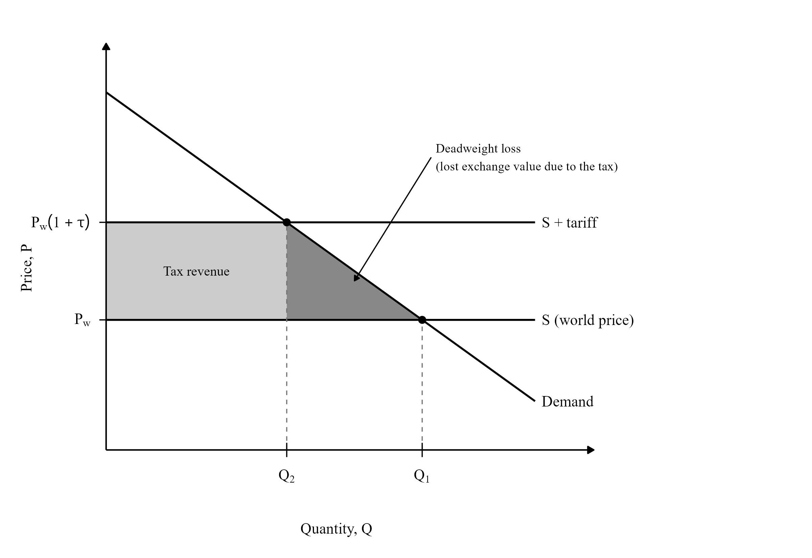
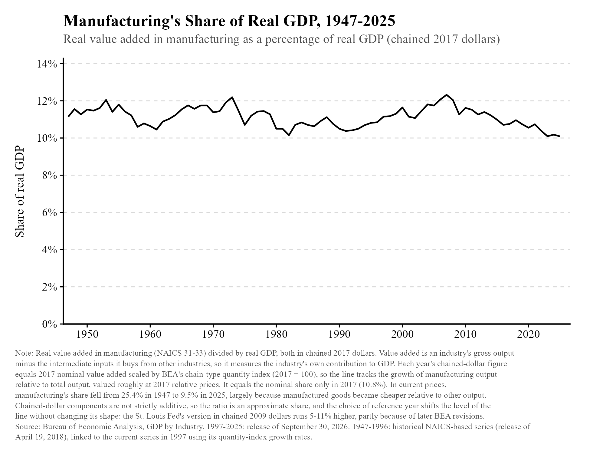
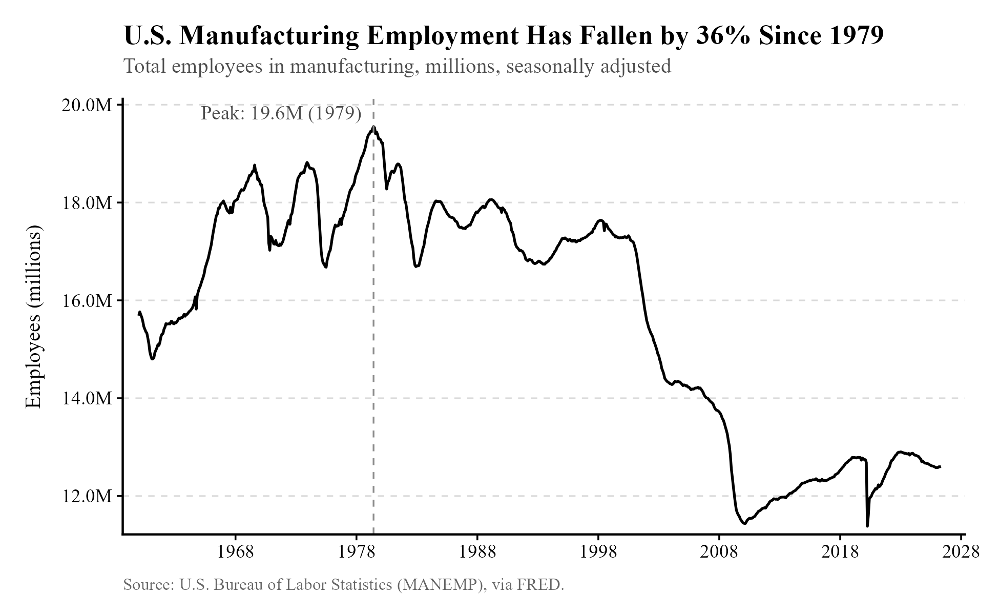
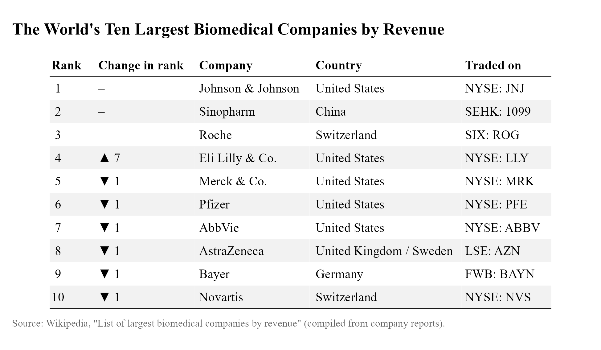
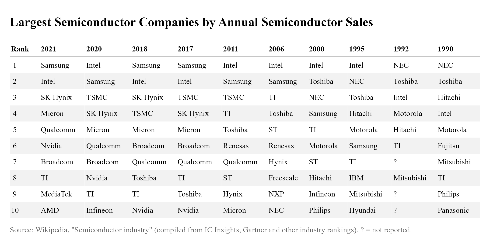
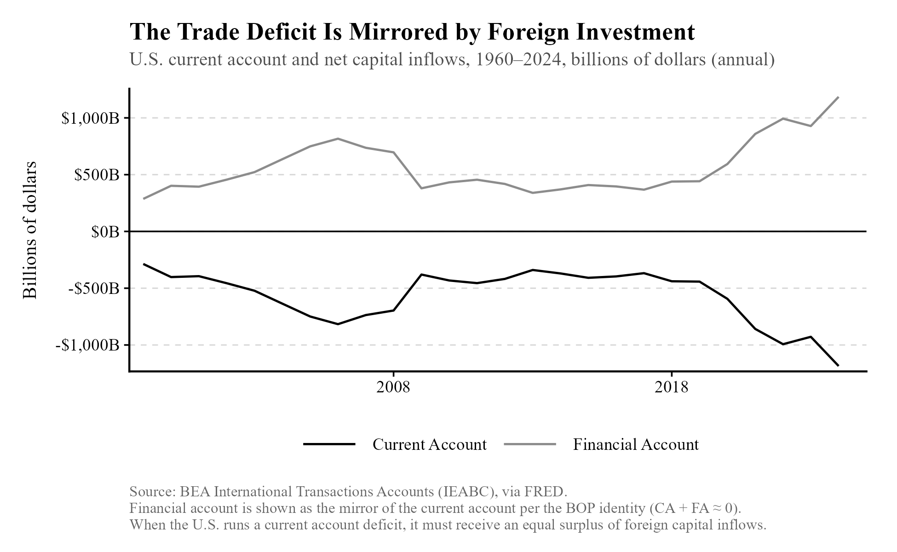
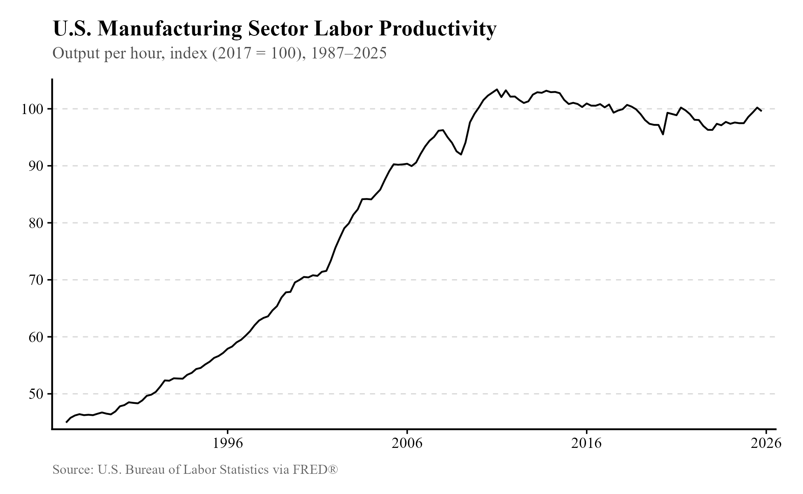
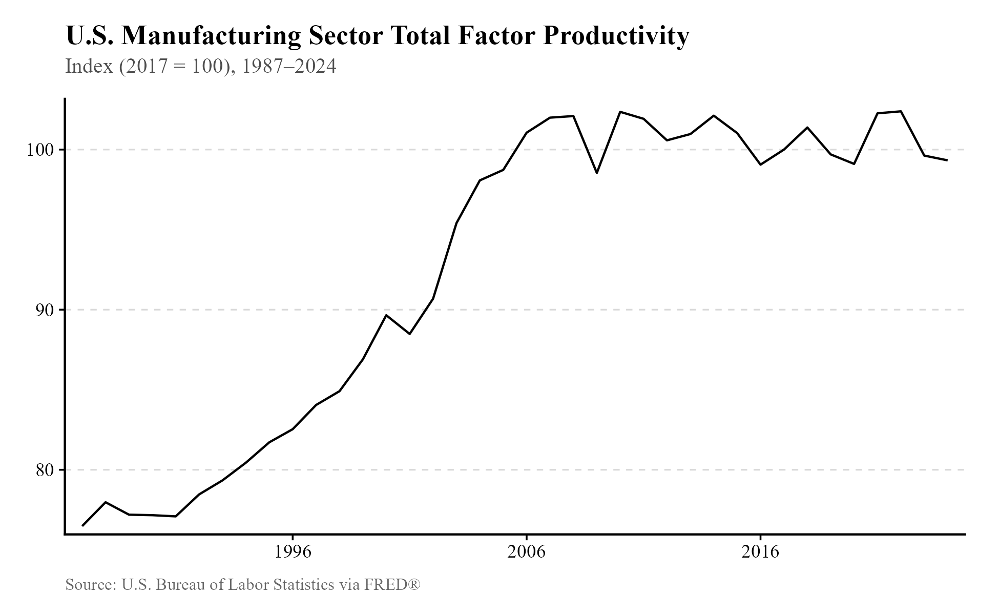
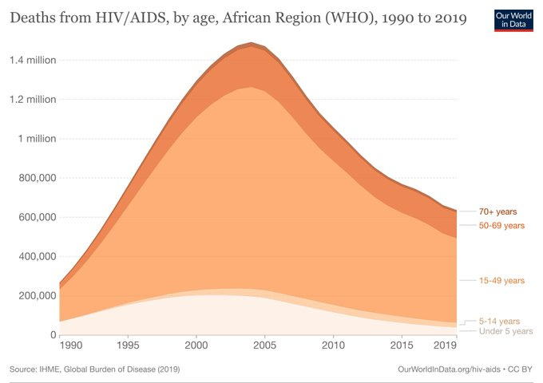

## Take 1: Tariffs are paid by foreigners. {#take-1}

[Rating: F-tier]{.rating .tier-f}

The incidence of tariffs, like the incidence of any tax, depends on the relative elasticities of supply and demand. It is more reasonable to believe that international supply is relatively elastic compared to domestic demand, so the burden of a tariff will mostly fall on domestic consumers and businesses.

To provide a simple analogy, imagine your name is John America, and you arrive at a market with many sellers. If you decide that anyone selling you something must pay a tariff of \$1, and communicate this to the sellers, they will simply raise all of their prices by \$1 to cover the cost of the tariff. If you forbid them from doing this, they will simply refuse to sell you anything. They have many other buyers they can turn to.

Of course, it's possible that the US has market power and can avoid such a predicament, so we need to perform empirical checks. "The Impact of the 2018 Tariffs on Prices and Welfare"[^n233] provides a good illustration of how this works. First, here is the theoretical description as a supply and demand graph they provided:

{width="75%"}

With elastic international supply S\*, there was very little producer surplus that might be lost. The international supply curve shifts by the amount of the tariff, and the entire tariff turns into a higher price.

If international supply is truly close to perfectly elastic, and the burden of the tariff is felt entirely by Americans, then the price received by foreign exporters (that is, the total price received minus the tariff they must pay) should be unchanged after the introduction of the tariff. That is indeed what the authors found, stating that "it appears that the supply elasticity of exports, at least in the short run, is close to perfectly elastic (as portrayed in Figure 2), which means close to all of the cost of the 2018 US tariffs was borne (so far) by US consumers and importers."

Of course, the tariffs from Trump's first term are not the only tariffs that have been imposed---we also have tariffs from his second term to use for estimation of the burden of tariffs. Writing for Commonplace on Substack,[^n234] Matthew Lynn claims "The Harvard Business School tariff tracker, which has been monitoring price changes across affected sectors, estimates a 'pass-through' rate of approximately 20%,[^n235] meaning that only one-fifth of the tariff costs are actually showing up in consumer prices."

As if to make it very clear to his audience that he's making a mistake, he makes his argument explicit later, claiming the other 80% is paid by foreigners:

> "So far, tariffs are generating an extra \$30 billion for the U.S. Treasury every month. If that is maintained---and there is no reason to think it won't be---that translates into roughly \$360 billion in annual duties on foreign goods, a staggering sum by any measure. If the critics were correct, that would represent a \$360 billion tax increase on American families. But if the pass-through rate is genuinely around 20%,[^n236] only about \$72 billion is actually falling on American consumers. The remaining \$288 billion? That's being absorbed by foreign exporters and foreign governments."

That is not what they found! Here is a quote from the paper he is citing: "\[\...\] we estimate that U.S. consumers were bearing roughly 43 percent of the tariff-induced border cost after seven months, with the remainder absorbed mostly by U.S. firms." So, the finding is the same: as predicted by economic theory, tariffs are mostly paid by domestic consumers and producers, not foreign exporters.

The claim, then, is almost certainly false. We have good theoretical and empirical reasons not to believe it. Supporters of tariffs have neglected the simple truths of economic theory to such an extreme degree that they have managed to cite the very evidence that proves them wrong. (I observed this happening a second time while browsing Twitter/X.) Motivated reasoning can be blinding, like with rent control advocates spoken about in the introduction and in [Chapter 2](02-housing.qmd), but this is the most extreme case I've seen.

## Take 2: The US has decayed and suffered great losses from free trade. Its industrial base has evaporated. {#take-2}

[Rating: C-tier]{.rating .tier-c}

As international trade has grown, the United States has indeed experienced some pains from it. Many of the ones people imagine, however, are made up. One of them is that the US manufacturing sector has greatly declined, beginning to slowly wither sometime in the 20th century before Donald Trump arrived to tell about its decline in the mid-2010s.

Below, you can see a chart of manufacturing as a percentage of real GDP from the St. Louis Federal Reserve, extended to the present.[^n237]

{width="95%"}

So it seems that manufacturing has not really declined, but manufacturing *employment* has suffered:

{width="95%"}

Thus, the story of American manufacturing decline is not really a story of manufacturing decline, but of manufacturing unemployment. That is the accurate story to tell.

What, exactly, happened to workers affected by the China shock of the 1990s? Researchers used data on individual earnings by employer to identify the labor market experiences of those most exposed to import competition from 1992 to 2007.[^n238] Those who were most exposed had lower cumulative earnings, were more likely to exit the labor force, and more likely to begin claiming disability benefits. As you would expect, unemployment is bad news.

My verdict is that this take is misleading and only half true. It would be wise to focus any discussion of American manufacturing decline on its effect on workers, rather than American manufacturing itself.

## Take 3: We need tariffs to protect vital industries like pharmaceuticals and semiconductor manufacturing, which other countries now dominate. {#take-3}

[Rating: D+]{.rating .tier-d}

Writing in the Wall Street Journal,[^n239] Oren Cass made the above claim, which is not addressed by the preceding discussion of tariff burdens and manufacturing decline. The claim that other countries have used tariffs and other forms of manipulation to dominate the pharmaceutical and semiconductor industries is somewhat misleading. Below, you can see the top ten biomedical companies in the world by revenue.[^n240] Half of them are American.

{width="95%"}

Similarly, Americans have maintained remarkable international performance in the semiconductor industry.[^n241] Micron, Qualcomm, Texas Instruments, and Intel have stayed in the top ten since 2011.

{width="95%"}

Broader measures of performance in these industries are also suggestive of what I'm describing. The US is #2 in semiconductor manufacturing market share overall,[^n242] with Taiwan taking a distant first place. The US is #3 for pharmaceutical exports[^n243] (or #2, depending on the measure used), with Germany and Switzerland leading. Germany exports about 26% more pharmaceuticals than the US.

These other countries didn't use tariffs to dominate these industries. The Taiwanese government assisted TSMC by providing the capital for it,[^n244] but they didn't tariff semiconductor imports, and Switzerland didn't tariff American pharmaceutical imports to bring Roche and Novartis to dominance. Switzerland did provide its companies with tax breaks for various forms of R&D,[^n245] much like how the US funds pharmaceutical development through the National Institutes of Health (which the Trump administration is seeking more budget cuts for[^n246]).

Regardless of how other countries privileged their own industries, it is possible that tariffs would provide an alternative means of doing the same thing. The burden of a tariff falls on domestic consumers, and discourages importing, so we would expect consumers to respond by switching to domestic producers. A potential problem is that tariffs often affect intermediate goods as well as final goods. That means domestic producers wind up paying higher prices for the goods they need, potentially hurting domestic producers rather than helping them.

Empirically, what has been found? Here is one paper on the 2018 tariffs imposed by the first Trump administration:[^n247] "We find that U.S. manufacturing industries more exposed to tariff increases experience relative reductions in employment as a positive effect from import protection is offset by larger negative effects from rising input costs and retaliatory tariffs." Another paper[^n248] looked at data on 151 countries spanning 1963 to 2014 and found that "tariff increases lead, in the medium term, to economically and statistically significant declines in domestic output and productivity."

This result is not perfectly consistent. Here is a paper[^n249] finding that tariffs raised output and employment in affected sectors between 1870 and 1909. Despite this, the authors conclude that tariffs are unlikely to have helped the US become a globally competitive manufacturer. They found that tariffs likely weakened labor productivity rather than enhancing it. "American productivity leadership, emblematic of this period, was almost certainly not a function of US trade policy and tariffs."

Overall, I would consider this claim mostly false. Suggesting that other countries now dominate pharmaceutical and semiconductor manufacturing, without including any particular measure, risks misleading people about American semiconductor and pharmaceutical exports. It is especially misleading to suggest that these countries pulled ahead by way of tariffs.

A weaker claim, "Tariffs could be used to privilege domestic producers and encourage investment," would be somewhat acceptable, though the evidence for it is weak, and would require somehow avoiding the tendency for tariffs to make important inputs to production more expensive. The universal tariffs implemented by the Trump administration[^n250] do not reflect that strategy.

But the biggest switcheroo performed is pivoting from "we need to protect vital industries" to "therefore we should implement universal tariffs." It's questionable that targeted tariffs would improve these industries, and nonsensical to believe that industries making up a small fraction of all imports provide a *casus belli* for universal tariffs.

## Take 4: We need to manufacture physical goods to trade with other countries. {#take-4}

[Rating: Super F]{.rating .tier-superf}

So claims Oren Cass in his Wall Street Journal article,[^n251] writing that "a community cannot thrive on cutting hair, serving fast food and delivering packages alone. Undergirding the service sector there must be an industrial sector where people can create tradeable products, sent to the outside world for the many things the community needs and does not make itself."

Perhaps one would believe this because it is easy to imagine goods traversing borders, and not so easy to imagine services doing the same. Despite this, the US exported \$2 trillion in goods and \$1.1 trillion in services in 2024.[^n252] **There is no clear reason why a community or country would need to export goods, rather than services, to acquire other products from other countries. Americans export services all the time.

## Take 5: A trade deficit is bad for the country---it means we're sending more money to other countries than we're getting from them. {#take-5}

[Rating: D-tier]{.rating .tier-d}

A trade deficit, if you do not know, is a situation where the total value of imports from other countries exceeds the total value of exports to other countries. The United States has experienced such a deficit for decades.

This take is an interesting one, because if not for the United States running a trade deficit, one could instead argue that our persistent *investment* deficit is a problem. I would certainly expect that to be the replacement, since the deficit in trade is perpetually mirrored by a surplus in investment,[^n253] with other countries investing more in the US than we invest in them. This is shown below.

{width="95%"}

This happens because every dollar an American exchanges for foreign currency must eventually return to the United States. If Americans are spending more on imports than foreigners are spending on their exports, then foreigners must be using those extra dollars for something else---investment. (Similarly, when immigrants send remittances to their home countries, they must do so by exchanging dollars for foreign currency, so those dollars must eventually be used to purchase American products anyway.)

So the claim, as it is usually made, is essentially a motte-and-bailey. It sounds like "We give more to other countries than we get," but as the American Enterprise Institute's Mark Perry explains,[^n254] "America's total trade with the rest of the world is always perfectly balanced once we account for all international transactions for goods, services, investment income, and financial assets."

Well, fine---this isn't as intuitive as proponents suggest. But are there good arguments that the trade deficit is a problem?

Here is Oren Cass again on the subject:[^n255]

> "The \[trade deficit\] is doubly damaging. First, the industrial base stagnates, as imports reduce demand for output without exports creating an offsetting increase. Whereas real manufacturing output doubled from 1980 to 2000, it rose only 7% from 2000 to 2020. As a result, after holding steady for 50 years, manufacturing employment collapsed by one-third, eliminating more than four million jobs. Automation is not the story here. To the contrary, manufacturing productivity has declined over the past decade---a shocking trend incompatible with a well-functioning capitalist system---leaving the sector far less competitive."

In view of what we just discussed, this is somewhat confusing. The trade deficit is mirrored by an investment surplus, so why would it *necessarily* cause a stagnating industrial base? That seems to be more of a function of the rate of return on different investments, rather than the presence of a trade deficit. We also saw previously ([Take 2](#take-2) of this chapter) that manufacturing has mostly grown in line with the rest of the economy, though Cass's statement about declining employment is accurate.

The problem with his argument concerning the trade deficit is that what he wrote about manufacturing productivity is mostly made up. Below, you can see labor productivity in the manufacturing sector over time.[^n256] It actually rose during the 1990s China shock and has stayed fairly constant since 2010.

{width="85%"}

Admittedly this might not be what he was referring to, but total factor productivity exhibits the same pattern:[^n257]

{width="94%"}

If his point was that both of these are down by about 3-4% since 2010, he should have made it clear that the decline was small and comparable to the regular fluctuations visible in the data. You should, too.

## Take 6: Foreign aid makes countries stay poor. {#take-6}

[Rating: D-tier]{.rating .tier-d}

According to this story, by making a country dependent on foreign assistance, foreign aid keeps a country poor by discouraging the investment that would otherwise be made necessary by the country's struggles with poverty. This claim is like a sister to the common sense idea that a parent can make their child's performance worse by failing to discipline them and rewarding their laziness. But it is not supported by available evidence, and the theoretical reasoning behind it is not as clear as it might initially seem to be.

If we start with a simple Solow model of growth, specifically the Cobb-Douglas form, we would not expect foreign aid to depress growth. Growth in per-capita incomes in the Cobb-Douglas model depends on growth in capital and, especially in the long run, growth in total factor productivity, usually understood to mean technology. Growth in TFP is typically taken to be exogenous to the model; we will ignore it for only a moment. Growth in capital is:

K'(t) = \[Y(t) - C(t)\] - d\*K(t)

where d is the rate of depreciation, meaning the fraction of capital that must be replaced. Intuitively, this says that whatever income is not used for consumption \[Y(t) - C(t)\] will instead be used for investment in more capital for production or for replacing old capital. Thus, capital per person grows as long as savings from income exceed depreciation of capital.

With this model in hand, it is much easier to see why we would expect foreign aid to help, if it does anything at all: foreign aid allows residents of a country to consume without using any of their own income. If they simply keep their level of consumption the same, they can save more income and grow their stock of capital. It *is* possible, in this simple model, for foreign aid to not help, since they could consume all of the foreign aid and all of the income they were consuming before, without increasing their savings. That would thus preclude them from growing their stock of tractors, computers, or other forms of capital that might enhance productivity. Such a conclusion is suggested by Boone (1996),[^n258] though as we will see, the empirical evidence is mixed. It is less clear what effect foreign aid might have on total factor productivity growth, but we can imagine a similar conclusion holding.

Could foreign aid actually reduce savings? If individuals save not for the sake of investment but because they are risk-averse, foreign aid could reduce their total savings. They might decide that there is no need to store resources for later in case disaster strikes, since they can rely on aid instead.

If we want to "steelman" (produce a stronger version of) and formalize the dependence hypothesis, where additional aid discourages saving and investment, it may be that when people live just above subsistence (a somewhat accurate description of the living standards of people in the underdeveloped world), utility from extra consumption is very high. Once foreign aid enables the utility from that extra consumption to be captured, the utility from more consumption is greatly diminished. If they expect the foreign aid to persist in the future, then the utility they expect to gain from saving and investment is greatly diminished, and so they may be discouraged from making those investments.

Empirically, it appears---though it cannot be confidently stated---that foreign aid does not have much of an impact on growth, either positive or negative.[^n259] The sad truth of the matter is that drawing solid conclusions in development economics is much more difficult because we often only have observational data to work with and must cope with the problems that come with (in particular, unobserved things that could affect growth will potentially be correlated with foreign aid and mislead us).

Still, Rajan and Subramanian[^n260] have their own potentially useful work to provide us with:

> "We examine the effects of aid on growth in cross-sectional and panel data---after correcting for the possible bias that poorer (or stronger) growth may draw aid contributions to recipient countries. Even after this correction, we find little robust evidence of a positive (or negative) relationship between aid inflows into a country and its economic growth. We also find no evidence that aid works better in better policy or geographical environments, or that certain forms of aid work better than others. Our findings suggest that for aid to be effective in the future, the aid apparatus will have to be rethought."

The lack of a consensus or clear evidence either direction has been remarked on elsewhere in this VoxEU column[^n261] by development economists. There is simply no clear correlation, and no natural experiment that might decisively cut through the noise.

That is not to say that no attempt has been made. Indeed, many have made use of pseudo-random variation in aid, such as variation driven by fluctuations in oil prices (useful when the donor government depends on oil for revenues), or variation driven by weather (useful when the donor, like the US, sends surplus domestic agricultural products abroad). As the authors of the column describe, these strategies have not revealed clear effects on growth. A survey of economists[^n262] likewise suggests that detecting the effects of aid is difficult, but they err on the side of believing aid cuts do harm growth to a small degree.

Returning briefly to the dependence story, rather than anti-aid ideas more generally, I think empirical reality firmly torches it to the ground. People make their decisions based on marginal benefits and costs, not total benefits and costs. If greater living standards---usually enabled by growth, sometimes enabled by aid---exhausted much of the gains from greater consumption and thus discouraged further investment, countries in the developed world would have given up on further growth a long time ago. As soon as they hit some threshold level of consumption, perhaps \$10k per person per year, each individual would have no interest in building wealth for later consumption or creating a new business venture. Real human beings appear insatiable.

It is worth noting that foreign aid takes a huge variety of different forms with different effects. For certain types, we can definitely say the aid massively reduces human suffering, setting aside potential effects on economic growth. Below, you can see the strong turnaround in African HIV/AIDS deaths after the introduction of PEPFAR, the US foreign aid program created by the Bush administration in 2003.

{width="78%"}

PEPFAR saved millions of lives, and the cancellation of much of PEPFAR's funding by the Trump administration appears to have led to a large number of excess deaths.[^n263] It looks like a shining star compared to the potentially growth-depressing effects of, say, foreign aid granted to a corrupt or autocratic government, which in theory (and perhaps only in theory---this is very hard to verify!) could entrench the autocrat's bad policies that keep a country impoverished.

To summarize, while there are theoretical reasons to suspect a negative impact on long-run growth is possible, there is scant empirical evidence for an effect in either direction. There is also a massive humanitarian cost to foreign aid cuts.

[^n233]: [pubs.aeaweb.org/doi/pdfplus/10.1257/jep.33.4.187](https://pubs.aeaweb.org/doi/pdfplus/10.1257/jep.33.4.187)
[^n234]: [commonplace.org/p/matthew-lynn-tariffs-are-a-taxjust?utm\_source=pos...](https://www.commonplace.org/p/matthew-lynn-tariffs-are-a-taxjust?utm_source=post-email-title&publication_id=2454085&post_id=179572291&utm_campaign=email-post-title&isFreemail=true&r=yv6n6&triedRedirect=true)
[^n235]: [pricinglab.org/files/TrackingTariffs\_Cavallo\_Llamas\_Vazquez.pdf#:~:...](https://www.pricinglab.org/files/TrackingTariffs_Cavallo_Llamas_Vazquez.pdf#:~:text=Our%20estimated%20retail%20tariff%20pass%2Dthrough%20is%2020,consumers%2C%20with%20additional%20spillovers%20to%20domestic%20goods)
[^n236]: [pricinglab.org/files/TrackingTariffs\_Cavallo\_Llamas\_Vazquez.pdf#:~:...](https://www.pricinglab.org/files/TrackingTariffs_Cavallo_Llamas_Vazquez.pdf#:~:text=Our%20estimated%20retail%20tariff%20pass%2Dthrough%20is%2020,consumers%2C%20with%20additional%20spillovers%20to%20domestic%20goods)
[^n237]: [stlouisfed.org/on-the-economy/2017/april/us-manufacturing-really-de...](https://www.stlouisfed.org/on-the-economy/2017/april/us-manufacturing-really-declining)
[^n238]: [ideas.repec.org/p/nbr/nberwo/19226.html#:~:text=Using representativ...](https://ideas.repec.org/p/nbr/nberwo/19226.html#:~:text=Using%20representative%2C%20longitudinal%20data%20on,workers%20over%201992%20through%202007.)
[^n239]: [wsj.com/economy/trade/why-trump-is-right-about-tariffs-3cad4097?gaa...](https://www.wsj.com/economy/trade/why-trump-is-right-about-tariffs-3cad4097?gaa_at=eafs&gaa_n=AWEtsqfZNZ7yUf29i0S-IcdnTs3WqcwuwdlSLU6zckXmkHUIhM8QoLAwBq64dOtWtgw%3D&gaa_ts=69d13e18&gaa_sig=m5wAgF-Rug3WCWoffCmwcLt6y6bNHGwhiwIl1x6axH-UU1G8KsVl8-rjTelUTdS-zTIrUQXrE57gzQmWSvJ9tw%3D%3D)
[^n240]: [en.wikipedia.org/wiki/List\_of\_largest\_biomedical\_companies\_by\_revenue](https://en.wikipedia.org/wiki/List_of_largest_biomedical_companies_by_revenue)
[^n241]: [en.wikipedia.org/wiki/Semiconductor\_industry#Largest\_companies](https://en.wikipedia.org/wiki/Semiconductor_industry#Largest_companies)
[^n242]: [worldpopulationreview.com/country-rankings/semiconductor-manufactur...](https://worldpopulationreview.com/country-rankings/semiconductor-manufacturing-by-country)
[^n243]: [en.wikipedia.org/wiki/List\_of\_countries\_by\_pharmaceutical\_exports#:...](https://en.wikipedia.org/wiki/List_of_countries_by_pharmaceutical_exports#:~:text=In%20second%20place%20were%20Asian%20pharmaceutical%20exporters,and%20medicine%20shipments%20originated%20from%20North%20America.)
[^n244]: [bbc.com/news/world-asia-67213293](https://www.bbc.com/news/world-asia-67213293)
[^n245]: [kpmg.com/ch/en/industries/life-sciences/tax-incentives-pharma-biote...](https://kpmg.com/ch/en/industries/life-sciences/tax-incentives-pharma-biotech-medtech.html)
[^n246]: [aacrjournals.org/cancerdiscovery/article/doi/10.1158/2159-8290.CD-N...](https://aacrjournals.org/cancerdiscovery/article/doi/10.1158/2159-8290.CD-NW2026-0038/782744/White-House-Proposes-Cuts-to-NIH-Funding-for)
[^n247]: [direct.mit.edu/rest/article-abstract/doi/10.1162/rest\_a\_01498/12442...](https://direct.mit.edu/rest/article-abstract/doi/10.1162/rest_a_01498/124420/Disentangling-the-Effects-of-the-2018-2019-Tariffs?redirectedFrom=fulltext#:~:text=Despite%20being%20intended%20to%20boost,input%20costs%20and%20retaliatory%20tariffs.)
[^n248]: [imf.org/-/media/files/publications/wp/2019/wp1909.pdf](https://www.imf.org/-/media/files/publications/wp/2019/wp1909.pdf)
[^n249]: [nber.org/papers/w33100](https://www.nber.org/papers/w33100)
[^n250]: [politico.com/news/2025/04/02/trump-tariff-trade-partners-liberation...](https://www.politico.com/news/2025/04/02/trump-tariff-trade-partners-liberation-day-00267350)
[^n251]: [archive.ph/Tl0Lq](https://archive.ph/Tl0Lq)
[^n252]: [stlouisfed.org/on-the-economy/2025/dec/look-at-us-services-export-t...](https://www.stlouisfed.org/on-the-economy/2025/dec/look-at-us-services-export-trends)
[^n253]: The chart is based on the one on this page: [aei.org/carpe-diem/worried-about-trade-deficits-dont-they-are-job-g...](https://www.aei.org/carpe-diem/worried-about-trade-deficits-dont-they-are-job-generating-foreign-investment-surpluses-for-a-better-america/)
[^n254]: [aei.org/carpe-diem/worried-about-trade-deficits-dont-they-are-job-g...](https://www.aei.org/carpe-diem/worried-about-trade-deficits-dont-they-are-job-generating-foreign-investment-surpluses-for-a-better-america/)
[^n255]: [archive.ph/Tl0Lq](https://archive.ph/Tl0Lq)
[^n256]: [fred.stlouisfed.org/series/OPHMFG](https://fred.stlouisfed.org/series/OPHMFG)
[^n257]: [fred.stlouisfed.org/series/MFGPROD](https://fred.stlouisfed.org/series/MFGPROD)
[^n258]: [cep.lse.ac.uk/pubs/download/dp0272.pdf](https://cep.lse.ac.uk/pubs/download/dp0272.pdf)
[^n259]: [nber.org/digest/feb06/no-evidence-aid-stimulates-growth](https://www.nber.org/digest/feb06/no-evidence-aid-stimulates-growth)
[^n260]: [nber.org/papers/w11513](https://www.nber.org/papers/w11513)
[^n261]: [cepr.org/voxeu/columns/does-foreign-aid-affect-growth](https://cepr.org/voxeu/columns/does-foreign-aid-affect-growth)
[^n262]: [kentclarkcenter.org/surveys/foreign-aid/](https://kentclarkcenter.org/surveys/foreign-aid/)
[^n263]: [cidrap.umn.edu/hivaids/pepfar-funding-cuts-will-lead-74000-excess-h...](https://www.cidrap.umn.edu/hivaids/pepfar-funding-cuts-will-lead-74000-excess-hiv-deaths-africa-2030-experts-warn) ; this source may be questionable, see this blog post: [cremieux.xyz/p/against-attribution-studies](https://www.cremieux.xyz/p/against-attribution-studies) ; also see: [jackonomics.substack.com/p/if-you-stop-paying-for-medicine-fewer](https://jackonomics.substack.com/p/if-you-stop-paying-for-medicine-fewer)
