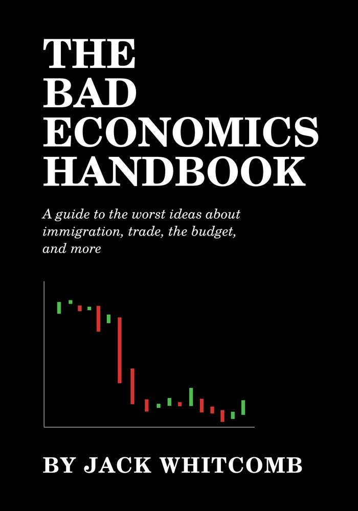

::: {.cover-hero}
{fig-alt="Cover of The Bad Economics Handbook by Jack Whitcomb"}

::: {.blurb}
From the tariff and immigration policies of Donald Trump to the misguided notions of major news organizations like the New York Times, the world has no shortage of bad economics. This book is your light in the darkness. Organized by subject, it provides explanations for 60 different takes on the economy, some better, and some far worse. If you want arguments and sources to beat back the stupidity of the world, or just want to learn more about economics, this book is for you.

[Start reading](introduction.qmd){.start-btn}

[[]{.snark-track}Snark mode](snark/){.snark-switch .no-external role="switch" aria-checked="false"}
:::
:::
