## Take 1: We need rent control to make housing affordable again. {#take-1}

[Rating: D-tier]{.rating .tier-d}

Rent control has made a seemingly permanent place for itself in the repertoire of politicians. Kamala Harris proposed capping "unfair" rent increases during her 2024 campaign,[^n41] and New York City Mayor Zohran Mamdani ran on a promised rent freeze,[^n42] which has only recently begun as of this writing. By making it illegal to charge excessively high rent, rent control lowers rent for renters. Most economists don't deny this. Unfortunately, many arguments in favor of rent control ignore the fact that "affordable" and "accessible" do not mean the same thing, which is why they tend to be misleading.

Typically, when the price of a good is low, it is easy to access it. The problem with making the price low by way of a price control, like rent control, is that accessibility becomes disconnected from the price. If the reward for providing housing is too low, there is no reason for a landlord or developer to provide that housing. That is the "law of supply" (which is obviously not a literal physical law if you show the bare minimum level of charitability to economists). When rent control eliminates much of the reward for providing access to an apartment, it damages the supply of apartments and makes them less accessible for some and more accessible for others.

People can be unfathomably dense about how this works. Here's how people like to respond to the news that landlords won't voluntarily take a loss if you set a price ceiling that makes it impossible to earn back the money spent on repairs:



Look man, I get that *it would be nice* if everyone was charitable with their own money and willfully took losses out of the goodness of their heart, but "it would be nice" has never worked as a solution to these problems in the history of humanity. Unless you have a plan to repeal the 13th Amendment and enslave all the landlords---this is your opportunity to make an edgy joke to show everyone how cool you because you hate landlords---they just won't voluntarily Be Nice™ and give away all their money.

Many arguments in favor of rent control rely on the implementation of subtly different versions of the policy, which are not as destructive, but only because they are not helpful, either. That is what we saw in the introduction, with a brief exploration of studies that claimed to show rent control works, which in fact only show that rent control causes no harm when it is modest enough to rarely affect the pricing choices of landlords.

All of this is fairly well understood and confirmed by evidence,[^n43] which is what we will turn to now. Here is another endnoted source[^n44] you can use to find evidence concerning the effects of rent control, and another one.[^n45] (This is me nudging you to throw links at people when you need to.) We can review highlights from each source now, because just saying "yippee, The Sources agree with me!" without reading the details is not a good way to think about the world.

A quote from Richard Arnott's review of the evidence:

> "New York City's rent controls have been in place continuously since 1942, and have undergone a byzantine set of policy changes. During most of that period controls were hard, but they have been liberalized in fits and starts over the past thirty years. The New York City experience has been extensively studied and widely discussed. Taken together, the studies generally support the predictions of the textbook model, though the effects have not been as dire as predicted."

It is also worth noting that Arnott discusses how some economists believe that it is possible, *in principle*, to design rent controls that are efficiency-enhancing (without making any claims as to whether any real rent controls have accomplished this). He also discusses various problems with estimating the effect of rent control on outcomes like construction rates---other variables, like macroeconomic conditions, might coincide with rent control changes and influence the observed outcome. Existing econometric evidence is thus lacking.

From Jenkins' review: "I find that the preponderance of the literature points toward the conclusion that rent control introduces inefficiencies in housing markets. Moreover, the literature on the whole does not sustain any plausible redemption in terms of redistribution." Jenkins also makes comments about the ambiguous effects of the rent controls that have been implemented, since they are often not as binding as textbook controls. Like many others, Jenkins notes the past tendency for rent-controlled units to be converted into uncontrolled condominiums. In Cambridge, Massachusetts, "10 percent of the city's rent-controlled housing stock was converted to condominiums and moved out from under the grasp of the \[rent control\] ordinance. As a result, the share of renter-occupied private units has shrunk from 75 percent in 1970, to 72 percent in 1975, to 66 percent in 1980." By this point, you can tell that the story of rent control has mostly been one where controls have been modest and easy to escape from, making the textbook prediction irrelevant, rather than falsified.

More on the case of New York City, from Jenkins:

> "\[I\]t is hard for the casual observer not to notice the difference in the supply of new construction for rental purposes in Chicago (which is very much a non-rent controlled city) and New York City (which has among the most Byzantine and volatile rent control rules...). Chicago's lakefront is dotted with apartment buildings built after World War II for rental purposes. New York's Upper East Side is filled with one-time rental buildings that were gradually turned into cooperatives and lacks new rental buildings despite the fact that technically these buildings would be free from rent control."

The third source I linked is a review[^n46] by Konstantin A. Kholodilin with many of the same conclusions. Below, you can see a recreation of his graph summarizing the findings of many studies of rent control. It is clear that these policies tend to reduce the tendency of renters to move, can raise homeownership by causing owners to convert to owner-occupied housing, tend to reduce the quality of housing by lowering the returns to investment, raise uncontrolled rents by causing demand to overflow into the uncontrolled segment, and misallocate housing by discouraging people from moving out (e.g., when their household size decreases and they don't need the extra space, while a larger family could use it).

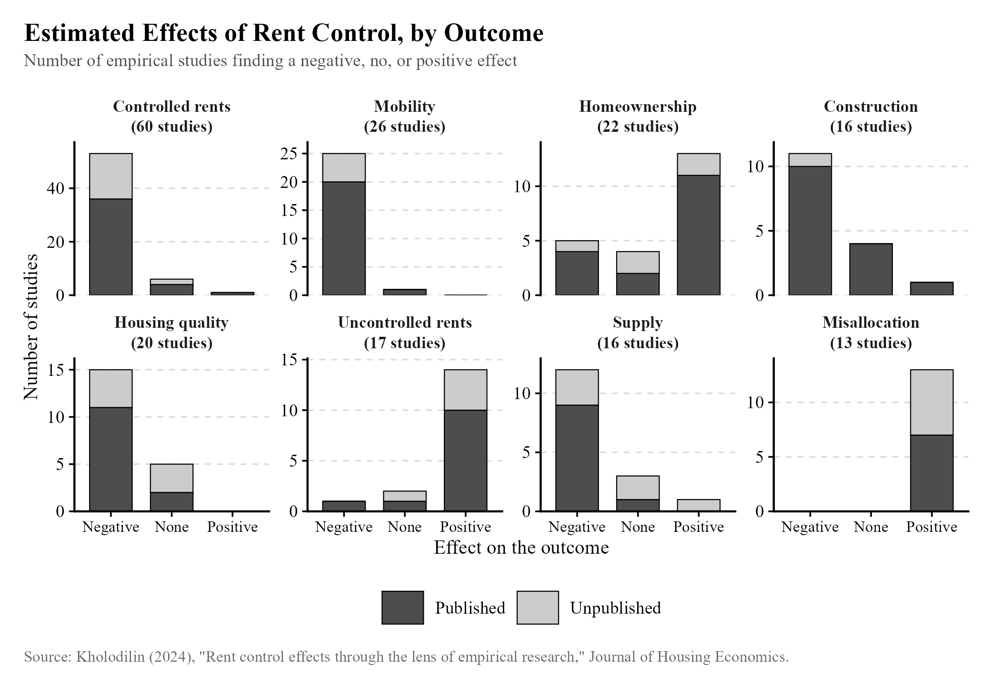{width="95%"}

The author elaborates on the construction and supply effects in this excerpt:

> "Approximately two-thirds of the studies indicate a negative impact \[on new residential construction and supply\], while several studies discover no statistically significant effect whatsoever. Two potential reasons underlie this variability. Firstly, variations in the design of rent control policies can matter. For example, newly constructed housing could be exempted from control, thus remaining unaffected by rent control regulations. Secondly, the choice of the dependent variable can also affect results of the analysis. Rent control can influence the construction of rental dwellings while leaving owner-occupied properties untouched; in fact, the quantity of owner-occupied dwellings might even increase, thereby compensating for any decline in the number of completed rental units. However, it is common to analyze the overall construction impact, often due to limitations in data availability. Furthermore, if private construction experiences a decline, governmental intervention becomes a possibility. This could involve the construction of public housing or financial support for private investors engaged in social housing development. Consequently, the total number of completed dwellings can remain steady or even rise, potentially leading to a misinterpretation of rent control\'s impact as beneficial."

It should be emphasized that some of the studies that are graphed look at the effect on the construction and supply of non-controlled units while others do not, but they are both graphed.

Why might rent control be beneficial in certain cases? To provide a somewhat silly but useful example to build intuition, imagine a policy targeting exactly one apartment complex owned by a businessman most people in the local area just really don't like. The one-time policy forces him to cut rents on existing units by 10%.

In this case, the policy is targeted only at existing units, allowing developers to profit from creating new ones. That is obviously a good way to improve on rent control, as many policies have. The problem with this type of policy, however, is that developers are not stupid. If a city imposes rent control on older units one year, that tells developers they are likely to do it again another year. That would damage their return on investment, so they are still discouraged from building more compared to the alternative case where no older units became rent controlled. Essentially, rent control damages the credibility of a city, not just the return on investment for existing units.

Our imagined policy, however, has been cleverly designed to target just one apartment complex owned by a businessman people hate. Developers might then rationally expect no further rent controls to be implemented, especially if they don't abuse their employees or damage their reputation in some other way. A clever city might implement a similar (but more realistic) policy where rents on existing units are controlled, and a credible commitment is made to keep free-market policies for future units by mandating that in a hard-to-change constitution. The United States could hypothetically do this with a constitutional amendment banning controls on new units---if such an amendment were created, repealing it would require 3/4ths of state legislatures to agree. (That same hurdle makes such an amendment impossible to pass.) It would be unlikely to boost housing supply, given the modest nature of existing controls, but might prevent harm from future policies.

A fellow at the London School of Economics, Cahal Moran, who writes under the pseudonym Unlearning Economics, wrote a piece for Current Affairs titled "Rent Control Is Fine, Actually,"[^n47] which falls fairly neatly in line with the kinds of claims about rent control I have discussed. The author fixates on evidence that rent control often does not reduce the total supply of housing. Indeed, as I described, if the owners of rental properties can convert them into more profitable forms, or owner-occupied forms, they will do it when rent control is implemented, and very often, rent controls do not apply to new properties. Detecting any effect of modest controls on the construction of new properties will be difficult. But clearly, rent controls do not tend to enhance the accessibility of housing for people who wish to move to a city. The author is only able to claim that "Rent control does not destroy cities" because practically every city believes in the textbook model and takes care to avoid implementing the most disastrous versions of the policy. This leads to a lot of silly claims about how rent control "works," where even the author of this piece is forced to admit some negative consequences of the more modest forms that actually get implemented.

Moran also lies about the contents of a paper[^n48] he referenced about rent control in San Francisco. The paper concludes that rent control reduced rental housing supplies by 15%. This conclusion follows from changes in the number of renters in a parcel of land, but he claims that "it's actually a combination of 8% being converted into owner-occupied buildings, and a further 7% being converted into rental units *which were exempt from rent control*." That is plainly false and not what the paper says. That 7% of renters did not remain in the newly converted units; they just left.

As an aside, the author claims that "One of the starkest predictions of \[the standard model of supply and demand\] is that price controls in any market will have negative consequences." This is not quite true. If supply is perfectly inelastic, a price ceiling merely redistributes resources from suppliers to consumers, without affecting the quantity produced. If demand is inelastic, a price floor (like the minimum wage) redistributes from consumers to suppliers. As it happens, neither of these conditions usually holds, so what the author is saying here is generally true. (I don't want to nitpick too hard.)

I think it is worthwhile to briefly examine a goal of rent control that is usually implicit. There are a variety of rich people that one might seek to target, but landlords are often singled out over, say, lawyers or doctors. I assume this is because of the sense that they are especially wealthy *and* have low working hours, profiting from doing next to nothing. I do not think the first characteristic (that they are especially wealthy) applies much of the time. In the case of St. Paul, according to Table VII of Ahern and Giacoletti's paper on rent control,[^n49] owners of rental properties typically make around \$80k to \$110k a year, compared to renters making from \$40k to \$90k a year. So the policy is one that attempts to redistribute from a portion of the upper middle class to everyone else, rather than taking from who we would typically think of as the rich. The referenced paper has the interesting conclusion that rent control exacerbated inequality, but that is just an aside; it simply isn't clear that landlords are the kind of rich pest that people might make them out to be.

As for the profitability of being a landlord and the hours they work managing their properties, working hours do appear modest: the median individually-owned property receives 5 to 9 hours of work from its owner,[^n50] based on data from the US Census Bureau. According to the same article, "While the average landlord collected \$40,226 in rent, gross profit from rental properties was \$6,522 in 2021." That suggests that about 16.2% of rent is left over as profit after paying expenses. If 7 hours a month is typical for a property, then using the \$2,000/month average monthly rent reported in the article, the landlord is receiving an "hourly wage" of about \$46. Confusingly, the same source reports a 36% figure for the share of rent that turns into profit, so a \$2,000/month property would yield a \$103 hourly wage.

Does such a high hourly wage explain the particular attention given to landlords? I don't think it does---\$103 an hour is still comparable to the compensation of lawyers, doctors, and other professionals. It seems more likely that the very frequent interactions people have with landlords, and the amount of money that they must pay them, explains the exceptional attention they receive.

Similar profits are reported by this source.[^n51] Lower hours per property are reported by this source,[^n52] while hours consistent with the previous source are reported by random landlords in this thread on Reddit,[^n53] though they vary a lot: some report 2 hours a month, while one reports managing lots of properties for 24 hours a month. (Boo-hoo, my sources suck. I couldn't find better ones. Just take this information with a grain of salt.)

Despite the possibility of implementing an efficient rent control that plausibly won't harm construction, I would be hesitant to implement any rent control policy at all. Prices are a signal. High prices tell you that a shortage is occurring, one that could be alleviated by provisioning more of the good. Controlling rents for existing units helps current tenants, but that does not help people who wish to move to a city and benefit from employment there, who cannot move there if there isn't enough physical space.

One might claim that no such shortage exists. That is our next take.

## Take 2: There is no housing shortage---the US has more than enough homes. {#take-2}

[Rating: D-tier]{.rating .tier-d}

This claim is usually accompanied by data like housing per capita, shown below.

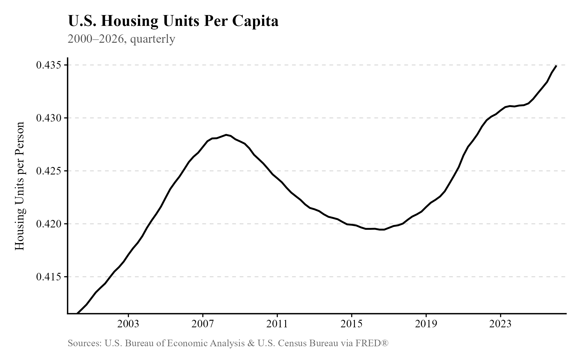{width="83%"}

Shared by Jon Brooks,[^n54] this data was accompanied with the caption "Everyone keeps saying America has a 'housing shortage.' It doesn't. Divide total homes by population and you get this: We've never had more housing per person than we do right now. The problem isn't supply. It's prices."

Yes, calling the current situation a "housing shortage" is imprecise. There's no shortage of housing in Gary, Indiana, where the average home value appears to have fallen below \$100k.[^n55] Homes like that, built in less-desirable locations with less-valuable job opportunities, are counted in statistics describing total housing units per capita. But nobody wants to move to Gary (sorry, Gary residents), so this is a silly way to measure the accessibility of housing. We want housing where the job opportunities are.

In general, when economists talk about a housing shortage in America, what they're talking about is the tendency for American cities to enforce regulations that prevent supply from meeting demand at the lower price that would prevail in a free(er) market. The most common and derided form of regulation is zoning. These regulations prevent developers from building denser forms of housing on the land they own, and with fewer units built, fewer people can live in a city, and if fewer people can live in a city, only the richest few will live there. They bid up the price of the scarce units, and you get a housing shortage.

This should be really, really obvious, but for some reason housing breaks people's brains and prevents them from intuiting the effects of engineering a shortage. It's like if we required every apple sold in America to be 5 inches in diameter and encrusted in a thin sheet of gold, and then people got mad when economists suggested, "hey, maybe requiring every apple to be ginormous and wrapped in gold is making them cost a lot more?" Don't you economists care about ensuring Americans have large, high-quality apples??? But there are people who seem to genuinely be under the impression that unless the government steps in to mandate infinite single-family homes, developers won't decide to build neighborhoods of single-family homes:





If you and a bunch of other people want to live in a neighborhood of single-family homes, developers will recognize that and sell you such a neighborhood if you're willing and able to pay for it. They can buy out the land and build the housing. That's how the markets for air travel, shoes, cars, and just about everything else work: businesses notice people are willing and able to pay for higher-quality versions of the thing and sell it voluntarily. An equivalent law for air travel would make it illegal to sell economy tickets on flights and erase the ability of poor people to go on vacation. Nobody would pass a law like that because it's obviously an idiotic idea.

It's easy to see this story playing out in San Francisco, which has long enforced zoning laws that require the construction of single-family homes over denser multi-family units. An illustration from Maps Mania[^n56] makes this very clear, showing how apartment buildings were illegal to build in 73.5% of San Francisco in 2019. The vast majority of land is likewise zoned single-family in Los Angeles.[^n97]

Does building more housing solve this problem? Yes. It has been tried. Austin, Texas, has outbuilt the rest of the US:[^n57]

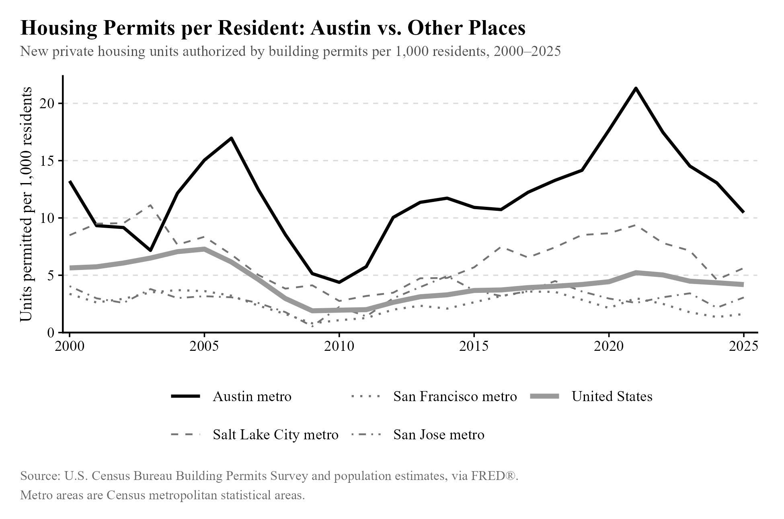{width="87%"}

And has reaped the rewards since 2023:[^n58]

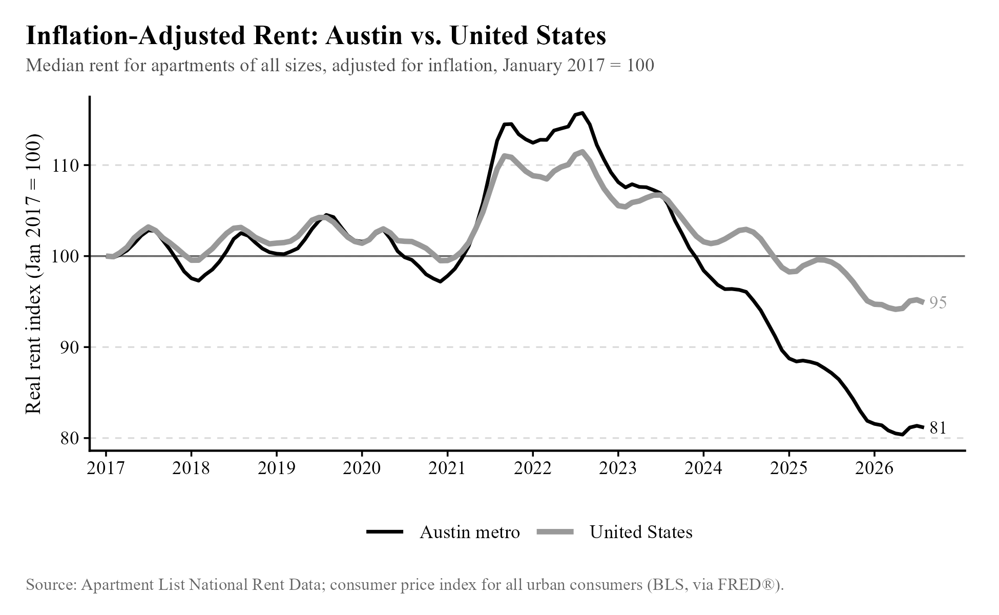{width="88%"}

The same thing has happened in Auckland, New Zealand:[^n59]

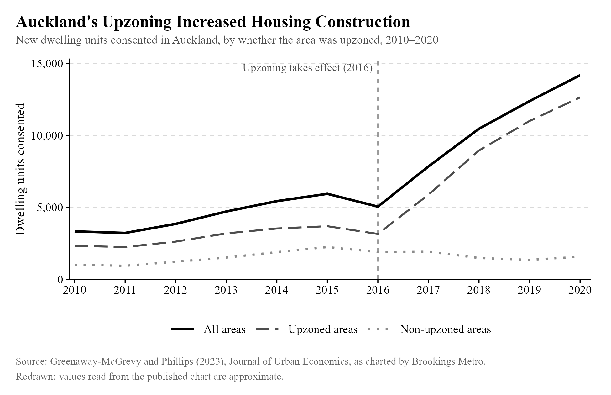{width="95%"}

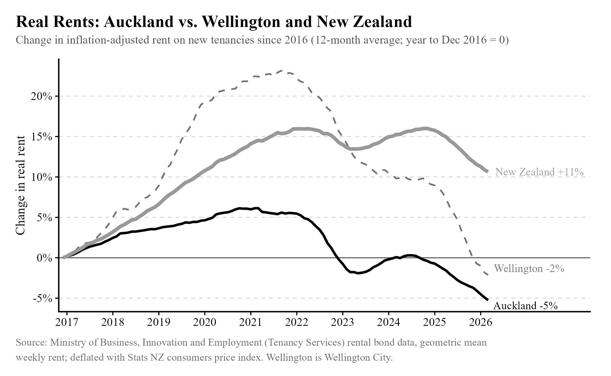{width="95%"}

Of course, cities like Austin and Auckland are the exceptions, and most cities seem hell-bent on pushing prices as high as possible. Most Americans seem to want changes to housing regulations that enable more construction,[^n98] but the American mind is an enigma, so I suspect this issue is gonna drag on for a while.

## Take 3: Building new, luxury housing displaces people. {#take-3}

[Rating: D-tier]{.rating .tier-d}

When a shortage occurs, and money is used to allocate the scarce good to people, the people with the most money will typically be among the first to acquire the scarce good. That applies to housing just as well as other goods. So when a shortage occurs, we shouldn't be surprised when luxurious units are built---they're the kinds of units wealthy people are willing and able to pay for. (If it were illegal for car companies to sell more than 1,000 cars each year, do you think they'd be more likely to be luxury vehicles or Honda Civics?) People then confuse what is caused by the shortage with the cause of the shortage itself. A shortage triggers "gentrification," and people judge that gentrification itself is what prices people out of the neighborhood.

In its weaker form, this take is just a confusion of correlation for causation, but it's also possible that new, luxury units change the character of a neighborhood in such a way that the neighborhood becomes more desirable, boosting demand and pricing out previous residents. It seems pretty straightforwardly implausible that this effect wouldn't usually be large enough to explain gentrification, but God hates economists, so he made everyone's intuitions as stupid as possible, and now we're gonna have to try to resolve this issue with applied micro.

To eliminate our confusion, what we'd like to see is some random variation in the presence of luxury units, unrelated to whether supply is constrained, and see if the introduction of those units affects rents. If one of two otherwise comparable neighborhoods has new luxury units built, does rent decline there compared to the other neighborhood, or rise? Researchers Brian J. Asquith, Evan Mast, and Davin Reed have a paper[^n60] that tries to answer this question. Here is the abstract:

> "We study the local effects of new market-rate housing in low-income areas using microdata on large apartment buildings, rents, and migration. New buildings decrease nearby rents by 5 to 7 percent relative to locations slightly farther away or developed later, and they increase in-migration from low-income areas. Results are driven by a large supply effect---we show that new buildings absorb many high-income households---that overwhelms any offsetting endogenous amenity effect. The latter may be small because most new buildings go into already-changing areas. Contrary to common concerns, new buildings slow local rent increases rather than initiate or accelerate them."

Here is a review of six working papers.[^n61] The relevant excerpt: "Five find that market-rate housing makes nearby housing more affordable across the income distribution of rental units, and one finds mixed results." Thus, the Asquith, Mast, and Reed result does not appear to be a fluke.

As Bob Hall once said, "Your evidence is strong, but my prior is stronger," so this is definitely not gonna change many hearts and minds. But if you want to be part of the cool kids club of sweaty econ nerds like me, you should avoid complaining about gentrification and complain about zoning laws instead.

## Take 4: Institutional investors, Airbnb, illegal immigrants, and foreign buyers make housing expensive. {#take-4}

Ratings: F, C, F, and A, respectively, for the listed buyers above.

These related claims are well-known thanks to officials like Vice President J.D. Vance arguing that high prices are driven by undocumented immigration,[^n62] and thanks to Senators Merkley,[^n63] Warren,[^n64] and others[^n65] arguing institutional investors are responsible for housing shortages. They are very wrong.

Obviously, given a limited amount of housing, if you remove much of the demand for said housing, it will be more accessible to the people who remain. The problem with targeting these groups is twofold. First, in the cases of undocumented immigrants and institutional investors, deporting them or banning them from buying housing also influences housing supply, not just demand. Undocumented immigrants are more[^n66] likely[^n67] than Americans to work in construction, and institutional investors buy housing to rent it out and buy land to build on it. Second, restricting demand from certain types of people does not eliminate the government-enforced supply constraints, discussed in the preceding takes, that any growing population will inevitably run into.

While the number of undocumented immigrants in the United States changes over time and is difficult to estimate, let's work with the Pew Research Center's 2023 estimate of 14 million.[^n68] The United States had a total population of about 334 million in 2023. Thus, if one were able to remove every undocumented immigrant in 2023, the population would fall by about 4.2%.

While it is obvious that such an event would leave approximately 4.2% of housing units vacant (perhaps fewer, if these immigrants tend to occupy units designed for fewer people), it is not obvious what the magnitude of the effect on market rents would be. What is the elasticity of housing supply? In areas where housing supply is more elastic, falling demand would not matter as much for the prevailing price. In areas where housing supply is more inelastic, it would matter a lot. The location of undocumented immigrants matters, too. States like Maine and Wyoming, which appear to have relatively few undocumented immigrants per capita,[^n69] would feel little relief from further deportations. Supply-constrained cities---ironically, those with the most Democratic voters---would probably feel the most relief.

In practice, deportations do not appear to have the effects that one would suspect them to have. The Secure Communities program of the 2000s, which enhanced the ability of law enforcement to deport undocumented immigrants, was rolled out at different times in different locations fairly randomly. That allows us to compare areas which implemented the policy early to those that did not in order to identify the effects of deportations. Researchers found[^n70] that deportations generally *increase* housing prices. That shouldn't be unexpected: undocumented immigrants are more likely to work in construction. Thus, areas where undocumented immigrants are especially concentrated might see lower prices, but other places will simply see rising construction costs and, as a consequence, higher prices for everyone. For adequate housing supply to be maintained, new units must be built for new entrants (even internal, American migrants), and old units must be repaired and replaced.

What about institutional investors and foreign buyers? They own only 3% of all single-family units in the United States,[^n71] though according to Econofact, "in the 20 Metropolitan Statistical Areas where these investors are most present, they own 12.4 percent." Foreign buyers, similarly, make up a tiny fraction of existing home sales, about 1.9%.[^n72] We would thus expect banning these buyers to provide only small, temporary relief, if any.

In the case of institutional investors, the firms purchasing these homes are not purchasing them to hold them vacant, contrary to popular belief. If a single firm were capable of buying out all of the housing, monopolizing the market, they would certainly restrain supply somewhat to maximize profits, but no such monopoly exists. The largest apartment owner is Greystar, which owns just \~0.52%[^n73] of all apartment units[^n74] in the US.

One way to measure the concentration of a market is via the Herfindahl-Hirschman Index (HHI). Take each company's share of the market as a percentage, square it, and take the sum of these squared shares. To avoid confusion over math, I'll provide simple examples: if two owners control half the market each, the HHI is 5,000; if ten owners each have 10%, it is 1,000. Here is a relevant excerpt from Richard Hanania:[^n75]

> "The Herfindahl-Hirschman Index \[\...\] is used by the Department of Justice in reviewing mergers. The details need not concern us here, but note that the DOJ considers a score[^n76] of 1,000 to be moderately concentrated, with a number above 1,800 indicating high concentration. Relying on *Builder Magazine's* top 200 builders of 2024[^n77] in terms of total closings, we get a score of 658[^n78] for the housing industry. \[\...\] Regardless of which measure we use, the housing market is highly competitive. And even the 658 number exaggerates the issue, since it only takes the top 200 builders[^n79] as the entire market."

If we look at a map of vacancy rates in the US,[^n80] shown below, we can see that the vacancy rate tends to be high in low-demand areas (where vacant units are hard to sell), and low in high-demand areas (where vacant units quickly sell).

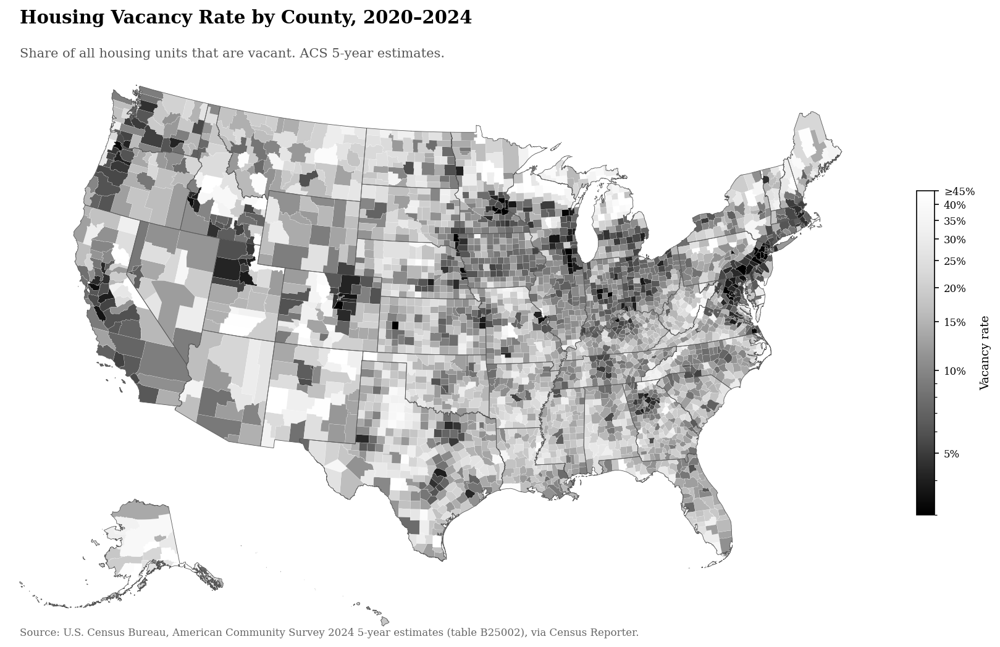{width="95%"}

Notice that the map is very dark in desirable urban areas like San Francisco and New York City, and brighter in open, rural areas with few urban centers. So there are plentiful vacant units, but they mostly aren't in the places people want to live. This pattern is consistent with vacancy rates being determined by competition for desirable units, not institutional investors holding units vacant in desirable locations to drive up prices. This is probably the map you want to bring up if you ever run into the "there are more vacant homes than homeless people!" crowd.

{width="90%" fig-alt="Pictured: the online left's plan for homelessness in America"}

(Pictured: the terminally online plan for homelessness in America.)

Aside from the fact that it would be morally questionable to deport homeless people to the most undesirable locations in America, it would also violate the Takings Clause to expropriate unused housing units, so in practice, this policy would just look like a big subsidy for decrepit housing and transportation services. I think you should just build housing where the homeless people are.

Returning to the institutional investors question: Memphis, Tennessee appears to be the city with the highest percentage of units owned by institutional investors at 19.2%.[^n81] That is far from a monopoly, or even a cartel, given that this count includes multiple institutional investors, not just one. It is more likely that institutional investors are simply managers of housing units, not consumers of housing units or scheming cartels.

Here is a relevant passage from a Brookings article on the subject:[^n82]

> "Barbieri and Dobbels' (2026)[^n83] study of the Atlanta metropolitan area finds some very high institutional shares (e.g., 50%+) of actively listed rental homes, typically in zip codes in counties on the periphery of that very large metropolitan area. \[\...\] There is evidence that more geographically concentrated institutional investors are able to raise rents above what a purely competitive market would generate. Those instances should be addressed by antitrust authorities, not by a ban on purchases by large investors. That a ban is not the appropriate policy response is indicated by two other findings of these researchers. First, the effect on rent is not particularly large on average. Second, it is small enough to be counterbalanced by other changes in the housing market induced by the entry of large institutional SFR investors."

A 2022 buy-to-let ban in the Netherlands allowed researchers to check what the real effects of an institutional investor ban are. They found no effect on prices,[^n84] but the policy did change the composition of neighborhoods, replacing institutional owners with new homeowners. These new homeowners had higher incomes than the renters they replaced. The study[^n85] mentioned in the Brookings excerpt actually found that, despite the heightened concentration they bring, institutional investors lower prices by building housing.

Of all the sources of demand discussed here, foreign buyers appear to be the most plausible case where a ban or tax could put downward pressure on prices for citizens. They do not appear to be particularly involved in home construction; they are *only* consumers of housing, which self-interested domestic buyers might be interested in excluding. This paper[^n86] examines the effect of a foreign buyer tax by comparing neighborhoods with high and low concentrations of such buyers, and finds that "house prices decline by 6% in neighborhoods with above median concentrations of foreign buyers after the tax relative to prices in neighborhoods with below median concentrations of foreign buyers." Here is another paper[^n87] that also found these taxes to be effective. I think this policy is morally wrong, but many would think it's desirable.

Many have attempted to identify the effect of Airbnb on housing prices, and the results have varied. This paper[^n88] finds an increase in rents of 1.9% after the introduction of Airbnb in Barcelona, but it does not appear to fully control for unit quality (e.g., an Airbnb owner might keep their unit especially clean compared to before the introduction of Airbnb, since they wish to please tenants). Much more interesting is this paper,[^n89] which uses the 2017 solar eclipse as a natural experiment. Wherever the solar eclipse occurred, Airbnb demand rose, providing the researchers with pseudo-random variation in Airbnb-originating housing demand. They found a small effect: "a 1% increase in Airbnb listings increases housing prices by 0.037-0.043%." There are also papers looking at the effect of banning Airbnb. This one[^n90] found that "a legislative ban on short-term rentals reduces contract rental prices in the long-term rental market by 2.7% while the number of long-term rental units increases." I suspect that in general, Airbnb has a small effect on housing prices, and banning it likewise has a small effect.

## Take 5: You can't expand supply and cut prices at the same time because investors need a positive return. {#take-5}

[Rating: D-tier]{.rating .tier-d}

Regulations like zoning make it difficult to build more units. This can be conceptualized (somewhat unrealistically) as a literal cap on the number of units that can be built, or as higher costs. But in either case, all that we need for the supply story to work is for there to exist units that, holding demand constant, are not worthwhile or practically impossible to build because of the regulatory environment. The goal of zoning reform is to make these units profitable to build by either legalizing their construction or cutting the cost of building them. In either case, all that need happen is for the price that the highest bidder is willing to pay to exceed the cost of construction, and for that construction to be legal. There is no contradiction in expanding supply and cutting prices with this logic in mind: when new units enter the market, the new buyers tend to be willing to pay less than existing residents. (Otherwise, they already would have moved in.) As Margaret Thatcher might say, "The trouble with gentrification is that you eventually run out of rich people to gentrify with." At some point, selling more units is only possible if you cut prices.

That is the essential story. It is best captured by simply showing people a supply and demand graph. We could depict the supply curve shift in many different ways, but the outcome would be the same as it is in the graph below:

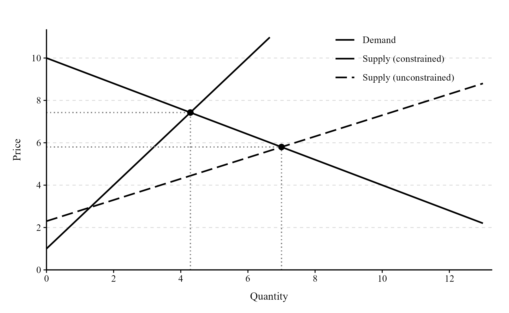{width="94%"}

At this point in the book, this idea might feel obvious to you, but writer Mike Fellman has previously argued against this story for various reasons that I think are silly. I will focus on this endnoted article.[^n91] Excerpt 1: "This makes the YIMBY 'quantity story' an inherent self contradiction. Prices must be high to induce the production YIMBYs say will lower prices."

If you assume the supply curve stays put, the preceding statement is true. But the goal of the "YIMBY" (or "Yes In My Backyard") movement is to allow the housing supply curve to shift forward by releasing constraints. That's what the graph above loosely describes. You would only need higher prices to induce more production if the supply curve is fixed. If it shifts forward, additional units become profitable at lower prices.

Austin does seem to present a case where YIMBY policies work. In response to it, Fellman writes:[^n92] "Rents are much higher in Austin than before the pandemic. Yes, new supply pushed down prices somewhat. The multifamily bubble happened because demand was insane, rents skyrocketed, and interest rates were at zero. It won\'t scale or repeat. It wasn't the zoning."

Focusing on his claim that rents are higher than before in Austin, I think it's important to clarify what it is that YIMBYs are trying to accomplish. It may not be possible---partly due to the growth in the money supply and consequent growth in what people can pay---to drive down prices compared to the past, but the relevant comparison is what would have happened without deregulation. It is useful, at times, to look at data that is as simple as housing prices over time, but the fact that housing prices are higher than they were before the pandemic simply isn't the most relevant comparison. The counterfactual where less construction occurred due to stronger supply constraints is the relevant comparison, and that would obviously be one where rents were higher. "Austin is just the building cycle" doesn't explain why this sort of thing keeps happening specifically in cities like Austin and Auckland.

Fellman seems to admit that releasing supply constraints *can* reduce rents, but he thinks that this can't be done multiple times. As for the case of Auckland, he seems to offer no response.[^n93] For all the success of the YIMBY movement, advocates of this take---that expanding supply cannot reduce rents---seem to have little to offer on evidence or reasoning for their view beyond "it seems like this shouldn't be possible."

A useful response to the Fellman argument comes from John Ruf.[^n94] He summarizes the points Fellman made as follows:

"YIMBY deregulation cannot shift the supply curve much because of

1.  Technological issues (it's difficult to implement automation and other innovations to construction)
2.  You can't outsource it to cheaper labor

"I think Mike is somewhat right on these counts, which is why I didn't really bother responding to it in the initial posts.

"Objectively, per Syverson, housing prices do not track construction costs \[Ruf used the wrong link here; he was referencing this endnoted paper[^n95]\],

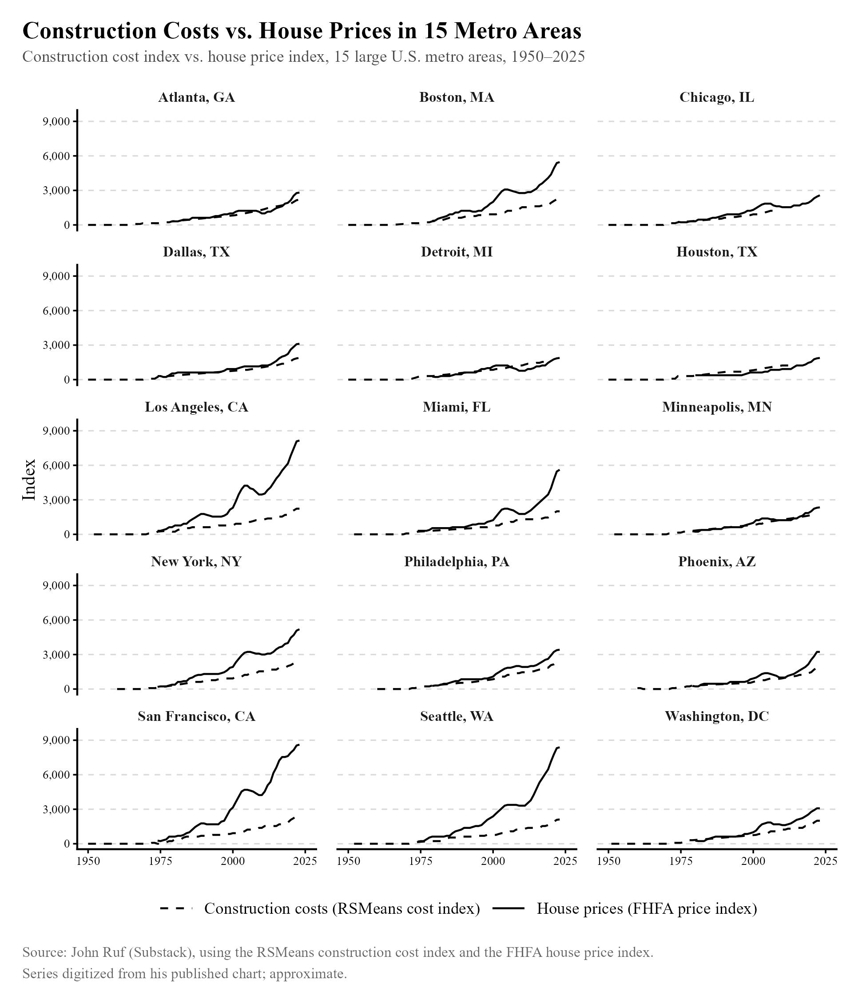{width="95%"}

"And objectively, per Glaeser, the empirical supply curves for housing are incredibly flat for big cities."[^n96]

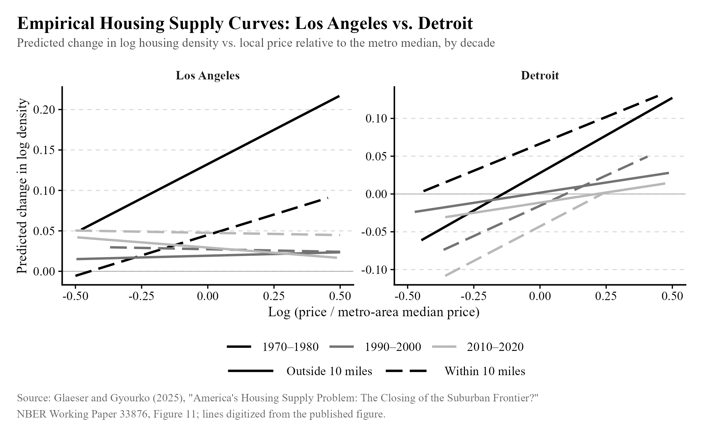{width="95%"}

Before returning to Ruf's piece, I should point out that quantities and prices are swapped from their usual positions above, so these graphs do indeed depict inelastic supply curves. Newer estimates (colored lighter in the graph) tend to be flatter, showing how housing supply has become even more unresponsive to demand in recent decades.

> Ruf wrote:\
>
> "Because the supply curve is flat, you can't really shift it outward. But *why* is the supply curve flat in the first place?\
>
> I think Mike is right that we're not going to see sustained rent reductions from solely reducing the 'paper' cost of housing. \[\...\] one good way of seeing zoning is that it's a government mandated requirement to buy X square feet of land to produce 1 unit of housing. ***This doesn't \*only\* raise costs, but it's also effectively a quantity ceiling.***"

Ruf then provides a helpful graph, recreated below.

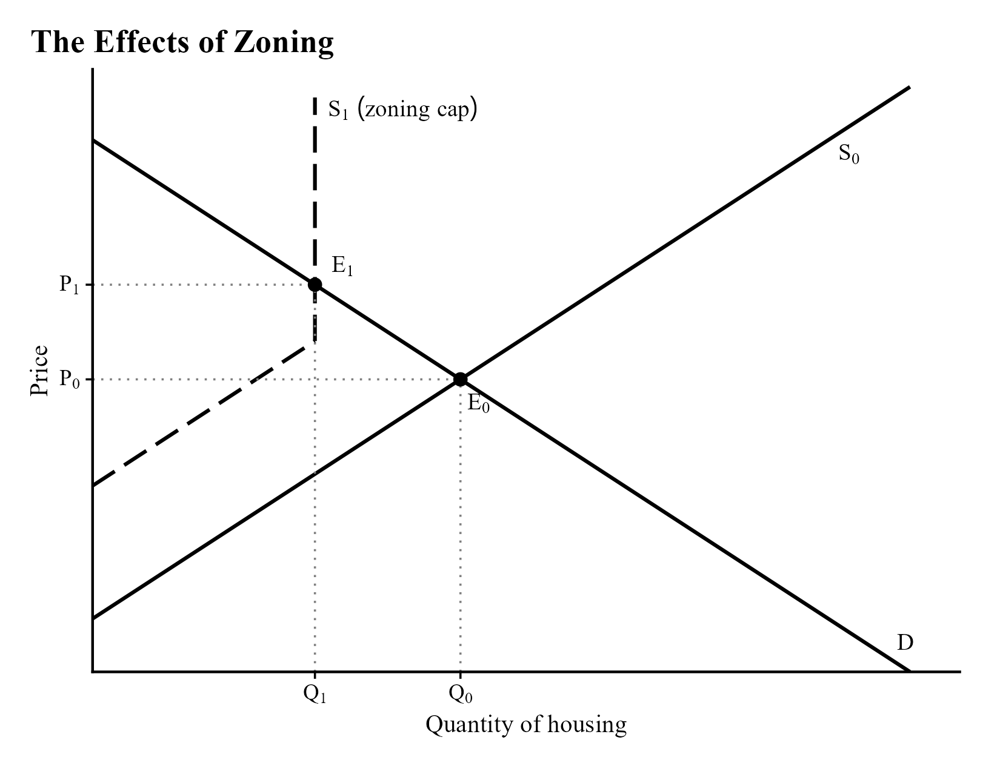{width="86%"}

The dashed line is the one you should pay attention to. For a certain range of quantities in a zoned city, supply can respond to increases in demand, but you eventually run into a limit. If builders are required to build low-density units, then there is a maximum amount of units they can build in the finite amount of land available, since they can't build upward. Thus, in some cases, eliminating restrictions will only provide temporary relief in a city (where supply can still respond to demand), but in the long term, the city will be better equipped to handle increases in demand because the quantity limit is also gone.

There are many cities in the United States that have basically made population growth illegal, and these restrictions explain much of the affordability issues in those places. Many confused and incorrect arguments have been made in favor of rent control and against deregulation, and I think I've done a fair job of dispatching them for now and providing you with what you need to know to do the same. If you run into trouble, just remember: it's not physically possible for people who wish to move to San Francisco to do so if it's not legal to build housing dense enough for them to live there. Whether that is reflected in prices or not has little relevance to the central problem of accessibility.

If you really want to defend exclusionary zoning, just explain why making it illegal for people to move to desirable parts of the country in the long run is a good idea, and why you should be able to do this through the law instead of just putting your big boy pants on and paying developers extra money to hold up land for you. They will happily plant single-family homes where you want them in LA if you're willing to pay insane sums, but I suspect the people who want to live in apartments are willing to pay more than you on a per-acre basis. For the racists out there (because yes, I've heard people make this argument), if you badly want to live in a neighborhood that's too expensive for black people, I'm sure developers will do that for you if you're actually willing to pay the equilibrium price for it. Racists don't have a reputation for being much more than bitter keyboard warriors, so I don't expect that to happen.

[^n41]: [vox.com/housing/365063/kamala-harris-housing-rent-control-landlords](https://www.vox.com/housing/365063/kamala-harris-housing-rent-control-landlords)
[^n42]: [zohranfornyc.com/platform](https://www.zohranfornyc.com/platform)
[^n43]: [fmwww.bc.edu/EC-P/wp391.pdf](http://fmwww.bc.edu/EC-P/wp391.pdf)
[^n44]: [econjwatch.org/file\_download/238/2009-01-jenkins-reach\_concl.pdf?mi...](https://econjwatch.org/file_download/238/2009-01-jenkins-reach_concl.pdf?mimetype=pdf)
[^n45]: [iea.org.uk/publications/rent-control-does-it-work/](https://iea.org.uk/publications/rent-control-does-it-work/)
[^n46]: Based on the chart in this study: [sciencedirect.com/science/article/pii/S1051137724000020](https://www.sciencedirect.com/science/article/pii/S1051137724000020)
[^n47]: [currentaffairs.org/news/rent-control-is-fine-actually](https://www.currentaffairs.org/news/rent-control-is-fine-actually)
[^n48]: [aeaweb.org/articles?id=10.1257/aer.20181289](https://www.aeaweb.org/articles?id=10.1257/aer.20181289)
[^n49]: [eccles-wpmedia.s3.us-west-2.amazonaws.com/ivory-boyer-real-estate-c...](https://eccles-wpmedia.s3.us-west-2.amazonaws.com/ivory-boyer-real-estate-center/wp-content/uploads/2022/08/Giacoletti-Ahern-RentControl.Main_.20220519.pdf)
[^n50]: [ipropertymanagement.com/research/landlord-statistics](https://ipropertymanagement.com/research/landlord-statistics)
[^n51]: [onrentme.com/articles/landlord-property-management-statistics](https://www.onrentme.com/articles/landlord-property-management-statistics)
[^n52]: [hemlane.com/resources/cost-time-property-management/](https://www.hemlane.com/resources/cost-time-property-management/)
[^n53]: [reddit.com/r/realestateinvesting/comments/1npp68s/landlords\_who\_sel...](https://www.reddit.com/r/realestateinvesting/comments/1npp68s/landlords_who_self_manage_how_much_time_do_you/)
[^n54]: [x.com/jonbrooks/status/2017070272546054510/photo/1](https://x.com/jonbrooks/status/2017070272546054510/photo/1)
[^n55]: [zillow.com/home-values/45401/gary-in/](https://www.zillow.com/home-values/45401/gary-in/)
[^n56]: [googlemapsmania.blogspot.com/2019/01/solving-san-franciscos-housing...](https://googlemapsmania.blogspot.com/2019/01/solving-san-franciscos-housing-crisis.html)
[^n97]: [belonging.berkeley.edu/single-family-zoning-greater-los-angeles](https://belonging.berkeley.edu/single-family-zoning-greater-los-angeles)
[^n57]: Chart based on: [morehousing.substack.com/p/austin](https://morehousing.substack.com/p/austin)
[^n58]: Chart based on: [vox.com/future-perfect/485295/austin-national-rents-declining-yimby](https://www.vox.com/future-perfect/485295/austin-national-rents-declining-yimby)
[^n59]: [morehousing.substack.com/p/auckland](https://morehousing.substack.com/p/auckland)
[^n98]: [cato.org/blog/poll-59-americans-favor-building-more-housing-their-n...](https://www.cato.org/blog/poll-59-americans-favor-building-more-housing-their-neighborhood)
[^n60]: [research.upjohn.org/up\_workingpapers/316/](https://research.upjohn.org/up_workingpapers/316/)
[^n61]: [lewis.ucla.edu/research/market-rate-development-impacts/](https://lewis.ucla.edu/research/market-rate-development-impacts/)
[^n62]: [factcheck.org/2025/12/vances-misleading-claims-on-housing-prices-an...](https://www.factcheck.org/2025/12/vances-misleading-claims-on-housing-prices-and-illegal-immigration/)
[^n63]: [merkley.senate.gov/merkley-applauds-senate-passage-of-housing-provi...](https://www.merkley.senate.gov/merkley-applauds-senate-passage-of-housing-provisions-to-crack-down-on-hedge-fund-control-of-american-homes/)
[^n64]: [warren.senate.gov/oversight/letters/as-wall-street-buys-up-single-f...](https://www.warren.senate.gov/oversight/letters/as-wall-street-buys-up-single-family-homes-in-bulk-and-worsens-housing-crisis-warren-and-reed-call-on-hud-to-preserve-affordable-homeownership-for-families)
[^n65]: [x.com/grahamformaine/status/2047720195465097590?s=20](https://x.com/grahamformaine/status/2047720195465097590?s=20)
[^n66]: [americanprogress.org/wp-content/uploads/sites/2/2021/02/EW-Construc...](https://www.americanprogress.org/wp-content/uploads/sites/2/2021/02/EW-Construction-factsheet.pdf)
[^n67]: [limos.engin.umich.edu/deitabase/2024/05/28/undocumented-constructio...](https://limos.engin.umich.edu/deitabase/2024/05/28/undocumented-construction-workers-us/)
[^n68]: [pewresearch.org/race-and-ethnicity/2025/08/21/u-s-unauthorized-immi...](https://www.pewresearch.org/race-and-ethnicity/2025/08/21/u-s-unauthorized-immigrant-population-reached-a-record-14-million-in-2023/)
[^n69]: [axios.com/2025/08/21/california-texas-states-unauthorized-immigrant...](https://www.axios.com/2025/08/21/california-texas-states-unauthorized-immigrant-pew)
[^n70]: [papers.ssrn.com/sol3/papers.cfm?abstract\_id=4729511](https://papers.ssrn.com/sol3/papers.cfm?abstract_id=4729511)
[^n71]: [econofact.org/factbrief/do-private-equity-firms-own-20-of-single-fa...](https://econofact.org/factbrief/do-private-equity-firms-own-20-of-single-family-homes)
[^n72]: [realtor.com/news/trends/popular-states-for-foreign-homebuyers-in-un...](https://www.realtor.com/news/trends/popular-states-for-foreign-homebuyers-in-united-states/)
[^n73]: [nmhc.org/research-insight/the-nmhc-50/top-50-lists/2026-top-owners/](https://www.nmhc.org/research-insight/the-nmhc-50/top-50-lists/2026-top-owners/)
[^n74]: [nmhc.org/research-insight/quick-facts-figures/quick-facts-apartment...](https://www.nmhc.org/research-insight/quick-facts-figures/quick-facts-apartment-stock/)
[^n75]: [richardhanania.com/p/anti-abundance-types-are-wrong-about](https://www.richardhanania.com/p/anti-abundance-types-are-wrong-about)
[^n76]: [justice.gov/atr/herfindahl-hirschman-index](https://www.justice.gov/atr/herfindahl-hirschman-index)
[^n77]: [builderonline.com/builder-100/builder-100-list/2024?next=true](https://www.builderonline.com/builder-100/builder-100-list/2024?next=true)
[^n78]: [chatgpt.com/share/683dae4d-9b94-8009-86ce-502f7bd2da94](https://chatgpt.com/share/683dae4d-9b94-8009-86ce-502f7bd2da94)
[^n79]: [chatgpt.com/share/683dbeec-80f4-8009-8560-5b5c8545d82b](https://chatgpt.com/share/683dbeec-80f4-8009-8560-5b5c8545d82b)
[^n80]: Map based on an older map by Trulia: [trulia.com/research/where-vacancies-are-high/](https://www.trulia.com/research/where-vacancies-are-high/)
[^n81]: [businessinsider.com/us-cities-with-most-institutional-investors-202...](https://www.businessinsider.com/us-cities-with-most-institutional-investors-2026-3#1-memphis-tn-ms-ar-10)
[^n82]: [brookings.edu/articles/the-ripple-effects-of-banning-institutional-...](https://www.brookings.edu/articles/the-ripple-effects-of-banning-institutional-purchases-of-single-family-rentals/)
[^n83]: [felipebarbieri.com/files/Barbieri\_Felipe\_JMP.pdf](https://felipebarbieri.com/files/Barbieri_Felipe_JMP.pdf)
[^n84]: [papers.ssrn.com/sol3/papers.cfm?abstract\_id=4480261](https://papers.ssrn.com/sol3/papers.cfm?abstract_id=4480261)
[^n85]: [felipebarbieri.com/files/Barbieri\_Felipe\_JMP.pdf](https://felipebarbieri.com/files/Barbieri_Felipe_JMP.pdf)
[^n86]: [ideas.repec.org/a/bla/reesec/v52y2024i3p928-950.html#:~:text=We use...](https://ideas.repec.org/a/bla/reesec/v52y2024i3p928-950.html#:~:text=We%20use%20the%20foreign%20buyer,effect%20on%20local%20house%20prices.)
[^n87]: [aeaweb.org/conference/2023/program/paper/kBBk4zQd](https://www.aeaweb.org/conference/2023/program/paper/kBBk4zQd)
[^n88]: [sciencedirect.com/science/article/pii/S0094119020300498](https://www.sciencedirect.com/science/article/pii/S0094119020300498)
[^n89]: [papers.ssrn.com/sol3/papers.cfm?abstract\_id=5369946](https://papers.ssrn.com/sol3/papers.cfm?abstract_id=5369946)
[^n90]: [apps.it.purdue.edu/sites/Home/DirectoryApi/Files/3b19fe91-8ec2-46ff...](https://apps.it.purdue.edu/sites/Home/DirectoryApi/Files/3b19fe91-8ec2-46ff-90a5-66255b61d390/Download?_ga=2.238418120.951964904.1675199431-1570152881.1675197478)
[^n91]: [precon.substack.com/p/what-supply-and-demand-actually-means?r=hb9yq...](https://precon.substack.com/p/what-supply-and-demand-actually-means?r=hb9yq&utm_medium=ios&triedRedirect=true)
[^n92]: [x.com/MikeFellman/status/1903179323714003336](https://x.com/MikeFellman/status/1903179323714003336)
[^n93]: [x.com/AmosAhola/status/1980082674216914976?s=20](https://x.com/AmosAhola/status/1980082674216914976?s=20)
[^n94]: [johnruf.substack.com/p/more-on-paper-homes-and-supply-and](https://johnruf.substack.com/p/more-on-paper-homes-and-supply-and)
[^n95]: [aeaweb.org/articles?id=10.1257/jep.20241432](https://www.aeaweb.org/articles?id=10.1257/jep.20241432)
[^n96]: Graph based on: [nber.org/system/files/working\_papers/w33876/w33876.pdf](https://www.nber.org/system/files/working_papers/w33876/w33876.pdf)
