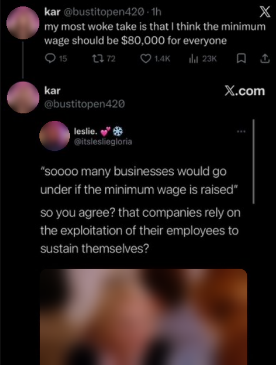
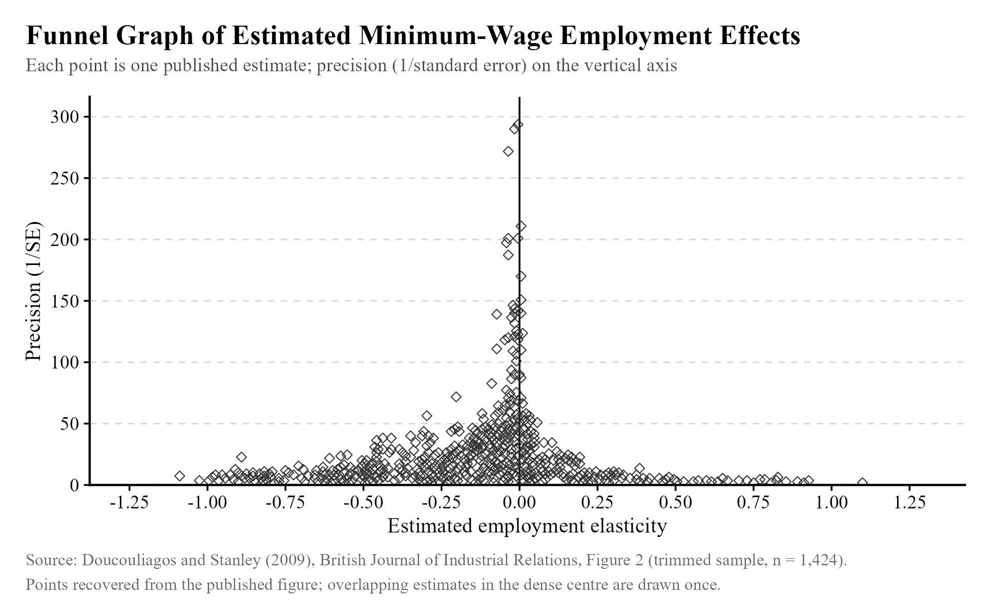
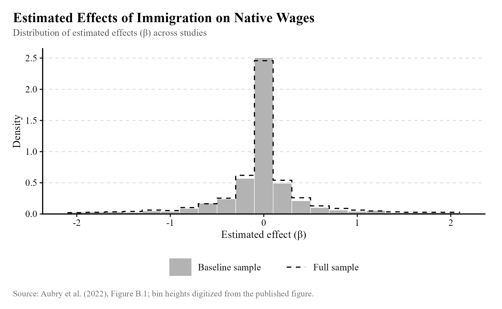
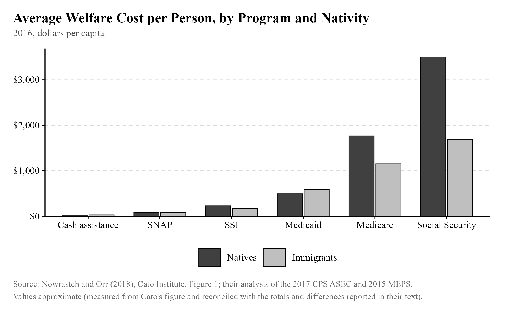
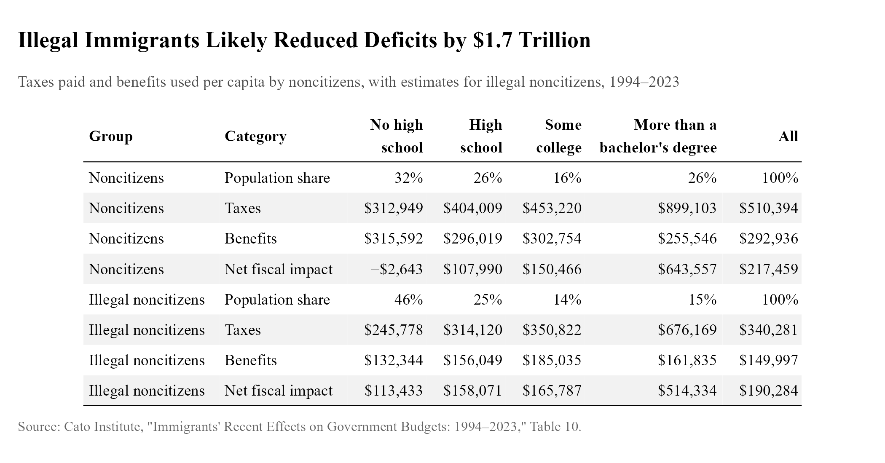
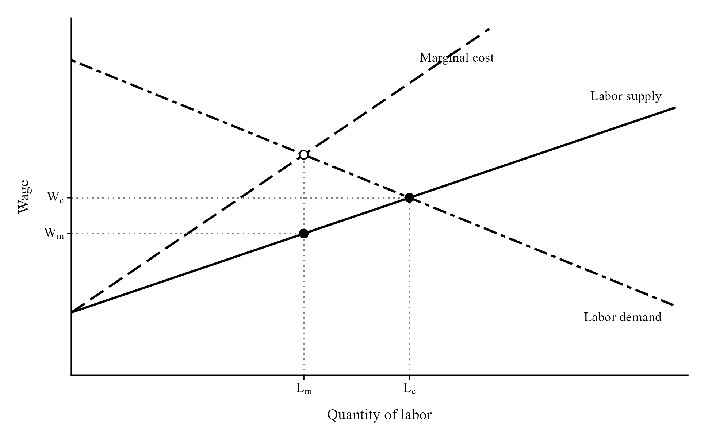

## Take 1: We need a much higher minimum wage! {#take-1}

[Rating: B-tier]{.rating .tier-b}

There are plenty of reasonable minimum wage advocates out there, but I think this image is a pretty good encapsulation of how the typical person seems to think labor markets work:

{width="54%"}

Let's just grant for a moment that every business is a little Reichstag with a micro-Hitler inside it.[^n131] They *still* have to decide whether or not to hire or fire you! We could bicker about the minimum wage literature (we'll get there in a moment), but that really doesn't save your case if you believe in an insanely high minimum wage. We should start every conversation like this by first acknowledging that, yes, obviously there's a limit to how high you can push the legal floor without causing an unemployment rate not seen since the Great Depression. That a bunch of people being paid \$17/hour to work at McDonald's would continue to be hired at \$80k a year strains credibility. (Sorry?)

To provide a more serious example, Zohran Mamdani has advocated for raising the minimum wage to \$30/hour in New York City by 2030. I sincerely hope that if this proposal is passed, firms are able to absorb such a hike without large layoffs---they've been surprisingly resilient in the past, as we'll see---but I doubt it.

## Take 2: We need to eliminate the minimum wage! {#take-2}

[Rating: B-tier]{.rating .tier-b}

Despite the concerns I've expressed, the minimum wage can be a decent policy tool. The graph below needs to be handled with care, so I'll be careful to interpret it for you and provide context.

{width="92%"}

A huge amount of work has been done on the minimum wage. The estimated effect on employment can be standardized by describing it as an elasticity: the percentage change in employment per percentage change in the minimum wage. That is the horizontal axis above. As you can see, effects appear to cluster just below zero, indicating a small but negative effect. That is how labor economists typically characterize the empirical literature, but this particular chart comes from a study[^n97] finding a bias in minimum wage research toward negative results. Their attempt at adjusting the average effect size resulted in a very tiny, slightly positive effect on employment, not meaningfully discernible from zero, as before. The vertical axis is the inverse standard error, a measure of statistical precision. More precise estimates tended to be closer to zero.

We would love to infer from this that the causal effect of the minimum wage on employment is near zero, but life is not so simple. Clearly, we should expect this effect to vary depending on the size of the minimum wage increase, as well as the characteristics of the labor market it is imposed on. New York City, for example, being an especially productive place, *might* be capable of absorbing an unusually large hike without too many problems, but I really mean *might.* Another relevant characteristic is the degree of monopsony power in an area. If there are few firms in an area that hire people, they may exert some degree of monopsony power, holding hiring and wages artificially low. Under these conditions, the effect of the minimum wage on employment can err on the positive side of the plot.

I could list endless caveats[^n98] of the empirical evidence on the minimum wage. The exercise of standardizing and plotting all available estimates isn't that effective, because the effect on employment could be nonlinear: no relationship for small hikes, a strong relationship for large ones. The hikes analyzed in the included papers are going to vary. A lot of a firm's adjustment could occur through different channels from employment:[^n99] they could raise prices, cut noncash compensation like health insurance, or even change the required effort for the job. Price hikes have the upside of increasing labor demand, counteracting part of the disemployment effect; the endnoted paper reviews some evidence that suggests this happens.

The larger point of addressing this take and the previous one is not to provide the one true review of minimum wage evidence. It's to point out that this policy is neither perfect nor apocalyptic. You need to think about the actual contribution a worker makes to the firm and how the minimum wage affects the firm's decision to keep them or lay them off. Businesses will not hand out \$80,000 salaries as an act of charity if that is the minimum level of pay. But when it comes to more modest proposals, the effect on employment is much less clear in practice. That leaves us with a "window of sanity" on the minimum wage for the sake of public discussion: do not raise it so much that you make it illegal to be poor, and do not act as if minimum wage hikes obviously never help people. These views don't hold up against the evidence and can only be called bad economics.

## Take 3: Immigrants reduce wages by competing with current workers and increasing labor supply. {#take-3}

[Rating: D-tier]{.rating .tier-d}

One day, a microeconomics teacher was sitting around, twisting his nipples and jerking off like usual, when he got the bright idea of presenting immigration economics to students by only modeling shifts in supply and ignoring demand. Labor economists have understandably been upset about this, as well as anyone with an IQ above room temperature.

While I admit that some forms of this take can be correct, the usual form it takes is so expansive and generalized that it must depend on completely absurd assumptions about how the world works. The proper response is to simply point out that immigrants do not just receive wages, they *spend* them, and when wages are spent on goods and services, demand for labor to produce those goods and services goes up. In theory, that cancels out the effect of labor supply on the wage, at least partially. Generally speaking, that is what we have observed in real life. The chart below is from Aubry et al. (2022).[^n100] Estimates of the effect of immigration on native-born wages tend to be negative but very close to zero.

{width="95%"}

The easier response, however, does not involve thinking about supply and demand simultaneously (which can be quite difficult for many people). It can sometimes be more effective to explain that new immigrants can do the kind of work we don't want to do and make the whole country more productive as a result. For example, Spanish-speaking immigrants in the United States can take on manual labor while English-speaking workers in the US can take on more interactive white-collar roles. Since the Spanish-speaking immigrants come from relatively impoverished countries, they benefit from their new roles as relatively well-paid manual laborers even while being considered poor in the United States, while Americans benefit from specializing in what they are best at. Mette Foged and Giovanni Peri have provided empirical evidence of this kind of effect occurring in Denmark.[^n101]

## Take 4: Immigrants don't reduce wages. {#take-4}

[Rating: C-tier]{.rating .tier-c}

Nevertheless, there are often costs of immigration. It is merely true that the preponderance of evidence and theoretical reasoning we can muster suggests that the typical effect is small.

To expand on what was just discussed, the conclusion that immigrants increase labor demand and cancel out their increase in labor supply depends on some assumptions that do not always hold. Imagine a McDonald's operating in a small town. If they need to, they can acquire more grills and fridges and other forms of equipment, allowing them to produce more cheeseburgers, but these take months to ship into town and install. They may even open a new location to cope with additional demand, but that likewise takes time.

If a bunch of new workers arrive in town and offer their services to this McDonald's (and other firms), there will be downward pressure on the prevailing wage, in spite of the fact that these workers also wish to purchase cheeseburgers and the other goods produced by the firms they are competing for employment at. Why? Because it takes time to acquire new equipment. The extra labor, hired at a new, lower wage, certainly allows the restaurant to increase production, but this increase in production is subject to rapidly diminishing returns as the kitchen becomes crowded. The same can hold at other firms. Thus, we wind up with a true "lump of labor"-like situation where workers appear to be fighting over a fixed pie. If it takes time to expand production, then in general, "the kitchen gets crowded," and firms are only able to hire all the workers at a lower wage. There simply isn't enough production to compensate them at the previous going rate.

In the long run---which in this imagined scenario is thankfully just a matter of months---production scales up, the marginal product of labor rises, and wages rise in response. But the short run can be painful, and if the short run is less than two years, midterm or presidential elections will occur, and the disgruntled native-born workers will vote accordingly. It is easy to see how problems might arise.

I would certainly prefer someone to announce that immigration never reduces wages than to announce that it always reduces wages, since it is more accurate, but neither claim should be made, nor anything to the same effect. Like with the minimum wage, discussion is better off within a window of sanity that excludes the ridiculous assumption that immigration does not affect labor demand, and the equally silly idea that immigration could never cause native-born workers harm.

If you ask for my judgment based on the weight of evidence, I would say the immigration defenders have it, for the most part. The supposed negative effects of immigration have proven difficult to observe in practice. But if you want the *best* summary of what we know, it's this: immigration can introduce short-term pain for some workers but generally has meager effects on wages for the typical worker, especially in the long run, and can even raise wages for the native-born under certain conditions.

## Take 5: Deportations would raise employment for Americans. {#take-5}

[Rating: D-tier]{.rating .tier-d}

With the evidence concerning immigration in view, it is unsurprising that what little evidence we have concerning the effect of deportation on the economy does not say it does any good. The Trump administration's view on the matter---that mass deportations will bring back jobs and raise wages for Americans---appears grossly uninformed by reason and evidence.

We begin with some theoretical reasoning. Like before, the movement of immigrants influences labor demand as well as labor supply. This time, we would expect demand to be erased almost instantly---and thus, the marginal product of labor would fall quickly. If there are no undocumented immigrants to buy the cheeseburgers, the added productivity from employing someone to cook them is greatly diminished. At the same time, fewer workers exist to compete with the native-born. Labor demand and supply both disappear, and the effect cancels out. Returning to the cheeseburgers example, the higher ratio of capital to labor (grills to workers) could raise the marginal productivity of labor in the short run, pushing up wages.

In practice, deportations seem somewhat worse than that reasoning suggests. A significant Mexican emigration episode occurred between 1929 and 1934 in the United States, with 400,000 Mexicans returning to Mexico. To try to examine variation in Mexican emigration that is as good as random (unrelated to other things that might affect employment outcomes), researchers looked at[^n102] variation in emigration that was explained by "the size of the Mexican communities in 1910 and its interaction with proxies of repatriation[^n103] costs." To simplify, we would expect places that happened to have more Mexicans in 1910 to also have more Mexican emigration during the episode, but importantly, their excess of Mexican emigration would *not* be related to labor market conditions during the early 1930s, since 1910 was so long before that point. Being unrelated to those labor market conditions, using these places to estimate the effects of emigration should give us unbiased estimates, since those coincidental labor market conditions would otherwise push or pull in a certain direction. The addition of repatriation costs makes the model even better, since we would expect those costs to likewise be unrelated to 1930s labor market conditions. They found that rather than boosting employment and incomes, this emigration episode "resulted in reduced employment and occupational downgrading of native workers."

A similar instrumental variables study[^n104] was performed using the Secure Communities program from the 2000s, mentioned earlier in this text. This program made deportation operations easier, but it was deployed earlier in some counties compared to others. The staggered introduction of the program allows us to compare the counties that received it early to those that received it later. Researchers found that while the program reduced employment of likely undocumented immigrants, it also reduced employment and wages for the native-born.

Chloe East, one of the authors of the study I just described, returned with another researcher to analyze the effects of the second Trump administration's mass deportations policy on native-born employment so far. While it is still a working paper, so one should be somewhat careful with it, they found the same result as usual: ICE activity has had small, negative effects on employment for male U.S.-born workers.[^n105] Note also that there is evidence that researchers are biased towards replicating their own results at an unusually high rate, so this should be considered weaker evidence than an independent team finding the same thing.

What would explain these results? Why don't the effects on labor demand and supply simply cancel out? Labor demand is equivalent to the marginal product of labor, and that depends not just on the number of people buying goods and services, but also on how productive the laborers are. It's possible that often, when new immigrants enter and the economy adjusts, labor demand increases *more* than labor supply, because immigrants complement the labor of the native-born, rather than just substituting for it. Deportations can thus prove counterproductive. Another possibility is that the costs firms endure from the disruption are partially passed on to the remaining workers.

Sometimes advocates of deportations lose confidence in their economic arguments. I would expect them to quickly pivot to moral arguments about the importance of enforcing the law. That is fine; I don't expect others to submit to a humiliation ritual where they finally admit their intellectual wrongdoing and prostrate themselves at the feet of economic liberals. But these arguments shouldn't happen in the first place. Start with the moral argument, if you wish to make it, and don't bother with poorly thought-out ideas about mass deportations being a foolproof plan to boost the economy. There is good reason to be skeptical, and no definitive evidence pointing in either direction.

## Take 6: Immigrants are a strain on the budget. {#take-6}

Rating: D-tier when this is about legal immigrants, no rating for when this is about undocumented immigrants.

This is typically not true. Below, you can see a chart of per-capita welfare usage by program and immigrant status.[^n106] Immigrants use slightly more cash assistance, SNAP, and Medicaid, but less supplemental security income (SSI) and much less Medicare and Social Security. Overall, "The average value of welfare benefits per immigrant was about \$3,718 in 2016, about 39 percent *less* than the \$6,081 average value of welfare benefits per native."

{width="95%"}

This should be unsurprising. As the author states, "Temporary migrants are generally ineligible for welfare benefits. Lawful permanent residents must wait at least five years before they are eligible for means-tested welfare benefits, but states have the option of providing those benefits earlier from their own tax revenues."

Another useful highlight is the author's commentary on another study by the Center for Immigration Studies:

> "Previous analyses by the Center for Immigration (CIS) come to contrary conclusions regarding the relative use of public benefits by immigrants and natives. The main reason for our differing findings is that CIS analyzes welfare use by entire households based on whether the head is an immigrant, whereas we examine individuals by immigration status. Focusing on persons is more accurate because households headed by immigrants often contain multiple native-born Americans, including spouses and children."

What about undocumented immigrants? It is difficult to estimate their effect on the budget, since one can't simply survey them and learn about the benefits they've received and how much they pay in taxes. (One would generally expect a person to be hesitant to reveal their legal status to a stranger.) Cato does provide an estimate, however,[^n107] by using their eligibility for benefits and their likely tax contributions, though they admit it is imprecise.

According to the Cato analysis, undocumented immigrants pay individual income and payroll taxes at about 67% of the average rate of compliance, and they also "directly or indirectly pay property taxes, corporate taxes, sales taxes, excise taxes, and many state fines and fees." They are generally ineligible for government benefits, but a variety of exceptions exist, such as school lunch and public K-12 education. To try to account for fraud and unusual situations in which they might be deemed lawfully present, undocumented immigrants are treated as receiving 5% of the level of benefits from programs they are ineligible for. The result: "Illegal noncitizens were only somewhat less fiscally positive per capita than noncitizens generally, and they likely reduced the deficit by at least \$1.7 trillion from 1994 to 2023."

Like before, the Center for Immigration Studies[^n108] has its own analysis of whether undocumented immigrants are a net fiscal drain, and like before, they perform it at the level of households rather than individuals, counting benefits received by their citizen children as part of the cost of hosting the undocumented immigrant. Just as before, they find that "the tax payments of illegal immigrants do not come close to covering the cost they create."

CIS suggests that the lifetime cost of an undocumented immigrant is \$68k. It is difficult to put this into perspective, because this calculation discounts future costs, so we can't simply divide by the number of years an undocumented immigrant spends in the US and then multiply by the undocumented population to get the annual cost. Instead, we can use their own numbers for annual costs and sum: \$42 billion in welfare (2021), \$69 billion in public education (2019-20), at most \$7 billion in expenditures on the uninsured, and negative \$25.9 billion from taxes paid (2019). This gives us a total of \$92.1 billion. The federal[^n109] and state and local governments[^n110] spent a total of \$10.8 trillion in 2020, so given the estimates provided, the estimated annual cost provided is \~0.853% of all government spending.

Because the citizen children of undocumented immigrants would not have received so many benefits if their parents had not immigrated to the US, it appears more sensible to include the benefits they receive in a calculation of the fiscal impact of undocumented immigration. However, because the amount they receive is such a small share of all government spending, it is very misleading to talk about undocumented immigrants as a strain on the budget. Notably, ICE was granted an extra \$75 billion by Congress in 2025[^n111] to enforce immigration laws.

We could compare this \$75 billion figure to the calculated cost of undocumented immigration of \$92.1 billion, but be careful. First, the cost figure includes the cost of the immigrant's children, who are not necessarily deported with their parent. If they were born in the US, they are a citizen, and may choose to stay. It is hard to say how often this happens; we can use a small sample[^n112] to estimate the rate at 36.7%. We can roughly estimate that 36.7% of the public education cost is retained even if you deport the parent. If we exclude that money from the cost figure, we get \$66.777 billion. This might make the funding for ICE appear excessive, but note that the idealized deportation regime would only have a high short-run cost.

It is thus very unclear whether deportations improve the budgetary situation. It is simpler and perhaps better to take the \$68k lifetime cost figure and compare it to the cost of a deportation, but those estimated costs vary. ICE reports a typical cost of \$11k,[^n113] which is what CIS uses, while the Penn Wharton Budget Model reports a cost of around \$70.2k[^n114] using an average of two very different estimates of \$109.9k (American Immigration Council) and \$30.6k (American Action Forum).

The ICE figure is the simplest one. It just looks at actual enforcement costs incurred in 2016 and divides those costs by the total number of people deported. The Penn Wharton Budget Model estimates are larger because they're estimating something different: the cost of enforcement under hypothetical scenarios where we greatly increase spending on enforcement.

As an alternative to carefully examining these figures, we can run our own numbers. HR1, the "One Big Beautiful Bill Act," added \$170 billion[^n115] total for immigration enforcement during Trump's second term, on top of regular appropriations. Those appropriations should amount to at least \$25 billion[^n116] a year, meaning we can expect the final bill to be about four times that, plus \$170 billion, or \$270 billion over four years. In order to break even, assuming the CIS estimate of the burden of an undocumented immigrant (\$68k) is correct, the Trump administration must oversee at least 4 million deportations and self-deportations, a perfectly conceivable goal.

...is what I'd say if we had done a reasonable analysis so far, but we haven't. There are very, very big problems with the assumptions we've made. We are using a *lifetime* cost figure for each undocumented immigrant. For this analysis to work, the deportations need to be permanent---no coming back. The DHS's stated belief[^n117] is that the overwhelming success they're claiming is mostly from *self-deportations*. If someone entered the US illegally and then self-deported once enforcement ramped up, it should be a simple task for many of them to return once policy changes, because the government never apprehended them and can't track their presence any better than anyone else immigrating illegally in the future. Neither party can hold power forever, so this is an inevitability.

The simplest way we can account for changing policy in the future is to assume that current policy will hold for about half the time, and cut the estimated lifetime cost of an undocumented immigrant (which is the estimated benefit of deporting them) in half. But returning to the US after deportation or self-deportation is difficult, so it is perhaps more reasonable to assume that the lifetime estimate provided is not that much of an overestimate, especially given that a net present value calculation is very front-loaded (the cost in the \$68k figure mostly occurs in the near term). So... what, maybe the real figure is 70% of that, at \$47,600? We're forced to guess. The administration would then need to force out about 5.7 million undocumented immigrants to break even.

But we *also* need to adjust for the fact that much of the cost CIS estimated comes from the undocumented immigrant's children receiving public education and welfare. If we use the same magnitude as before, we get a 27.5% reduction in cost, down to \$34,500. Then you need to force out 7.8 million to break even.

By this point, we haven't even tried to estimate the economic benefits accrued from the presence of undocumented immigrants, which aren't counted in these fiscal calculations, and we also haven't even accounted for the fact that the lifetime cost estimate is *not* an estimate of the lifetime cost of an undocumented immigrant going into the future---much of that \$68k figure has already been paid at the point in time they are deported. But we've already skipped into woo-woo guessing land, and I think it's time to wrap things up.

To make a clear case for mass deportations from an economic standpoint, there are a number of stumbling blocks. Roughly in order of importance:

1.  An estimate of the lifetime cost of an undocumented immigrant is not an estimate of the cost that would be incurred if they weren't deported. Much of the costs of hosting them have already been incurred by the time the deportation occurs, and an unknown share of the children of undocumented immigrants will still stay in the US and receive welfare and education benefits after their parent is deported.
2.  Policy will change in the future, and that will impact whether undocumented immigrants return after leaving and how costly they are to federal, state, and local governments. The betting odds for a Democrat winning the 2028 presidential race are at 60.5%[^n118] as I write this, and empirically, predictions have tended to occur at approximately the rate bettors forecasted them.[^n119] They are accurate, essentially. The odds that Democrats will *eventually* control the government again are essentially 100%, barring an eternal Trumpreich emerging.\

    Thus, if we simply compare the lifetime cost of hosting an undocumented immigrant to the cost of deporting them, we may be overestimating the cost of hosting them by failing to account for returns if and when more lenient policies are introduced. The CIS estimate is based on NAS estimates that do try to account for leaving and returning, but they do not account for election uncertainty.
3.  The cost of the mass deportation operations of the current administration is very unclear. The \$270 billion figure I arrived at does not account for the possibility that even more funding will be appropriated later, and uses an underestimate of regular appropriations.
4.  The Center for Immigration Studies is not the only organization that has estimated the lifetime cost of an undocumented immigrant. They have apparently produced one of the highest estimates, and one would need to ensure that this is the right one. There are a lot of them; this Cato estimate[^n120] suggests that undocumented immigrants *reduce* the deficit rather than increase it.
5.  Related to the above point, there are uncertain economic benefits from hosting an undocumented immigrant that are excluded from most estimates of the impact they have on government finances. I noted previously that low-skilled immigrants can complement the labor of the native-born, allowing them to earn more rather than less. This is both directly beneficial to the native-born and also results in higher government revenues. It is not clear which direction this effect goes and how large it is.

I will make one last attempt to resolve this issue by examining the methodologies of CIS[^n121] and Cato[^n122] in more detail. It would be bad to simply throw our hands up and say "Well, the two sides disagree as usual. I guess nothing can ever truly be known because we're biased humans."

Briefly, CIS relies on a National Academies of Science study estimating the fiscal impact of *legal* immigration by education level. The NAS estimates varied depending on whether they looked at all immigrants or more recent higher-earning immigrants, whether they assumed immigrants cause defense and subsidy spending to increase, and the CBO estimate they used. The CBO estimate didn't matter much, but varying the other two can change the fiscal impact of a high school dropout immigrant from -\$109k to -\$230k. Rather than selecting the estimate they think is most reasonable, CIS just takes a simple average of all of them.

This seems very obviously wrong. It would make a lot more sense to drop the assumption that immigrants raise spending on defense and other public goods, especially since we're using these numbers for undocumented immigrants, and to figure out whether more recent (as of the CIS report) undocumented immigrants are better represented by the all immigrants group or the recent (as of the NAS report) immigrants group.

CIS does account for the undocumented immigrants being different from legal immigrants. To account for varying education level, they use a weighted average of the legal immigrant fiscal impact estimates that uses estimated education levels of undocumented immigrants as weights. To account for them not using as many services or paying as many taxes as legal immigrants, they multiply their estimates by the ratio of illegal to legal immigrant fiscal impact in a Heritage Foundation estimate.

Cato appears to estimate education levels among undocumented immigrants the same as CIS, so that isn't where the difference lies. And they find a positive fiscal impact across education levels, anyway, as shown in the table below.

{width="95%"}

The key to understanding why Cato's estimate is positive and CIS's estimate is negative is to understand why the NAS estimate for high school dropouts is negative and the Cato estimate is almost dead even.

The big difference appears to be that the NAS estimate assumes that an immigrant arrives at age 25 and then forecasts their impact over the following 75 years, while the Cato estimate, on the other hand, is purely retrospective and looks at the impact immigrants have had in practice during their working years. Basically, the NAS estimate is forecasting that the government will pay out retirement benefits to immigrants while the Cato estimate is not. Another thing Cato is explicit about is that they exclude public goods from their estimate of the cost of an immigrant, rather than throwing their hands up and averaging like CIS did.

Focusing on legal immigrants for a moment, I'm inclined to think "*Of course* we should be forecasting their retirement benefits," but the trouble is what we're really thinking about is the effect of letting immigrants enter the country. Benefits like social security are funded by younger people. If the working-age immigrants analyzed by Cato were eliminated, you would avoid paying out benefits to them, but you would simultaneously be depressing the incoming flow of younger working-age immigrants who pay into the system. This makes the correct form of analysis relevant for doing a cost-benefit analysis for deportations very unclear. On top of that, because CIS doesn't look directly at undocumented immigrants (they adjust the NAS estimates), the Heritage Foundation-based adjustment factor is load-bearing.

The use of the Heritage estimates makes things really weird, because while the NAS estimates occur at the level of individuals over their lifetime, the Heritage estimates are for *households* during a single year, 2010. Thus CIS is adjusting the impact of an individual by asking "How does the fiscal impact of an undocumented immigrant household (potentially with kids in school) compare to that of a legal immigrant household?" and using that for the adjustment. Heritage estimates greater education spending on undocumented immigrant headed households, so their adjustment is distorted by this. I don't think this is the worst way to do it, but combining estimates for two different things seems wrong.

There are also differences between the legal and illegal groups in the Heritage study. The illegal group tends to be younger while the legal group is older, so we'd expect the denominator in the adjustment factor to be too large, making the estimated fiscal impact of undocumented immigrants less negative in the CIS estimate than otherwise. So we have two distortions pushing in opposite directions: the denominator is too big, making the CIS estimate of the cost of an illegal immigrant too small, while the numerator is also too big due to the difference in the number of children receiving education.

No question has left me feeling as bewildered and confused as this one has. For that reason, and the issues noted in the list above, I strongly suspect that confidence about whether deportations will improve the fiscal health of the US is unfounded. It's possible, but it does not look like anyone can prove it. None of the available estimates account for, or are capable of accounting for, future changes in who runs the government, how benefits are paid out and taxes raised, and the future patterns of potentially temporary emigration. None of these estimates tell us about the cost of a *deported* undocumented immigrant by checking what lifecycle stage those who are deported, or will be deported, tend to be in: the NAS estimate CIS uses assumes they're all 25 years old, while Cato is just doing a retrospective rather than forecasting anything. The Heritage Foundation estimate is a snapshot of the year 2010.

The one thing we can be confident about is that there's a relationship between the education level of an immigrant and their effect on the budget, so the government can exploit that. At the very least, we can be fairly confident that better-educated immigrants will continue to be more fiscally positive, since they earn more and contribute more in taxes, so being selective about who immigrates here will have some influence on the budget. It's just not clear what *kind* of influence. If low-skill immigrants tend to have a small but slightly positive impact on the budget, selecting for high-skilled immigrants will raise the typical impact of an immigrant while making the budgetary situation slightly worse, since we'd be letting go of people who have a positive impact, even though it's smaller.

## Take 7: Wealth is being transferred from everyone else to the rich. Capitalism exploits everyone. {#take-7}

[Rating: D-tier]{.rating .tier-d}

While it is conceivable for this to happen (as we will see in a moment), this idea is often grossly mis-applied. An example from More Perfect Union:[^n123] "From 1975 to 2023, \$79 trillion in wealth was transferred from the bottom 90% to the top 1%." Another user[^n124] said the following in the wake of the COVID-19 recession: "If EVERYONE is losing money, where is it going? It's almost like there's some people hoarding massive amounts of wealth and managing to profit off this disaster."

Many of those who saw what More Perfect Union shared were under the impression that they had found that the system had robbed them[^n125] and that wealth had been redistributed.[^n126] The trouble is that they didn't actually provide proof that this had happened. Instead, the study[^n127] they were referencing was merely quantifying the increase in inequality observed from 1975 to 2023 by identifying the extra cumulative earnings the bottom 90% would have received if growth in earnings was more even. It's conceivable that the only reason why inequality increased is that the rich robbed everyone else, but quantifying that increase in inequality proves nothing about its causes, which is what the claim is about.

The idea that lost money during COVID-19 was going somewhere is much sillier. If a house burns down, that wealth is gone. It goes nowhere. Similarly, when the US economy shut down during the pandemic, all of the value that would have been generated from production in the country was never created. Because things like stock market valuations are based on the profits people expect in the future---many stocks pay out those profits in the form of dividends---the stock market collapsed and struggled for years.

I could spend time trying to check if the rich are wealth-creators, but that is beside the point, and a tall order, anyhow. The point is simply that many people make claims about wealth being transferred and stolen that either lack evidence that would clearly discern whether that had happened, or which are nonsensical on closer inspection.

Under what circumstances can we say that someone is truly being exploited? Economists have a formalization of this idea that can help you think better about how exploitation works. In an *idealized* marketplace, one with perfect competition, worker pay is equal to the extra productivity they add to the firm. If a worker were paid less than that, another firm could simply swoop in and take that worker at a profit by offering a higher wage.

The real world is different, for a variety of reasons. Workers often must pay costs to move locations and work at a better job, which allows their current employer to offer a lower wage than otherwise. Competition for a worker can be limited. Economists often describe some labor markets as "monopsonistic," meaning that they function similarly to a "monopsony," a case where workers have just one choice of firm to work at. In that case, with a single wage offered for some kind of work, the wage is determined by the equilibrium of the labor demand curve and the firm's *marginal cost* curve, which is higher than the labor supply curve, making equilibrium employment lower and the wage lower as well. This happens because, when the firm considers hiring an additional worker, they can only profit by cutting the wage for the previous one (since they offer only one wage). This is depicted below. W~c~ indicates the competitive wage, while W~m~ indicates the wage the monopsonist pays.

{width="92%"}

I'd like to think that, because of how wealthy people in the United States have become (see [Chapter 1](01-living-standards.qmd)), the typical difference between the productivity a worker adds to their firm and the wage they're paid is small. But it is hard to tell, and usually, people seem to just take it for granted that workers are exploited. That's no good.

Is it sufficient to show that lots of workers face few options when looking for a job? No---be careful. Even if there is only one firm, as in the case of monopsony, the lower monopsony wage can only be charged in the long run if some barrier to entry prevents new firms from entering the market. If the firm is acquiring large profits from exercising monopsony power, that makes the market hugely attractive to new firms. So if a market doesn't have high barriers to entry, we would expect many firms in a monopsony position to provide a fair wage anyway. There are thus multiple conditions we would expect to be necessary for most workers to be exploited.

You can tell that this is a difficult task; my focus here is merely to point out these difficulties to set you to work, not to show definitively that workers are not exploited. In fact, monopsony power appears fairly common.[^n128] But claiming that all increases in inequality are attributable to exploitation without providing good evidence for it is just bad economics. In fact, you can find an attempt to measure the effect of changing monopsony power on inequality in the attached endnote;[^n129] the authors find that competition *increased* from 1977 to 2013, and that inequality would have been slightly worse without that increase in competition. And interestingly, despite the Economic Policy Institute appearing as a minor villain earlier in the text for their misleading graph about productivity and pay, here is what they found[^n130] on this issue:

> "\[\...\] between 1973 and 2014, rising inequality of compensation made up 83.5 percent of the growth of the productivity--pay gap, whereas the erosion of labor's share of income explains about one-sixth of the gap (16.5 percent). Importantly, if rising product and labor market concentration \[falling competition\] were primary drivers of the rise in inequality over these four decades, it seems that the erosion of labor share should have played a much larger role in the growth of the productivity--pay gap."

So it seems that worker exploitation is not the main story.

But the most important lesson here has nothing to do with empirical economics, and more to do with how we think about the very concept of exploitation. It is easy to look at a manager hiring a worker and profiting from it and think that this must *necessarily* be exploitative, since the manager is providing nothing of value. The big leap of logic that people with this contention need to make has little to do with measurement and more to do with conceivability.

Just take a moment to think: for things to get produced, why might it be necessary for a manager to exist and profit from hiring workers? A roughly equivalent question is: why would we expect anything bad to happen if, through some surgically precise laws, we managed to bring the profits of firm owners down to zero?

In this imagined scenario, there is no difference between what owners expend on employees, equipment, inventory, and other inputs, and the revenue their firm brings in. Nothing is left over for them to capture. In other words, there is no compensation for being an owner in this hypothetical situation---we have managed to outlaw it by effectively taxing their earnings at 100%. They would simply resign from their positions, and there would be no management.

I hope that it's obvious to you that we need managers of some kind to exist in order for places like McDonald's, Target, a hair salon, or other businesses to operate. Someone needs to manage staffing at different hours depending on how many customers are expected, tell workers when to show up, monitor product quality (and help workers do their job right, hopefully without being rude), manage the inventory of things like patties and hairspray, and hire new workers when necessary. It is easy to imagine a firm operating without these tasks getting done, but it wouldn't be very well-run (what happens when there's no more peanut oil for cooking fries?). And if we say, "Why not just have the workers do those things?" then we have simply re-invented the role of manager and distributed it. It makes more sense to have one person specialize in being a great manager than to have lots of people be decent managers from time to time.

If we can acknowledge this necessity and the conceptual difficulties with the idea that everyone is exploited, we can identify *real* exploitation and confront it where it occurs. At the very least, it's useful to everyone involved in a discussion if we're more specific about what exploitation means and be careful about measuring it. Assuming away the problem and calling any kind of inequality "exploitation" only leaves us all dazed and confused in the end.

[^n97]: The graph is a recreation of the one contained within: [onlinelibrary.wiley.com/doi/abs/10.1111/j.1467-8543.2009.00723.x](https://onlinelibrary.wiley.com/doi/abs/10.1111/j.1467-8543.2009.00723.x)
[^n98]: [hampsters.substack.com/p/price-controls-are-bad-minimum-wages](https://hampsters.substack.com/p/price-controls-are-bad-minimum-wages)
[^n99]: [aeaweb.org/articles?id=10.1257/jep.35.1.51](https://www.aeaweb.org/articles?id=10.1257/jep.35.1.51)
[^n100]: The graph is a recreation of the one contained in the meta-analysis: [ideas.repec.org/p/cpm/docweb/2202.html](https://ideas.repec.org/p/cpm/docweb/2202.html)
[^n101]: [aeaweb.org/articles?id=10.1257/app.20150114](https://www.aeaweb.org/articles?id=10.1257/app.20150114)
[^n102]: [sciencedirect.com/science/article/abs/pii/S0047272721001948](https://www.sciencedirect.com/science/article/abs/pii/S0047272721001948)
[^n103]: [sciencedirect.com/topics/economics-econometrics-and-finance/repatri...](https://www.sciencedirect.com/topics/economics-econometrics-and-finance/repatriation)
[^n104]: [journals.uchicago.edu/doi/10.1086/721152](https://www.journals.uchicago.edu/doi/10.1086/721152)
[^n105]: [nber.org/papers/w35129](https://www.nber.org/papers/w35129)
[^n106]: The graph is a recreation of the one from here: [cato.org/immigration-research-policy-brief/immigration-welfare-stat...](https://www.cato.org/immigration-research-policy-brief/immigration-welfare-state-immigrant-native-use-rates-benefit#results)
[^n107]: [cato.org/white-paper/immigrants-recent-effects-government-budgets-1...](https://www.cato.org/white-paper/immigrants-recent-effects-government-budgets-1994-2023#why-illegal-immigrants-were-fiscally-positive)
[^n108]: [budget.house.gov/imo/media/doc/the\_cost\_of\_illegal\_immigration\_to\_t...](https://budget.house.gov/imo/media/doc/the_cost_of_illegal_immigration_to_taxpayers.pdf)
[^n109]: [cbo.gov/publication/57170#:~:text=The federal budget for 2020 inclu...](https://www.cbo.gov/publication/57170#:~:text=The%20federal%20budget%20for%202020%20included:%20*,$769%20billion%20*%20**Social%20Security**%20$1.1%20trillion)
[^n110]: [www2.census.gov/programs-surveys/gov-finances/tables/2020/2020\_alfi...](https://www2.census.gov/programs-surveys/gov-finances/tables/2020/2020_alfin_summary_brief.pdf)
[^n111]: [npr.org/2026/04/13/nx-s1-5771608/immigration-congress-75-billion](https://www.npr.org/2026/04/13/nx-s1-5771608/immigration-congress-75-billion)
[^n112]: [pmc.ncbi.nlm.nih.gov/articles/PMC6139667/](https://pmc.ncbi.nlm.nih.gov/articles/PMC6139667/)
[^n113]: [cis.org/Report/Deportation-vs-Cost-Letting-Illegal-Immigrants-Stay](https://cis.org/Report/Deportation-vs-Cost-Letting-Illegal-Immigrants-Stay)
[^n114]: [budgetmodel.wharton.upenn.edu/p/2025-07-25-mass-deportation-of-unau...](https://budgetmodel.wharton.upenn.edu/p/2025-07-25-mass-deportation-of-unauthorized-immigrants-fiscal-and-economic-effects/#fn:5)
[^n115]: [cfr.org/articles/ice-and-deportations-how-trump-reshaping-immigrati...](https://www.cfr.org/articles/ice-and-deportations-how-trump-reshaping-immigration-enforcement)
[^n116]: [migrationpolicy.org/article/immigration-enforcement-spending-rising](https://www.migrationpolicy.org/article/immigration-enforcement-spending-rising)
[^n117]: [dhs.gov/news/2026/01/21/celebrating-one-year-trump-dhs-now-offering...](https://www.dhs.gov/news/2026/01/21/celebrating-one-year-trump-dhs-now-offering-2600-stipend-cbp-home-app-illegal)
[^n118]: [electionbettingodds.com/PresidentialParty2028.html](https://electionbettingodds.com/PresidentialParty2028.html)
[^n119]: [electionbettingodds.com/TrackRecord.html](https://electionbettingodds.com/TrackRecord.html)
[^n120]: [cato.org/blog/immigrants-pay-more-taxes-average-person?utm\_source=h...](https://www.cato.org/blog/immigrants-pay-more-taxes-average-person?utm_source=hootsuite&utm_medium=twitter&utm_term=&utm_content=&utm_campaign=)
[^n121]: [cis.org/Report/Deportation-vs-Cost-Letting-Illegal-Immigrants-Stay#1](https://cis.org/Report/Deportation-vs-Cost-Letting-Illegal-Immigrants-Stay#1)
[^n122]: [cato.org/blog/immigrants-pay-more-taxes-average-person?utm\_source=h...](https://www.cato.org/blog/immigrants-pay-more-taxes-average-person?utm_source=hootsuite&utm_medium=twitter&utm_term=&utm_content=&utm_campaign=) ; also see this source for Table 10: [cato.org/white-paper/immigrants-recent-effects-government-budgets-1...](https://www.cato.org/white-paper/immigrants-recent-effects-government-budgets-1994-2023#why-illegal-immigrants-were-fiscally-positive)
[^n123]: [x.com/MorePerfectUS/status/2020873447656526030?s=20](https://x.com/MorePerfectUS/status/2020873447656526030?s=20)
[^n124]: [reddit.com/r/badeconomics/comments/g8md2c/bruh/](https://www.reddit.com/r/badeconomics/comments/g8md2c/bruh/)
[^n125]: [x.com/thefalseeconomy/status/2020878336117883056?s=20](https://x.com/thefalseeconomy/status/2020878336117883056?s=20)
[^n126]: [x.com/cryptodaaddy/status/2020898212136018066?s=20](https://x.com/cryptodaaddy/status/2020898212136018066?s=20)
[^n127]: [rand.org/pubs/working\_papers/WRA516-2.html](https://www.rand.org/pubs/working_papers/WRA516-2.html)
[^n128]: [sciencedirect.com/science/chapter/handbook/abs/pii/S1573446324000099](https://www.sciencedirect.com/science/chapter/handbook/abs/pii/S1573446324000099)
[^n129]: [aeaweb.org/articles?id=10.1257/aer.20191521](https://www.aeaweb.org/articles?id=10.1257%2Faer.20191521)
[^n130]: [epi.org/publication/what-labor-market-changes-have-generated-inequa...](https://www.epi.org/publication/what-labor-market-changes-have-generated-inequality-and-wage-suppression-employer-power-is-significant-but-largely-constant-whereas-workers-power-has-been-eroded-by-policy-actions/)
[^n131]: this joke was STOLEN! [x.com/PositivistWitch/status/2105082854552064332?s=20](https://x.com/PositivistWitch/status/2105082854552064332?s=20)
