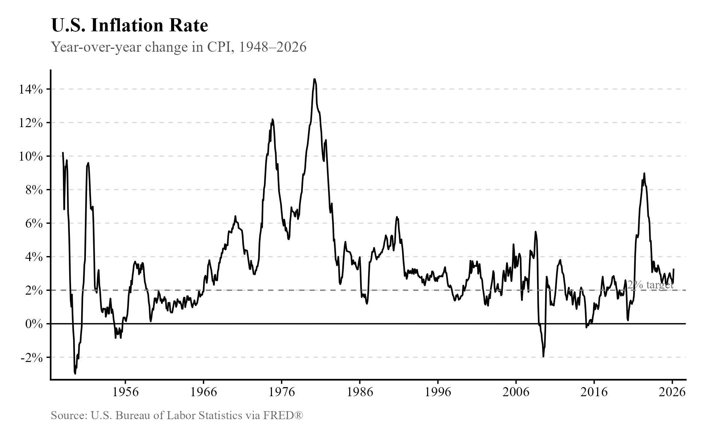
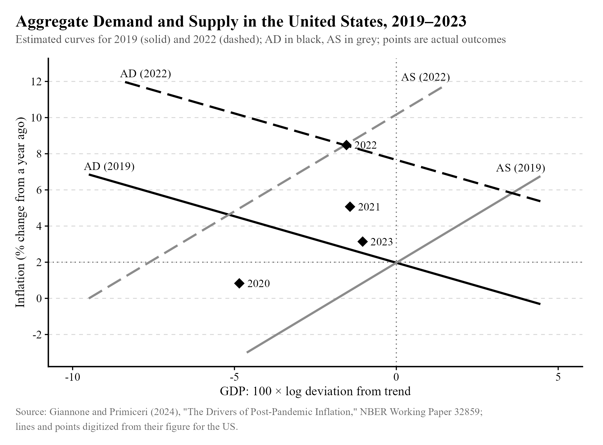
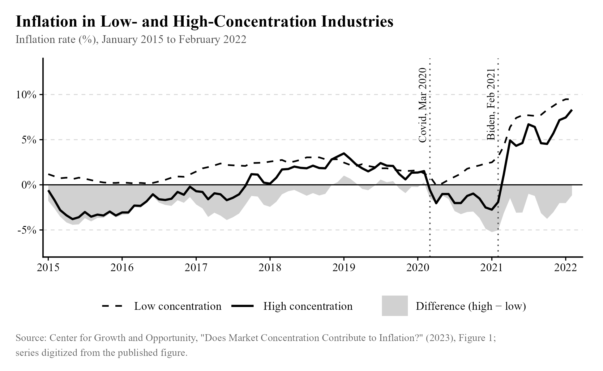
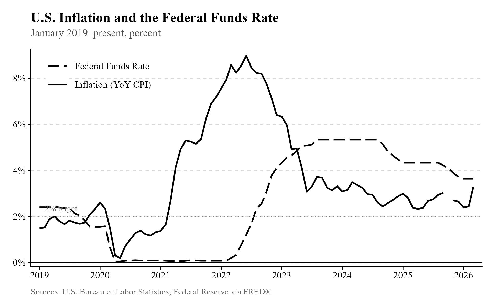
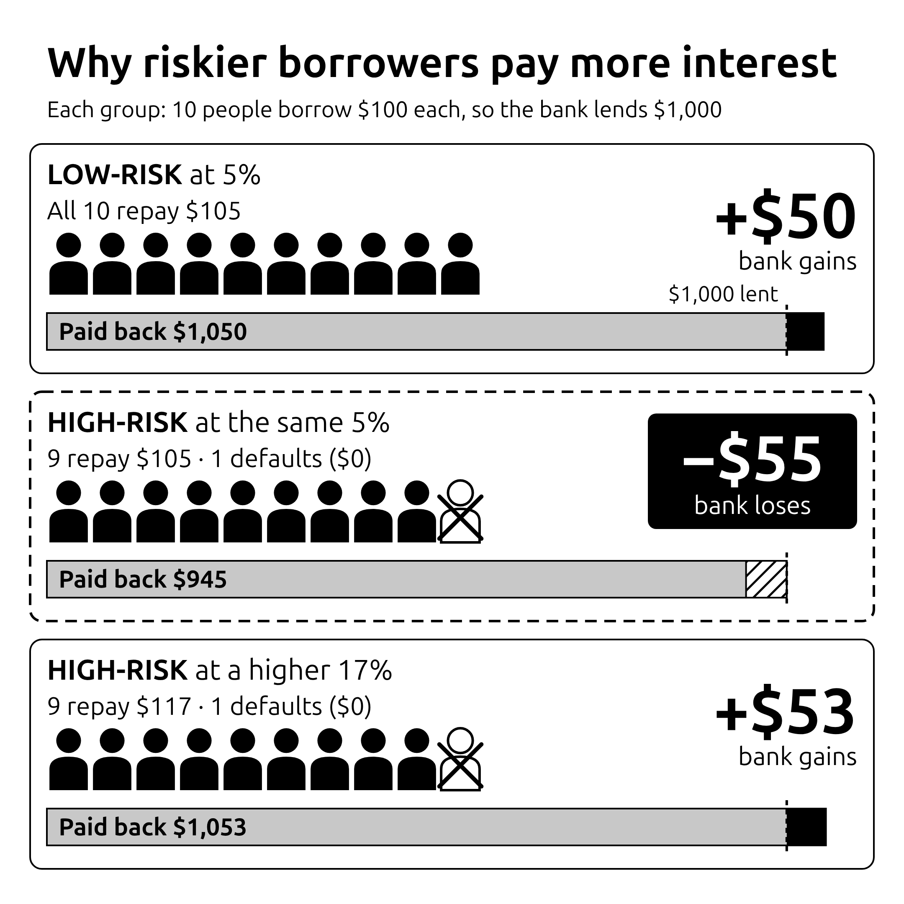
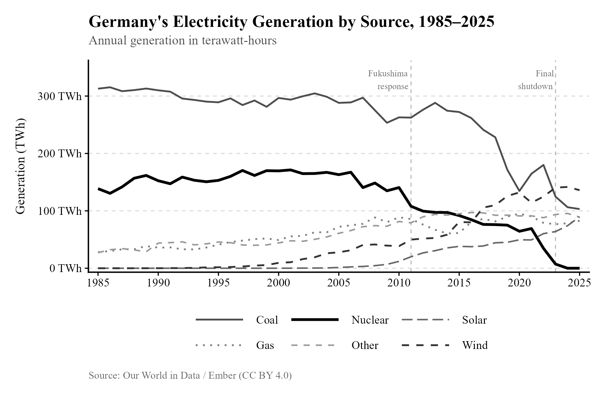

## Take 1: Inflation is caused by corporate greed. {#take-1}

[Rating: D-tier]{.rating .tier-d}

Smoking meth, joining the NFL, and reading tweets about economics by Bernie Sanders are all very effective ways to destroy your brain. I don't have Jesse Pinkman or John Madden here to write for me, so we're going to be focusing on the third option.

Sanders argued this point about inflation in November of 2022 while writing in Fox News (of course).[^n158] At that point, the price level had risen about 7% from November 2021,[^n131] a remarkably high rate of inflation, so it's no surprise that people were looking for someone to point the finger at.

The weaker version of this claim (that inflation in general is caused by corporate greed) makes little sense on short reflection. The rate of inflation varies greatly over time:

{width="91%"}

Was the 1970s peak greed? Were corporations unusually generous during the financial crisis?

I do not think this theory has much to do with how inflation actually works. Corporations are *always* going to be trying to charge the highest prices they can; they don't wake up some days and decide they're going to be much greedier. Coincidentally, where inflation has been remarkably high, we can spot macroeconomic changes that explain the difference: in the 1970s, the United States was hit by an energy crisis. OPEC, a cartel of petroleum-exporting countries, greatly increased oil prices by choking supply. Since oil is a particularly useful commodity with few substitutes, the effects of OPEC's embargo were quite strong. Similarly, but working in the opposite direction, the Great Recession briefly caused deflation in the United States, since it shocked aggregate demand---less money changing hands means slower, or even negative, price growth.

But of course, "inflation is caused by corporate greed" is too easy to attack. The stronger claim, and one Sanders makes the case for, is that inflation is needlessly high when it occurs because of corporate greed. He cites a study finding that "nearly 54% of the rise in inflation is directly attributable to the astronomical increase in corporate profit margins." So maybe corporations do charge the highest prices they can at all times, but sometimes macroeconomic changes form a cover for them to hike prices even more.

This study that Sanders cited, as it turns out, comes from the Economic Policy Institute,[^n132] our devious villain from [Chapter 1, Take 4](01-living-standards.qmd#take-4). For most companies in the private sector, we have detailed data on their prices as well as what they are paying their employees, and what they're spending on capital (like replacing a grill at McDonald's). The author takes the observed change in prices, subtracts the changes in input costs, and uses that to identify that most of the increase in prices went into profits.

The problem is that the implicit claim being made here is a causal one: "If corporations did not have so much power and did not act with such greed, prices would not have risen as much." In other words, if we could live in a better world of greater competition (and perhaps greater generosity), inflation would not be so terrible.

But the strategy used is not capable of identifying whether or not that's true. Consider the two hypotheses:

1.  Corporations are greedy and powerful, and that gives them pricing power. If that's true, then we might observe 10% inflation rather than, say, 5% inflation.
2.  Corporations are greedy but don't have much pricing power. If that's true, then with constrained supply and growing demand, we might observe 10% inflation rather than, say, 5% inflation.

The strategy used *appears* to rule out the second option, but we could observe the same evidence EPI provides in either case. With constrained supply and growing demand occurring at the same time as the supposed greed effect, corporations would hike prices to ration scarce goods and maximize profits as they usually do. In other words, it could just be (aggregate) supply and demand, like usual:[^n133]

{width="95%"}

That input costs didn't grow as much as prices doesn't tell us much about which hypothesis is true, since input costs are determined by other things---we might observe labor costs not growing as much as prices because wages are fairly sticky in the short run. Higher profits during a shock to aggregate supply and an increase in aggregate demand is exactly what the standard view of wages as sticky tells us would happen.

One way we can check this claim is by looking at inflation in low and high concentration parts of the economy---i.e., by comparing markets with lots of firms to markets with few. We would generally expect more concentrated markets to be less competitive, though that isn't necessarily true (it's conceivable that ten firms might collude while three firms compete).

{width="95%"}

This figure comes from the attached endnote.[^n134] As you can see, low concentration industries did not experience lower inflation than high concentration industries. While this analysis is not causal, it is suggestive that the supply shock story is correct, and should at least rule out overconfident, simplistic stories about greed driving inflation. We would like something like a natural experiment as a check, but those are rarely available to macroeconomists. (Sad! Won't somebody think of the papers that could be written? I say we start randomly deposing central bankers.)

The evidence Sanders is citing is just as likely to be observed if greedflation isn't real as if it is, so it doesn't actually prove anything. Meanwhile, the companies we would expect to have taken advantage of the situation to raise prices more because they lack competition actually didn't raise prices all that much. Methinks the greedflation hypothesis is lacking.

## Take 2: Price gouging is real, and should be addressed with price controls. {#take-2}

[Rating: D-tier]{.rating .tier-d}

The weak version of this claim is easy to rebut. If you claim that a business raising prices when a crisis occurs is *necessarily* "price gouging" as some kind of distinct phenomenon from normal price hikes when a supply shock occurs, you are just criticizing businesses for not being generous with their money. Using price controls in this case would just make a bad situation worse by making it unprofitable to assist people who need help. This is sad-but-true Econ 101 stuff.

What happens when, in an emergency situation, price gouging laws are present? From NPR:[^n136]

> "\[\...\] when Hurricanes Gustav and Ike hit South Carolina back in 2008, some gas station owners said they closed their doors rather than pay extra to have fuel trucked in and run the risk of being accused of price gouging. Obviously, that's not good for anybody. So as angry as people might be about high prices, in some cases, the alternative could be worse."

We don't have to limit our evidence to anecdotes. "Hurricanes and Gasoline Price Gouging"[^n137] provides some evidence by examining data on station-level retail gas prices combined with weather data. "We find no evidence for widespread price gouging. Instead, we document evidence consistent with shortages predicted by theory in the presence of restrictions on price movements." To be clear, the authors simply mean that they find no evidence of producers raising prices far above the increases in input costs. They do find that prices tend to rise when hurricanes strike.

Despite the findings of the above paper, there are others that suggest current anti-price gouging laws are not actually enforced. That is the finding of Dinerstein et al. (2025).[^n138] Their findings are very interesting, and are summarized in a presentation available online, with the link in the endnotes.[^n139] They found that disasters cause large demand shocks, small average price increases, and shortages. A small subset of stores tend to engage in extreme price increases. Most interestingly, "\[Price\] increases are, if anything, higher in states with anti-price gouging laws than states without." That is strongly suggestive of current laws being non-binding. They did find small effects on transportation costs, consistent with what NPR described.

The apparent disagreement on whether these laws are actually enforced is fairly easy to reconcile. The authors of "Hurricanes and Gasoline Price Gouging" do find evidence of shortages consistent with restrictions, but like Dinerstein et al., they find that while lots of complaints of unconscionable price increases are filed, only a small fraction of these complaints result in penalties. I am inclined to conclude that modern price gouging laws generally aren't enforced, and so they don't provide much evidence concerning the ability of price controls to generate shortages. The more useful result from "Hurricanes and Gasoline Price Gouging" is that price increases are consistent with input cost increases.

But we shouldn't limit ourselves to evidence focusing explicitly on price gouging, which will naturally be scarcer than evidence on price controls in general. [Take 4](#take-4) of this chapter looks at caps on credit card interest rates, while [Chapter 2, Take 1](02-housing.qmd#take-1) looks at rent control. The same result is found in each case. Interestingly, there *is* an exception of sorts in the minimum wage literature, where disemployment effects are not as common as one would expect, but that is still the general tendency that seems to be observed.

The quintessential historical example of price controls in action is the Nixon-era price controls implemented in 1971 to try to control inflation, which had become unusually high by 1970 and had yet to cool down. Shortly after this, in 1973, OPEC engineered a shortage of oil, which only worsened the shortages triggered by the price controls.[^n140] Nixon himself remarked that[^n141] "The difficulty with wage-price controls and a wage board as you well know is that the God damned things will not work. They didn't work even at the end of World War II. They will never work in peacetime."

One might be interested in alleviating the distributional impact of a price hike, since it is especially difficult for the poor to cope with a higher price. In that case, it is simple enough to avoid the potential shortages triggered by price controls by introducing subsidies instead, both encouraging new supply and (if the subsidies are granted exclusively to the poor) alleviating the distributional concern.

In case the point somehow isn't clear enough, here are a few other examples of what happens when you make it illegal to benefit from business activity and then ask people Oh Won't You Please Be Good and Do Business Activity Anyway?

- Price controls enacted by the Venezuelan government triggered shortages.[^n142] At one point during the rule of Hugo Chavez, coffee sellers looking to avoid selling at a loss hoarded their supplies in hopes that the government would allow retail prices to rise.[^n143]
- World War 2-era price controls in the United States made it difficult for meat producers to maintain profitability.[^n144] They degraded the quality of their own products to cut costs, and later cut production when the Truman administration refused to back down from controls. "By September of 1946, meat production had fallen drastically, plummeting over 80 percent from the previous year." Here is a paper[^n145] finding negative impacts on employment and output.
- Similarly, the government of West Germany had imposed price controls for a brief period, carried on from the Nazi era. From Cato:[^n146] "In the following weeks Erhard removed most of the Bizone's remaining price controls, wage controls, allocation edicts and rationing directives. The effects of decontrol were dramatic. The shortages ended, black markets disappeared, and Germany's recovery began." (Troublingly, this is confounded somewhat by the coincidental introduction of Marshall Plan aid. You could easily tell a story about how it was aid that boosted Germany and not deregulation. It's an episode worth mentioning, nevertheless.)

I am a big believer in the idea that if you are gonna leave people to choose whether or not to do something anyway, you should probably make sure they have some good reason to do it that doesn't involve giving away free shit for no reason. People generally aren't willing to do that.

## Take 3: The Federal Reserve should cut interest rates to make housing more affordable. {#take-3}

[Rating: F-tier]{.rating .tier-f}

In some people's minds, the Federal Reserve seems to be a magical entity. Employees of America's central bank sit around with an infinite money printer that is always turned on for Da Billyanayrs, and if it wasn't for how psychopathically evil the economists who run the place are, we would all be living in 5,000-square-foot single-family homes with two-car garages, a pool, and a Hispanic maid we pretend to care about by talking about how terrible it is that people like her are brought here to be exploited by being paid twice as much as they were in Mexico.

The quick response to this take is simple. The real interest rate on a loan is approximately equal to the nominal rate, written on paper, minus the rate of inflation. This is known as the Fisher equation. Intuitively, if you are lent \$100 and must pay back \$110, you can pay back the loan at no *real* interest if money gets cheaper. If inflation turns a \$100 sale for your business into a \$110 sale, it is easy to see the Fisher equation logic in play.

If the Federal Reserve cuts interest rates to make housing more affordable, that will typically raise the rate of inflation. As a consequence, the real interest rate on a mortgage will remain unchanged, because lenders will be forced to raise the nominal rate they charge to cover the extra inflation.

The Federal Reserve thus cannot make housing more affordable by cutting rates, at least not usually, and would only cause harm by trying. In the short run, inflation does not respond instantly to monetary policy, so the Fed *can* put some downward pressure on mortgage rates by cutting, but the honeymoon wouldn't last forever.

It is difficult to illustrate this relationship empirically, since the Federal Reserve typically seeks to avoid inflation on the basis of the very theory just described. (So, we wouldn't expect them to keep interest rates low to deliberately trigger inflation.) But the COVID-19 recession and associated inflation make it clear how raising rates and cutting back on the money supply can reduce the rate of inflation. Notice in the graph below how inflation fell when the Fed began to "tighten" policy and raise rates.

{width="100%"}

It is thus easy to see how the opposite holds as well, with inflation tending to rise when interest rates are cut. With a higher rate of inflation, banks would be inclined to charge higher nominal rates.

None of this is to say that cutting rates to make housing more affordable isn't an option. It's totally an option! But it's an option in the same way that snorting a line of coke and downing a bottle of Jack Daniel's is an option. You are going to have an *amazing* time! The problems arise the following morning when you roll off the bed, smash your naked body into the ground, and discover that Ms. "Angelique" has disappeared and so has your wallet.

## Take 4: The government should cap credit card interest rates. {#take-4}

[Rating: F-tier]{.rating .tier-f}

As if thinking has been outlawed, political debate over capping credit card interest rates sometimes takes the form of Senator Elizabeth Warren criticizing Donald Trump for failing to deliver on capping credit card interest rates.[^n147] Others like Senator Josh Hawley[^n148] have encouraged the move. We should be grateful that they are as unproductive as they are.

If you make it less profitable to do something, companies will do it less often. This is true of providing people with credit, just as with anything else. Banks prefer to charge higher rates to riskier borrowers because they wish to cover the cost of lending to them. Here is a handy image demonstrating how this works, brought to you by Anthropic's AI, Claude. If the bank couldn't charge more to riskier borrowers, it couldn't cover the cost of default, and wouldn't be willing to lend to them.

{width="75%"}

The government of Chile lowered the maximum legally permissible rate from 54% to 36% in 2013. Researchers found[^n149] that those who were risky enough to be charged legally impermissible rates above 36% were 8.7% less likely to have access to credit after the change, and "A counterfactual exercise shows that the new legislation excluded 9.7% of the borrowers from banking consumer loans." A similar policy in Colombia was modified in 2007, allowing lenders to charge higher rates, which also resulted in a credit expansion.[^n150]

I would like to provide some final remarks on the subject of price controls. As I described, it is conceivable that more modest controls can avoid the harms that stringent price controls have caused in the past. But it is misleading and irresponsible to treat this as some kind of grand rebuttal to the economics profession. It is as if one was instructed about the harms of cyanide by a chemist, ingested a milligram for fun, and then remarked that the chemist was wrong. Mainstream debates over price controls seem to generally have this character, which is why they are so difficult to resolve. Any effect of a more modest price control is going to be hard to detect empirically.

Perhaps the most reasonable argument for price controls is political rather than purely economic. From the abstract of "Can Price Controls Be Optimal? The Economics of the Energy Shock in Germany"[^n151] by Tom Krebs and Isabella Weber:

> "We argue that the German government handled the immediate response to the energy shock well, but subsequently waited too long to introduce an energy price brake in 2022. This failure to act decisively in response to heightened economic insecurity coincided with a strong rise of the approval rates of the far-right AfD in the summer of 2022."

If your desire is to prevent the success of other parties and the introduction of their policies, a case can be made for price controls on the grounds that their harms are not as terrible as the alternative. Economists in the United States are no strangers to such thinking, since they are usually restricted to one of two choices in their elections, neither of which has perfect intentions, but which are usually distinct enough for it to be worthwhile to vote for one over the other.

The *intrinsic* benefits of price controls, whatever they may be, remain a hard sell. It is notable that Germany spent decades choking out its nuclear energy before the crisis hit in 2022:[^n152]

{width="95%"}

If Germany had not eliminated an important substitute, the crisis might not have been so terrible---the postponement of the closing of the last three nuclear plants in Germany appears to have reduced electricity prices.[^n153] It is a good thing that Mrs. Weber, one of the authors of the aforementioned paper, seems to be aware of the importance of supply.[^n154] But you, dear reader, should keep in mind that the people you encounter citing her may not be so careful. I have seen good work misappropriated and exaggerated plenty of times, as in the introduction to this book, and again as you'll see later in [Chapter 8](08-international-trade.qmd).

## Take 5: Quantitative easing steals from the poor to give to the rich. Also, why can we pay for these bailouts but not healthcare? {#take-5}

[Rating: D-tier]{.rating .tier-d}

Kevin Warsh,[^n155] the current chair of the Federal Reserve, gave voice to the first sentence in the title above, while others have complained about the latter[^n156] (and I would like to clarify that Warsh doesn't think the Fed can pay for Medicare; these are just two beliefs that tend to go together).

Quantitative easing (QE), if you do not know, refers to when the Federal Reserve purchases long-term Treasury bonds and other assets from banks on the open market. These bonds are essentially loans received by the federal government---when someone purchases a bond, they are giving the government a loan, and their ownership of the bond entitles them to repayment with interest. By purchasing these bonds, the Fed is able to increase the money supply more than they can by pushing down the federal funds rate (the rate banks charge for "overnight loans" used to meet short-term liabilities, which the Fed influences through purchases of short-term bonds). The post-2008 QE program also included purchases of mortgages bundled into mortgage-backed securities.

There is little criticism I have to offer towards the idea that quantitative easing can exacerbate inequality, and I think Mr. Warsh's treatment of the issue is more reasonable than that of popular QE critics. He has himself worked with the rest of the Fed's Board of Governors to engage in QE after the Great Recession, so he clearly believes that the practice can be beneficial depending on the circumstances. He was skeptical of the second round of QE and resigned shortly after voting for it, trusting in then chair Ben Bernanke's judgment while opposing the policy.

What is clear is that many skeptics of QE do not understand it and seem to be under the impression that it is a way for the government to give free money to the rich. For example:[^n157] "SO we can afford this but not Medicare for All? Okay. Yeah, thanks." The billion-dollar figures involved with QE often suggest it isn't a form of lending.

The Fed is not legally allowed to pay for a policy like Medicare for All, and for good reason---creating that much money would pay for the program, sure, but it would do so by greatly increasing the rate of inflation. Very little free money is involved in QE, if any, since the program centers around the purchase of bonds. A bank must first purchase a bond before it can be sold to the Fed; they do not appear in the coffers of large financial firms out of thin air.

[^n158]: [foxnews.com/opinion/our-economic-crisis-isnt-inflation-its-corporat...](https://www.foxnews.com/opinion/our-economic-crisis-isnt-inflation-its-corporate-greed-gop-will-only-make-that-worse)
[^n131]: [fred.stlouisfed.org/series/CPIAUCSL#](https://fred.stlouisfed.org/series/CPIAUCSL#)
[^n132]: [epi.org/blog/corporate-profits-have-contributed-disproportionately-...](https://www.epi.org/blog/corporate-profits-have-contributed-disproportionately-to-inflation-how-should-policymakers-respond/)
[^n133]: The graph is a recreation of the one in here: [nber.org/system/files/working\_papers/w32859/w32859.pdf](https://www.nber.org/system/files/working_papers/w32859/w32859.pdf)
[^n134]: The graph is a recreation of the one in here: [thecgo.org/wp-content/uploads/2023/03/Does-market-concentration-con...](https://www.thecgo.org/wp-content/uploads/2023/03/Does-market-concentration-contribute-to-inflation-v3.pdf)
[^n136]: [npr.org/2024/10/12/nx-s1-5150153/residents-in-hurricane-affected-st...](https://www.npr.org/2024/10/12/nx-s1-5150153/residents-in-hurricane-affected-states-are-complaining-of-price-gouging-what-is-it)
[^n137]: [journals.uchicago.edu/doi/10.1086/712419#:~:text=We exploit the fac...](https://www.journals.uchicago.edu/doi/10.1086/712419#:~:text=We%20exploit%20the%20fact%20that,of%20restrictions%20on%20price%20movements.)
[^n138]: [jrayl.github.io/files/Dinerstein\_Lucas\_Nath\_Rayl\_PriceGouging.pdf](https://jrayl.github.io/files/Dinerstein_Lucas_Nath_Rayl_PriceGouging.pdf)
[^n139]: [static1.squarespace.com/static/5cd333a4421adb0001ce2d8a/t/67085b8a7...](https://static1.squarespace.com/static/5cd333a4421adb0001ce2d8a/t/67085b8a733f6b5ea08e8c22/1728600972083/Price_Gouging_Slides_10_2024.pdf)
[^n140]: [youtube.com/watch?v=sq1zIj8s8R0](https://www.youtube.com/watch?v=sq1zIj8s8R0)
[^n141]: [fee.org/articles/nixon-knew-his-price-controls-wouldnt-work/](https://fee.org/articles/nixon-knew-his-price-controls-wouldnt-work/)
[^n142]: [noahpinion.blog/p/how-maduro-and-chavez-wrecked-venezuelas](https://www.noahpinion.blog/p/how-maduro-and-chavez-wrecked-venezuelas)
[^n143]: [news.bbc.co.uk/2/hi/business/4599260.stm](http://news.bbc.co.uk/2/hi/business/4599260.stm)
[^n144]: [npr.org/sections/money/2022/02/08/1078035048/price-controls-black-m...](https://www.npr.org/sections/money/2022/02/08/1078035048/price-controls-black-markets-and-skimpflation-the-wwii-battle-against-inflation)
[^n145]: [journals.uchicago.edu/doi/abs/10.1086/261102?journalCode=jpe](https://www.journals.uchicago.edu/doi/abs/10.1086/261102?journalCode=jpe)
[^n146]: [cato.org/commentary/german-miracle-another-look#](https://www.cato.org/commentary/german-miracle-another-look#)
[^n147]: [x.com/SenWarren/status/2026510714123247789?s=20](https://x.com/SenWarren/status/2026510714123247789?s=20)
[^n148]: [x.com/HawleyMO/status/2017064205971505613?s=20](https://x.com/HawleyMO/status/2017064205971505613?s=20)
[^n149]: [ideas.repec.org/p/chb/bcchwp/840.html#:~:text=Carlos Madeira-,Abstr...](https://ideas.repec.org/p/chb/bcchwp/840.html#:~:text=Carlos%20Madeira-,Abstract,from%2054%25%20to%2036%25.)
[^n150]: [researchgate.net/publication/354127230\_Effects\_of\_interest\_rate\_cap...](https://www.researchgate.net/publication/354127230_Effects_of_interest_rate_caps_on_credit_access#:~:text=%C2%A9%20The%20Author%28s%29%2C,rate%20ceiling%20for%20microcredit%20loans)
[^n151]: [scholarworks.umass.edu/entities/publication/f152cf6b-c3e6-467b-b75e...](https://scholarworks.umass.edu/entities/publication/f152cf6b-c3e6-467b-b75e-e0fb29ad723b)
[^n152]: [ourworldindata.org/profile/energy/germany#what-sources-does-germany...](https://ourworldindata.org/profile/energy/germany#what-sources-does-germany-get-its-electricity-from)
[^n153]: [sciencedirect.com/science/article/pii/S0301421524002283](https://www.sciencedirect.com/science/article/pii/S0301421524002283)
[^n154]: [x.com/IsabellaMWeber/status/1769755203845177809?s=20](https://x.com/IsabellaMWeber/status/1769755203845177809?s=20)
[^n155]: [brookings.edu/articles/kevin-warsh-don-kohn-on-qe-and-inequality/](https://www.brookings.edu/articles/kevin-warsh-don-kohn-on-qe-and-inequality/)
[^n156]: [reddit.com/r/badeconomics/comments/fjdj7k/literally\_no\_redditors\_un...](https://www.reddit.com/r/badeconomics/comments/fjdj7k/literally_no_redditors_understand_qe_the_federal/)
[^n157]: [reddit.com/r/badeconomics/comments/fjdj7k/literally\_no\_redditors\_un...](https://www.reddit.com/r/badeconomics/comments/fjdj7k/literally_no_redditors_understand_qe_the_federal/)
