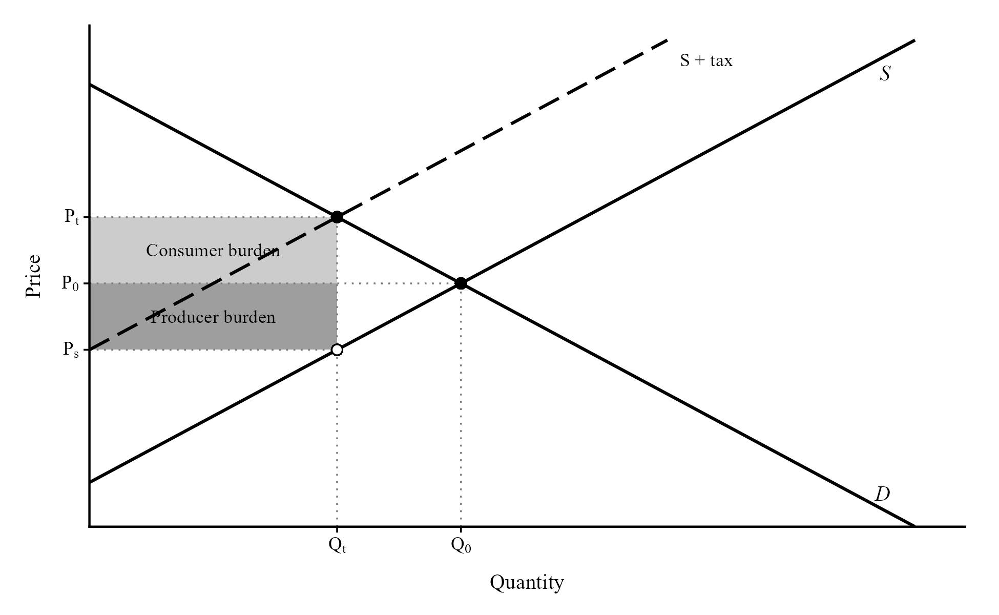
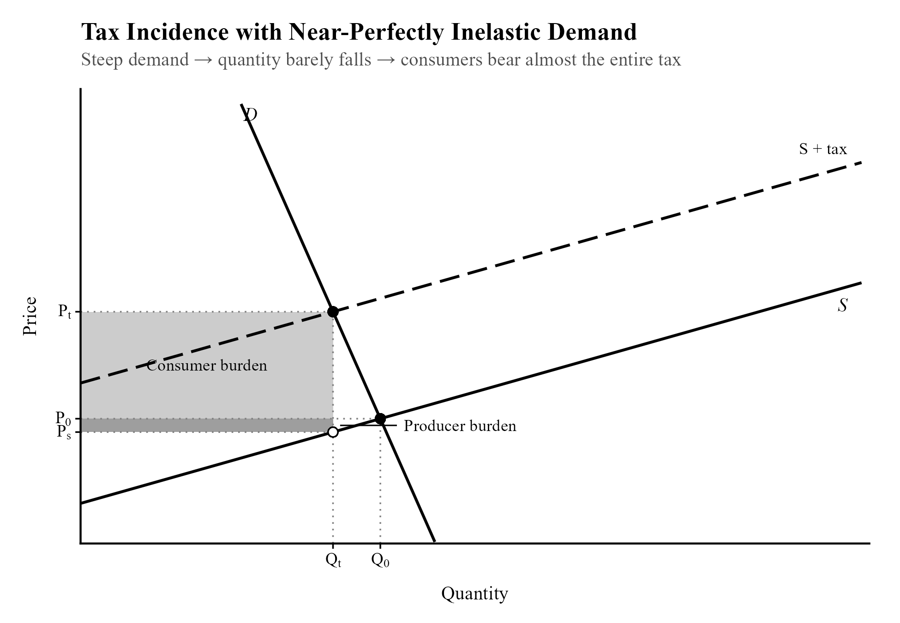
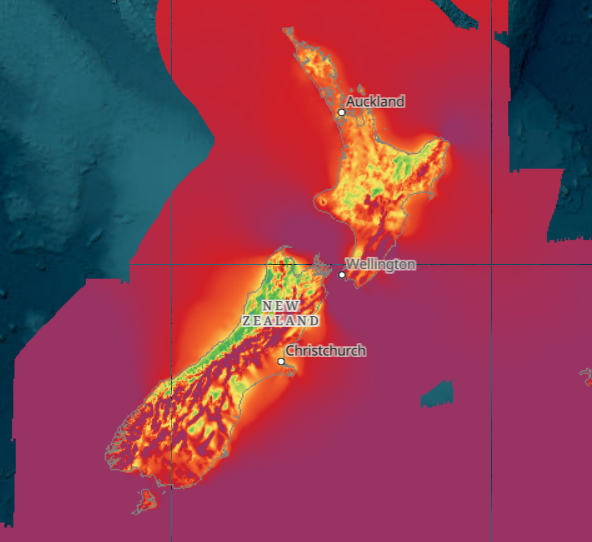
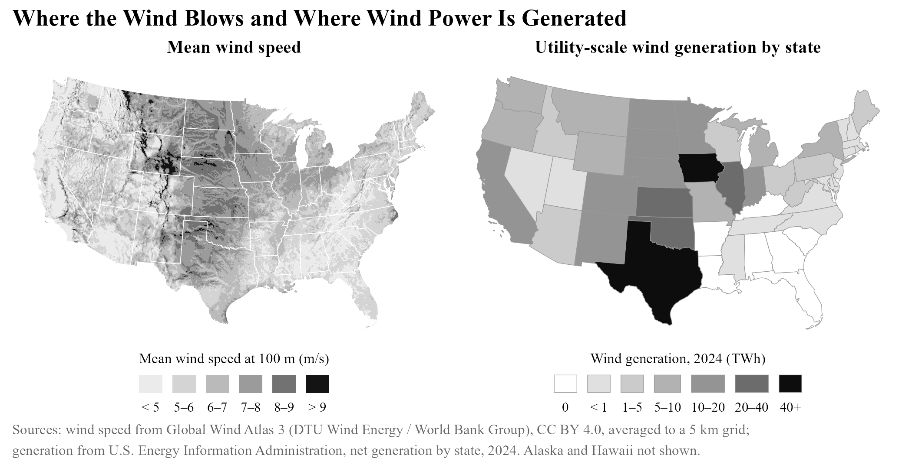
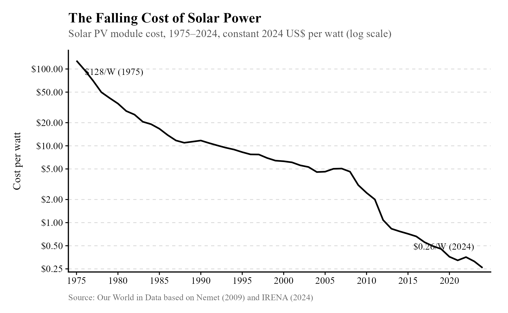
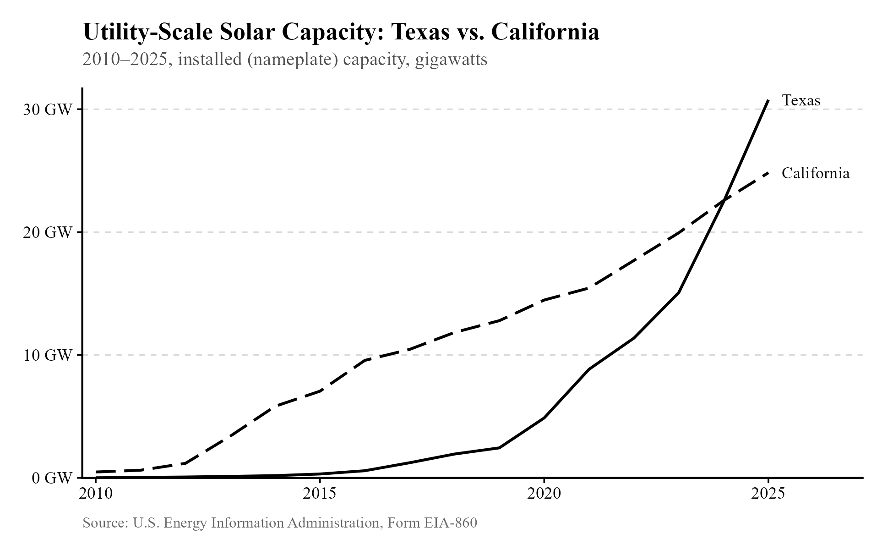
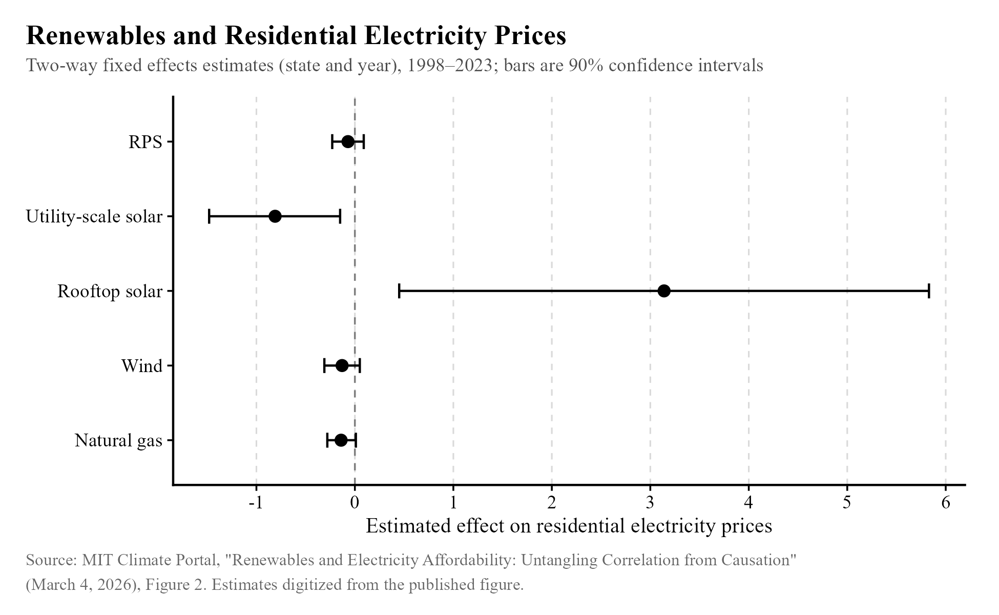

## Take 1: Climate change and pollution are entirely the fault of major corporations. {#take-1}

[Rating: C-tier]{.rating .tier-c}

A headline from The Guardian proclaims[^n188] "Just 57 companies linked to 80% of greenhouse gas emissions since 2016." The Natural Resources Defense Council claims[^n189] "A recently published report[^n190] identified that 100 energy companies have been responsible for 71% of all industrial emissions since human-driven climate change was officially recognized." Are they right? Is climate change all the fault of major corporations?

"Fault" is a much vaguer term than people let on. It's Billy's fault when his dad's car breaks down after he poured milk into the tank to see what would happen. But is it also his mom's fault? It wouldn't have happened if she hadn't given birth to him. Or maybe it's his dad's fault, or his grandad's fault, or it's the fault of the neighbors for failing to run him down when he was playing in the street again.

I think when we say something is someone's fault, we usually mean something like "that person made a choice that would have been especially easy to avoid making, compared to all the other choices people made that led to this happening." Opting not to give birth to Billy wouldn't have been the least costly choice to avoid the incident, since his parents love him in spite of it all. Billy simply choosing not to pour milk into the tank wouldn't have been costly at all because he probably would have just gotten bored of the milk idea and played video games instead.

So is climate change, and pollution in general, just corporations pouring milk into the gas tank for fun? No, obviously not. There are plenty of other actors involved who would have found it about as costly, in fact probably *less* costly, to make choices that would have prevented the problem---in particular, consumers. It's also hard for people to cooperate on not polluting without someone defecting because their individual choice to sell or buy gasoline doesn't push the needle much.

If it were always easy for corporations to simply decide not to pollute, and if it were costly for consumers to make the same choice, we would expect supply to be very elastic (strongly responsive to changes in prices) and demand to be inelastic (relatively unresponsive to changes in prices). If this is true, it would be revealed through tax burdens: when pollution taxes are imposed, the entire burden would fall on consumers.

It is fairly intuitive to understand in theory. If a tax is introduced, the production of the good is discouraged; the supply curve shifts up. This is visualized by microeconomists using supply and demand, as below.

{width="94%"}

Because the quantity sold falls, producers do not have to sell to as many people, so they can raise the price. The price paid by consumers is higher than what they would pay without the tax, so it is costly to them. The price *received* by producers is lower than before, since they must subtract the tax from the price they charge. Thus the tax is costly for both consumers and producers in most cases.

At the new quantity, producers charge a higher price, and some of it is passed to the government. To understand the box abstractly representing the consumer burden, notice that there is a gap between the demand curve and the old equilibrium price P~0~, which becomes more narrow near the equilibrium quantity Q~0~. That gap is consumer surplus, the difference between what consumers are willing to pay and what they actually pay. At the higher price and lower quantity with the tax, we can see that the consumer burden is the lost consumer surplus from the tax. A similar description applies to the producer burden.

The exact distribution of the burden depends on the relative elasticities of supply and demand. If supply is perfectly inelastic, like with land, then the owners of land can do nothing when a tax on land is introduced. They will simply pay the whole tax. Likewise, a tax on producers of vitally needed insulin would be entirely paid by diabetic consumers of insulin---they cannot dodge the tax if producers stick it to them, since there is no substitute. Such a situation is depicted below.

{width="90%"}

Empirically, do taxes on these companies that pollute cost consumers money? Indeed they do. That is what one study of carbon pricing in Canada found,[^n191] and another study of carbon pricing in Australia found the same thing.[^n192] Here is a snippet from a second study from Canada:[^n193] "Using daily retail gasoline prices for 40 treated cities and nine control cities we find the pass-through rates are city-specific and vary from 0% to over 140%."

Because there are alternative energy sources we can switch to in the long run, I'd expect it to be relatively easy for consumers to make better choices over that time horizon. But similar logic applies to corporations, so it's not clear what to say, except that it should be very obvious by this point in the text that climate change isn't just Da Billyanayrs. Consumers benefit from pollution, too---otherwise nobody would get upset about carbon tax proposals---and their own choices matter for these things.

Still, there are some ways in which corporations appear uniquely blameworthy. Some of them have campaigned to discourage consumers from believing climate change is real.[^n194] Consumers, being less well-organized, are not as capable of engaging in such a campaign. They are also perhaps not as likely to be informed about the real harms of pollution as companies are---though I suspect that people are likely to eat their own propaganda. (Whether it *was* propaganda and climate change is really real is beside the point. If you think the harms are exaggerated, I have no need to write this section for you anyway.)

I suspect the best way to resolve this kind of dispute is to simply point to the fact that both consumers and producers benefit from an exchange that pollutes, so blaming corporations for climate change is very misleading. Everyone involved has some agency, and everyone involved typically has to pay some price to shift to alternative energy sources---consumers pay more for cleaner energy, producers might hypothetically pay by giving up their jobs out of goodwill to the world.

I'd like it if people directly argued some more defensible claim like "major corporations have spent money trying to propagandize people into believing climate change isn't real," but until then we're stuck with "corporations have agency, but I, on the other hand, have an inalienable right to drive a used Toyota and get a little treat." Oh well.

## Take 2: Clean energy is a scam. It's entirely held up by the government. {#take-2}

[Rating: D-tier]{.rating .tier-d}

I strongly suspect that people who hold this view have not considered the great variation in the available resources in different places, and the efficacy of different forms of power production. It suffices to provide an example: "As wind farms in New Zealand receive no subsidies, they are only built when they are expected to generate electricity at a competitive price." That's from the New Zealand Wind Energy Association.[^n195] The same report says that about 4% of energy in New Zealand came from wind power in 2010. Below, you can see a map of how windy New Zealand is:[^n196]

{width="68%"}

(Map: Global Wind Atlas 3 (DTU Wind Energy / World Bank Group), CC BY 4.0.)

Of course, the United States is not as windy, and where wind power does exist in the US, the winds tend to be blowing harder. Here is a useful image demonstrating this fact:[^n197]

{width="89%"}

While this evidence does not tell us whether the government *should* subsidize wind power or any other form of clean energy, it shows that it is clearly not true that it only exists because of government subsidies. Private companies and individuals freely choose clean energy even when it is not subsidized, since it is sometimes a more sensible choice than the alternatives. This has only become more true with time. Solar power, for example, has become much cheaper with time:[^n198]

{width="75%"}

If subsidies are what matters, we would expect sunny, Democrat-led California to be growing its solar power more than Republican-led Texas. That is not the case. Hamstrung by government regulations intended to benefit the environment but repurposed for blocking construction, Californian solar companies are having trouble keeping up with their Texan counterparts, who are freely seeking profits:[^n199]

{width="73%"}

The simplest explanation for what we can observe is that while clean energy companies have often received government support, they would often be profitable without it, too.

A related claim made by Donald Trump[^n200] is that renewable energy is to blame for higher energy prices. If you are somehow under the impression that subsidies cause higher prices, see [Chapter 9, Take 6](09-miscellaneous-bullshit.qmd#take-6).

I can't help but peel back the curtain on this kind of conversation. Why do people so often feel compelled to bicker about which energy source is most effective? You don't see people having these bitter arguments about the production methods of water utility companies, or fighting about which machines Nike would best procure for making its shoes. Those companies make decisions based on the prices they face in a free market, as do energy companies, at least sometimes.

The unique situation faced by energy companies is due to the costs they sometimes impose on those who don't participate in the market at all. If I buy a pair of Nikes, it doesn't matter to you what machines were used to make those shoes. But if I get my electricity from a coal plant, my purchasing decisions might be causing you to inhale poisonous gases emitted by the plant.[^n201] Combine this with the cultural schism over climate change, and suddenly, everyone feels the need to be an expert on which power source is most efficient, all so they can feel like they're winning a grand national battle over whether and to what degree the government should intervene in power production to save lives. After all, if one feels strongly that no intervention should occur, it is useful and convenient to believe clean energy is an inefficient "scam," and conversely, if one believes intervention *should* occur, it is convenient to believe clean energy is the future. My team's energy is better than your team's energy.

I believe there was a time when clean energy looked like it might be a less efficient but necessary source of power to avoid the costs of climate change. The experience of Texas with solar power suggests otherwise. At this point, perhaps we would all be better off if companies were free to choose what kind of power to build and where, rather than being restricted by laws like the California Environmental Quality Act, which has only made it needlessly difficult to build clean energy capacity.[^n202] With time, fossil fuels look like they will be outcompeted by clean energy. Climate change advocates should learn to truly believe this, and say: "Alright---no more government intervention. Let's see if fossil fuels are truly superior to wind, solar, nuclear, and hydropower." I suspect I already know the winner.

Returning to Mr. Trump's claim, we now have a pretty clear idea why he would say something like that without spending much time complaining about Nike's production processes. Aside from the fact that subsidies do not raise the prices paid by consumers (i.e., net of the subsidy the consumer doesn't pay, the price is lower), we might wonder if investors had simply made stupid decisions about energy supply that the government must correct, being more enlightened about energy investment than they are. I think this is a ridiculous contention, since it relies on widespread irrationality in a competitive industry, but my own feelings aren't an answer. Thankfully, researchers at MIT have run a regression for us[^n203] that controls for unobserved differences between states to try to identify the effect of renewable power sources on prices. Their results are below. Renewable portfolio standards ("RPS") have no relationship with electricity costs. Utility-scale solar seems to be related to lower costs, while rooftop solar is related to higher costs, though their estimate is very imprecise. The evidence suggests that, in general, renewable power sources are simply another production technology for energy that have their uses in cases where companies can find profit. Maybe we should all care much less about this subject.

{width="86%"}

[^n188]: [theguardian.com/environment/2024/apr/04/just-57-companies-linked-to...](https://www.theguardian.com/environment/2024/apr/04/just-57-companies-linked-to-80-of-greenhouse-gas-emissions-since-2016)
[^n189]: [nrdc.org/bio/josh-axelrod/corporate-honesty-and-climate-change-time...](https://www.nrdc.org/bio/josh-axelrod/corporate-honesty-and-climate-change-time-own-and-act)
[^n190]: [cdp.net/en/press-releases/new-report-shows-just-100-companies-are-s...](https://www.cdp.net/en/press-releases/new-report-shows-just-100-companies-are-source-of-over-70-of-emissions)
[^n191]: [sciencedirect.com/science/article/abs/pii/S0301421519303301](https://www.sciencedirect.com/science/article/abs/pii/S0301421519303301)
[^n192]: [sciencedirect.com/science/article/abs/pii/S0140988321000839](https://www.sciencedirect.com/science/article/abs/pii/S0140988321000839)
[^n193]: [onlinelibrary.wiley.com/doi/abs/10.1111/caje.12674](https://onlinelibrary.wiley.com/doi/abs/10.1111/caje.12674)
[^n194]: [theguardian.com/environment/2021/nov/18/the-forgotten-oil-ads-that-...](https://www.theguardian.com/environment/2021/nov/18/the-forgotten-oil-ads-that-told-us-climate-change-was-nothing)
[^n195]: [windenergy.org.nz/wp-content/uploads/2024/06/FactSheet-Electricity\_...](https://www.windenergy.org.nz/wp-content/uploads/2024/06/FactSheet-Electricity_Supply_and_Wind_Generation.pdf)
[^n196]: [globalwindatlas.info/en/](https://globalwindatlas.info/en/)
[^n197]: The map is based on this one: [eia.gov/energyexplained/wind/where-wind-power-is-harnessed.php](https://www.eia.gov/energyexplained/wind/where-wind-power-is-harnessed.php)
[^n198]: [ourworldindata.org/grapher/solar-pv-prices](https://ourworldindata.org/grapher/solar-pv-prices)
[^n199]: The chart is based on the FT chart featured here: [adamtooze.substack.com/p/chartbook-285-cal-tex-how-bidenomics](https://adamtooze.substack.com/p/chartbook-285-cal-tex-how-bidenomics)
[^n200]: [nsjonline.com/article/2025/08/trump-blames-renewables-for-rising-po...](https://nsjonline.com/article/2025/08/trump-blames-renewables-for-rising-power-bills-experts-cite-other-causes/)
[^n201]: [nih.gov/news-events/nih-research-matters/deaths-associated-pollutio...](https://www.nih.gov/news-events/nih-research-matters/deaths-associated-pollution-coal-power-plants)
[^n202]: [blog.ucs.org/vivian-yang/for-clean-energy-progress-in-california-we...](https://blog.ucs.org/vivian-yang/for-clean-energy-progress-in-california-we-must-solve-the-permitting-problem-part-3-of-3/)
[^n203]: [climate.mit.edu/posts/renewables-and-electricity-affordability-unta...](https://climate.mit.edu/posts/renewables-and-electricity-affordability-untangling-correlation-causation)
