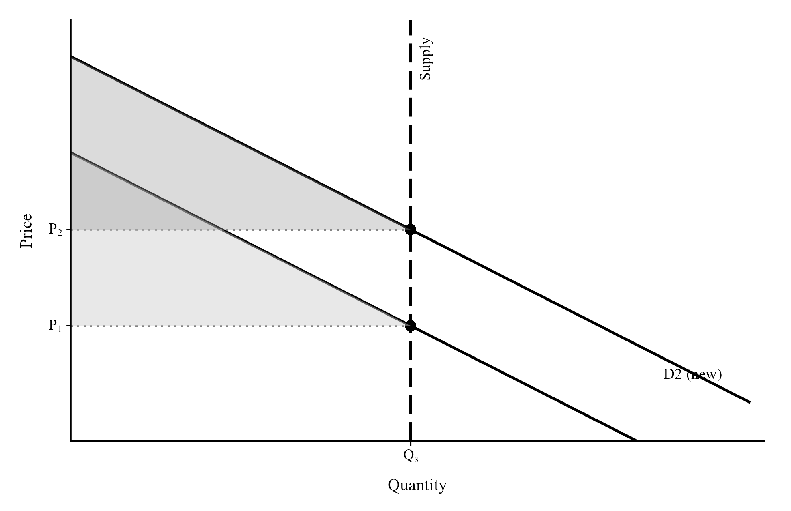
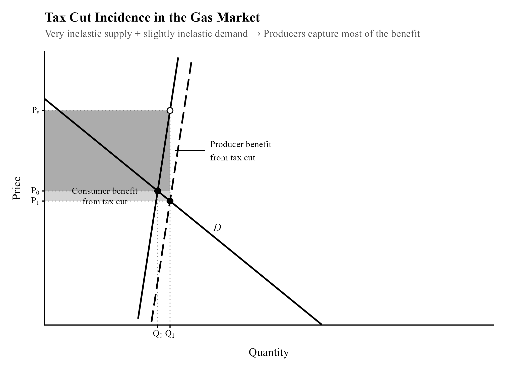
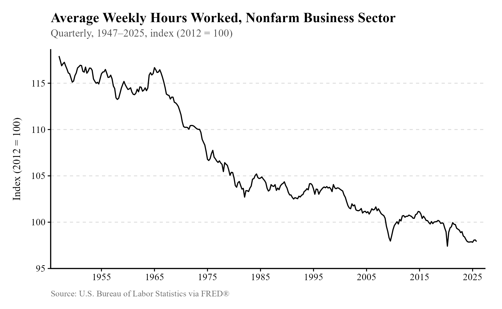
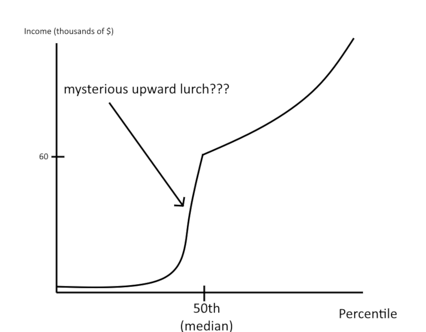
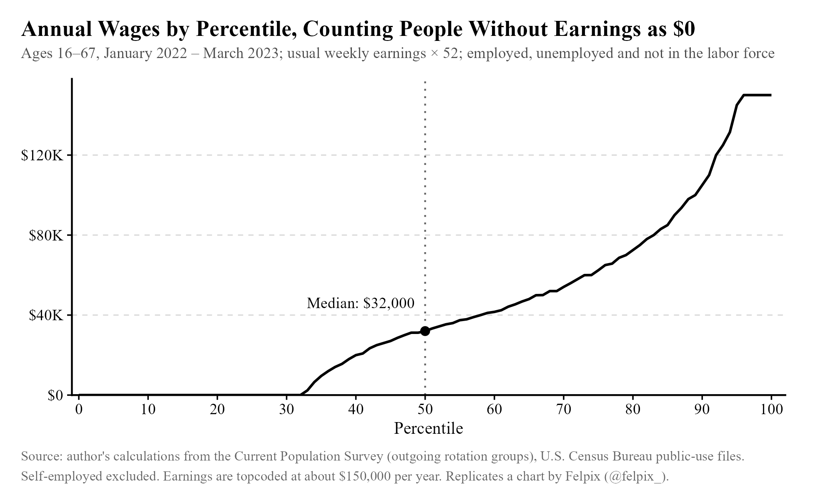
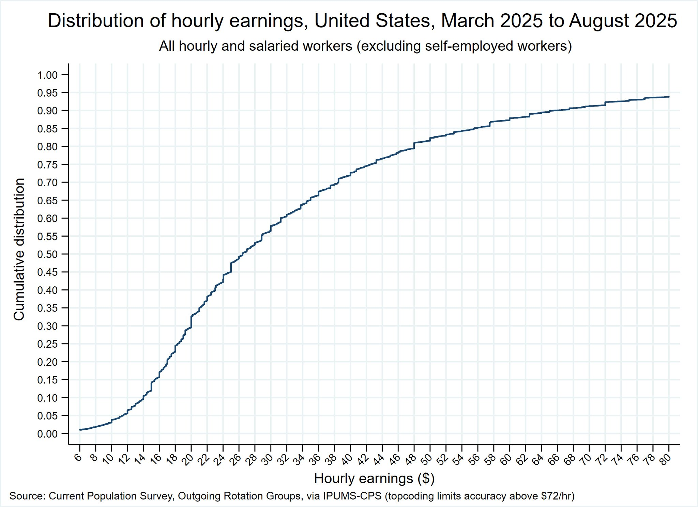

Due to the ridiculous nature of many of these ideas, I will be greatly increasing the level of snark from this point on. You have been warned. However, some ideas will not receive much snark because they are included here only because they don't fit neatly into any other category.

## Take 1: Economists invented inflation. {#take-1}

[Rating: Super F]{.rating .tier-superf}



"Theoretically" is doing a lot of heavy lifting here. And they say economists are too theoretical!

The rate of inflation, if you do not know, is the change in the average price level of an economy over a year. Sadly, economists insist on allowing the concept of inflation to continue existing, so life keeps getting more expensive every year. A great shame.

But to be less flippant, the problem with printing lots of money is less that it causes inflation and more that it doesn't cause the wealth of society to increase in proportion. If you triple the money supply, you will *not* triple the number of workers, cars, grills, or airplanes. Sure, it's conceivable that people could keep prices the same even with three times as much money available, but that would almost inevitably lead to a shortage---spending power greatly exceeding available resources---unless you gave all of the money to just one guy and asked him to pinky promise not to spend it. <!--ent:7woni-->

So: I rate this take 100% factual. Spit your truth, my friend. After all, the rate of inflation doesn't respond instantly to increases in the money supply, and it is not as responsive when the economy is far below potential output due to an aggregate demand shock---so maybe we should just plug our ears and say, "La la la, monetary neutrality doesn't hold even in the long run, la la la!" before pretending to read about New Keynesian DSGE models that don't say that.

## Take 2: Before money, there was no poverty. {#take-2}

[Rating: Super F]{.rating .tier-superf}



It is difficult to precisely identify the living standards of the distant past, but very easy to tell that they were much, much worse than current living standards. The exact date of the creation of money is very hard to pin down, but we can find evidence of coins going back to like 650 BC,[^n266] so we can pin the date down as being "at least 2,500 years ago."

But really, it doesn't matter: "the average person in the world of 1800 was no better off than the average person of 100,000 BC." That is from Gregory Clark's *A Farewell to Alms.*[^n267] He continues:

> "The quality of life also failed to improve on any other observable dimension. Life expectancy was no higher in 1800 than for hunter-gatherers: thirty to thirty-five years. Stature, a measure both of the quality of diet and of children's exposure to disease, was higher in the Stone Age than in 1800. And while foragers satisfy their material wants with small amounts of work, the modest comforts of the English in 1800 were purchased only through a life of unrelenting drudgery. Nor did the variety of material consumption improve. The average forager had a diet, and a work life, much more varied than the typical English worker of 1800, even though the English table by then included such exotics as tea, pepper, and sugar."

There is some dispute over exactly how much living standards varied before 1800, but little disagreement over the fact that they varied little compared to the variation that occurred after 1800.

It is easy to see how much worse the quality of life must have been based solely on the date of invention for a variety of vitally important aspects of modern life. Antibiotics did not arrive until the discovery of penicillin in the 1920s. Before modern medicine, up to at least the year 1800, almost every mother would have to see nearly half her children die before turning 5.[^n268] These improvements have occurred not only because of improvements in medical care, but improvements in nutrition and sanitation. Before 1847, even physicians didn't know to wash their hands---thanks to Ignaz Semmelweis, obstetricians began doing so as a general practice, and fewer women died from infections during childbirth.[^n269]

It *is* true that hunter gatherers probably had more free time than we do, requiring perhaps 20 hours of work per week to acquire food.[^n270] But generally speaking, a life that is nasty, brutish, and short, in the words of Thomas Hobbes, is considered a horribly impoverished one even with lots of leisure time.

## Take 3: Hyperinflation is coming! {#take-3}

[Rating: F-tier]{.rating .tier-f}

Balaji Srinivasan, a venture capitalist and former CTO of cryptocurrency trading platform Coinbase, once made a bet that the US would enter hyperinflation.[^n271] That refers to a state of extreme inflation, like what occurred in Zimbabwe from 2007 onward, with the price level increasing by hundreds of thousands of times in a year. I could explore his (very confusing) reasoning, but I don't think engaging with it will do anything more than distract from the fact that you should find it incredibly implausible that hyperinflation will occur in the US.

The US has been a democracy (or at least not a dictatorship, given that women and minorities were excluded for a long time while white men received broad democratic rights) for more than two centuries, and has steadily developed into one of the richest countries in the world. When we turn to cases of hyperinflation in the past, we see common patterns of political disorder and dictatorship. Robert Mugabe had total control of Zimbabwe's government, and greatly expanded the money supply to bribe his enemies and reward his allies.[^n272] An episode of hyperinflation also occurred in Venezuela not long after the takeover of Nicolas Maduro, taking the reins of a former democracy that autocratized under Hugo Chavez. Countries that have experienced hyperinflation have tended to be much less politically stable, and much poorer, than the United States, and the root cause has fairly consistently been the printing of huge amounts of money. Like this insanely large Venezuelan note:[^n273]

{width="75%"}

It is true that autocracy is not a prerequisite of hyperinflation. The Weimar Republic in Germany also had an episode of hyperinflation with the same cause (a greatly increased money supply). There is some disagreement[^n274] over why Weimar officials chose to do this, but none of the available reasoning suggests that hyperinflation could occur in the modern United States in the near future. There are no reparations the United States is being required to pay. Nobody has invaded an important industrial area[^n275] of the United States to seize wealth for said reparations, and the federal government does not plan to print money to pay workers pushed out of said region by said invasion.

So in the future, if you ever see anyone like Balaji forecasting hyperinflation in the US, you should start by being very skeptical and set a high bar for evidence. Most forecasts of doom, in general, are pure unadulterated bullshit created by people who don't provision enough evidence to justify their claims---Balaji did not, and he lost a million dollars for it.

## Take 4: Abolish debt. {#take-4}

[Rating: Super F]{.rating .tier-superf}

This take comes from here.[^n276]

Nobody likes being in debt, so it's natural to conclude that we'd all be better off as a "wealth economy" where the government never runs a deficit and nobody is allowed to lend. Yay! No more debt!

But this ignores the purpose of debt, which is to transfer the benefits of an investment across time. If you have an idea for a business that will cost \$500k to build and run, and you expect it to bring in \$700k of revenue, you'd like some way to acquire that \$200k profit. Everyone would like that, in fact, since your success would mean the community has a new business it likes. (Unless you're selling hard drugs.)

The trouble is that the \$700k of revenue exists only in the future, and you probably don't have \$500k lying around to pay for the business. Luckily, the bank does, so if you can convince them that you've got a good idea, they can lend you the \$500k. You take the money, run your business, and make \$700k. You pay \$10k in interest to the bank. You benefit, the bank benefits, and your community benefits from the new business activity. Everyone wins.

This isn't the only way we can do this, at least in principle. Some government entity could do the lending instead, or it could directly manage resources, providing goods and labor to people with the best ideas instead of lending money. (That kind of system doesn't have a good track record, but to be nice, I won't rule out the possibility entirely.) But this is still a really important idea: we want some way to transfer the benefits produced by business activity across time so that they can be paid for in the present. We similarly want some way to pay for education before it pays off, even if one doesn't have the money to pay for it right now.

Ban lending, and all of that goes up in smoke. Business activity crumbles, students can no longer pay for college, and you can't even use your credit card to pay for an unexpected expense before your paycheck arrives. "No more deficits" is also a terrible idea, for reasons explained in just about any macroeconomics textbook, where deficit spending often plays a useful role in managing economic downturns.

All of this is just a long-winded way of saying "please learn the lessons of the Great Depression and don't let it happen a second time." Lending provides money, and money is the lifeblood of the economy.

## Take 5: Unskilled labor doesn't exist. {#take-5}

Rating: No, no rating. I feel too bad about this one.

This take comes from here.[^n277]

If you dislike the label "unskilled labor" and it makes you feel bad, I'm sorry to hear that. People just need a term that describes "labor that doesn't require as much training or skill as other forms of labor," which *obviously exists.* It takes many years of study to become a doctor, 4 years to become an electrician, and not much time at all to join the ranks of service workers as a McDonald's cashier.

We could, of course, use some other term, like "less-skilled labor," but that really doesn't roll off the tongue, and I don't think we should be constantly shuffling language around to make people feel less bad. There's a relevant George Carlin bit about this.[^n278]

## Take 6: Subsidies only raise prices for consumers. {#take-6}

[Rating: D-tier]{.rating .tier-d}

I admit that there are some conditions under which this is sort of true, but please stop and think about this for a second before declaring that subsidizing college or healthcare just makes it more expensive.

Imagine apples are trading for \$1 an apple. I am the government. I decide to give every consumer \$0.50 for every apple they purchase. Is it conceivable that producers would raise the price to \$1.60? How would that work? Why would they raise the price not just up to the amount consumers were granted (so, \$1.50), but *beyond* that amount, making the item more expensive? Couldn't they have just raised the price to \$1.10 beforehand?

This is just how it works in general. There are cases where the whole subsidy can be eaten by producers even when you give the money to consumers, but the good cannot possibly become *less* accessible because the government decided to give people more money to access it.

Here is the supply and demand chart of the most extreme case, where the entire subsidy turns into a higher price paid to the producer:

{width="93%"}

Consumer surplus is the difference between what consumers are willing to pay and the price they actually pay. Because the price rises in proportion to the increase in demand, the new consumer surplus is the same as the old consumer surplus, visible above as an identical triangle to the one below it. The subsidy does not benefit consumers, but it doesn't hurt them, either.

Can a subsidy hurt *a* consumer, or a particular group of consumers? Yes. Intuitively, if you grant a subsidy to only some consumers, they can consume what others would consume in their place and price others out of the market. The degree to which this occurs depends on the elasticity of supply. With perfectly inelastic supply (like above), everyone is stuck with a fixed pie to fight over, so any extra product consumed by the subsidized group is lost by the unsubsidized group. This is mostly not true in real life. Suppliers can produce more when demand rises.

I'm primarily concerned with the weaker version of this take ("Subsidies just make things more expensive") because it doesn't make sense, but it's worthwhile to spend some time on the stronger version ("Subsidizing a good for some people makes it more expensive for non-recipients"). I would also like to request that everyone make the better argument here instead of the silly one.

SNAP is a form of food subsidy, but because a consumer's demand for food is finite, it mostly just allows recipients to spend their grocery money on other things,[^n279] functioning much like a cash benefit. The linked article cites this study,[^n280] which uses the staggered rollout of SNAP to estimate its effect on consumer spending patterns. They found that "food stamps reduce out-of-pocket food spending and increase overall food expenditures. We also find that households are inframarginal and respond similarly to one dollar in cash income and one dollar in food stamps."

To be more specific about the expenditures finding, they found that "FSP is associated with a statistically significant and robust 18 percent increase in total expenditures on food."[^n281] Note that this is from only one of their estimates; there are multiple, and the others appear even smaller. Most notably, the authors performed a test of the program's effect on food expenditures for non-participant high-income groups. Their results were mostly not statistically significant, and all small negative effects. The "White High Educated Married Families with Children" group saw a 6.6% dip in total food expenditures due to the introduction of the program. The other two high-income groups saw 0.9% and 2.3% drops.

If we broaden the claim to "Subsidies are expensive for people who don't receive them," the claim is straightforwardly true. We do not have infinite resources (though the supply of many goods is elastic), so with few exceptions, government spending on a program like SNAP is going to cost somebody something. You can displace and reallocate resources to the poor with taxes on the rich, or by printing money and raising the rate of inflation; the method matters little for the simple fact that money is not magic and the number of useful atoms on this floating rock in space is finite.

## Take 7: Use a gas tax holiday to lower prices for consumers. {#take-7}

[Rating: B-tier]{.rating .tier-b}

Like the benefits of a subsidy, the burden of a tax depends on the relative elasticities of supply and demand, and supply is very inelastic in the short run. The Iran War caused shortages and increased prices, and this led Democrats[^n282] to suggest cutting gas and diesel taxes:

> Senator Michelle Hinchey said, "Trump's war in Iran has closed the Strait of Hormuz and sent gas prices skyrocketing, hurting average Americans who just need to get to work. While the Federal Government forces New Yorkers to choose between filling up their tank or putting food on the table, we, the state, should do everything we can to save New Yorkers money, and suspending the fuel tax will provide immediate relief for working families and seniors across our state. Every penny we can save people matters, and we are calling on Governor Hochul to swiftly lower gas prices at the pump for New Yorkers."

To work your intuitions on why this might not work, think about what happens if the supply of gas is fixed in the short run. If you make it easier for people to purchase gas, you still can't increase the actual quantity of gas supplied. That means that suppliers have no reason to cut prices even if a tax cut is implemented. They can't sell any more gas, so lowering the price charged at the pump is pointless.

This is difficult to show graphically, but if we model this as a downward shift of the supply curve (reflecting lower costs), we get the graph below. Demand should be somewhat inelastic here, but for illustrative purposes it is not (the price effect would be unclear). Notice how the price paid by consumers barely moves, while suppliers benefit from a much lower tax to pay on what they supply.

{width="95%"}

That's how the standard story goes. The reality is that this applies only to the *world* market for gas, not the United States market for gas, and especially not the market in an individual state in the union. (For an individual consumer, the supply from a market is typically modeled as close to perfectly elastic, since they are too small to affect the price. The same idea applies here.) Empirical evidence suggests that these tax cuts actually do provide relief,[^n283] but as the endnoted Cato article describes, the real problem is that a tax cut is a tax cut, and this is one of the most efficient taxes you could eliminate.

So believe it or not, this isn't that bad of a take, despite a lot of past complaints from economists that fixate on supply being inelastic. It's just not very useful to implement a deficit-financed tax cut when the tax in question is more efficient than others (it doesn't affect quantities much, since demand *is* inelastic), and the economy already appears to be near its natural level of output, making stimulus inappropriate.

## Take 8: The economy has become dominated by bullshit jobs. They were created by the ruling class to distract you. {#take-8}

[Rating: F-tier]{.rating .tier-f}

It is not surprising that David Graeber's 2013 essay "On the Phenomenon of Bullshit Jobs: A Work Rant"[^n284] is full of bullshit, but the call was coming from inside the house. Graeber managed to reiterate a lot of myths about the economy all while inventing entirely new bad ideas, infohazards to spread everywhere. Here, I'll do my best to dispense with some of them.

The central narrative Graeber drew up can be summarized as "The ruling class in America needs to keep the people down somehow, and so they soak up the public's free time by giving them bullshit jobs." Ignoring, for now, the implausible conspiracism, there are important claims Graeber makes that just aren't true.

Consider Graeber's statement that the ruling class "has figured out that a happy and productive population with free time on their hands is a mortal danger (think of what started to happen when this even began to be approximated in the \'60s)." Is this 1960s nostalgia justified? No, because workers in the United States worked[^n285] *more*[^n286] hours in the 1960s:[^n287]

{width="93%"}

The data that matches Graeber's suggestion, if there is any, is the labor force participation rate[^n288] for prime age (25-54 year old) workers, which rose from 70.1% in 1965 to 83.8% at the start of 1990 before steadying itself at roughly that level ever since. I do not think this is a revolutionary (or anti-revolutionary) difference, and it can be almost entirely attributed to women entering the labor force. Compare the rate for men,[^n289] which declined a little, to the rate for women,[^n290] which rose greatly. (Perhaps Graeber was among the few left-wing figures to wish women stayed at home.)

Graeber also claimed that "if 1% of the population controls most of the disposable wealth, what we call 'the market' reflects what they think is useful or important, not anybody else." This, he says, explains why there is more demand for specialists in corporate law than for talented poet musicians.

A much simpler explanation is that people in the US, in general, need to hire lawyers, who require years of training and licensing, and whose efforts cannot be spread across millions of people---unlike musicians, who can put their work on Spotify to be enjoyed by any number of people at once. And it isn't an atypical bourgeois habit to hire a lawyer: one online survey[^n291] found 76.6% of respondents had hired a lawyer in the past ten years. The wealthy are certainly more likely to hire lawyers, but the simplest explanation for their ubiquity and compensation is the number of legal issues people have and the high barrier to entry to the profession.

We have detailed data on the consumption habits of Americans by income level, in fact. The wealthy just aren't all that different. They aren't guiding production towards bullshit through their spending habits,[^n292] which I have provided below as percentages by category using the BLS Consumer Expenditures Survey data for 2024. There are columns for each income quintile (these are acquired by sorting all earners by income and splitting them into five equally-sized groups) as well as a column for the top 1% of earners. Note that because they are such a small share of the population, the data for the top 1% may be imprecisely estimated.

+----------------------------------+--------+---------------+--------+----------------+---------+--------+
| Consumption category             | Lowest | Second lowest | Middle | Second highest | Highest | Top 1% |
+----------------------------------+--------+---------------+--------+----------------+---------+--------+
| Housing                          | 24.37% | 22.09%        | 20.90% | 17.82%         | 16.26%  | 16.65% |
+----------------------------------+--------+---------------+--------+----------------+---------+--------+
| Food                             | 22.41% | 20.91%        | 19.79% | 18.08%         | 14.88%  | 11.52% |
+----------------------------------+--------+---------------+--------+----------------+---------+--------+
| Utilities                        | 8.15%  | 7.93%         | 6.79%  | 5.98%          | 4.55%   | 3.27%  |
+----------------------------------+--------+---------------+--------+----------------+---------+--------+
| Personal insurance, pensions     | 2.14%  | 5.56%         | 9.44%  | 13.43%         | 18.04%  | 18.15% |
+----------------------------------+--------+---------------+--------+----------------+---------+--------+
| Healthcare                       | 8.45%  | 9.12%         | 7.90%  | 7.80%          | 6.52%   | 4.27%  |
+----------------------------------+--------+---------------+--------+----------------+---------+--------+
| Vehicle expenses                 | 13.49% | 15.91%        | 15.88% | 15.67%         | 15.95%  | 13.85% |
+----------------------------------+--------+---------------+--------+----------------+---------+--------+
| Entertainment                    | 3.11%  | 3.61%         | 3.68%  | 4.27%          | 4.69%   | 5.05%  |
+----------------------------------+--------+---------------+--------+----------------+---------+--------+
| Apparel and services             | 1.88%  | 1.91%         | 1.95%  | 2.03%          | 2.00%   | 2.05%  |
+----------------------------------+--------+---------------+--------+----------------+---------+--------+
| Cash contributions               | 2.38%  | 3.06%         | 2.75%  | 2.90%          | 3.01%   | 7.53%  |
|                                  |        |               |        |                |         |        |
| (mostly charity)                 |        |               |        |                |         |        |
+----------------------------------+--------+---------------+--------+----------------+---------+--------+
| Household furnishings, equipment | 2.86%  | 2.32%         | 2.28%  | 2.61%          | 2.65%   | 3.56%  |
+----------------------------------+--------+---------------+--------+----------------+---------+--------+
| Smoking products                 | 0.97%  | 0.73%         | 0.59%  | 0.38%          | 0.18%   | 0.04%  |
+----------------------------------+--------+---------------+--------+----------------+---------+--------+
| Education                        | 2.35%  | 0.49%         | 0.80%  | 1.20%          | 2.62%   | 4.11%  |
+----------------------------------+--------+---------------+--------+----------------+---------+--------+
| Housekeeping supplies            | 1.24%  | 0.88%         | 1.04%  | 0.74%          | 0.81%   | 0.82%  |
+----------------------------------+--------+---------------+--------+----------------+---------+--------+
| Household operations             | 2.33%  | 2.15%         | 2.22%  | 2.27%          | 2.64%   | 3.38%  |
+----------------------------------+--------+---------------+--------+----------------+---------+--------+
| Everything else                  | 3.88%  | 3.33%         | 3.99%  | 4.81%          | 5.22%   | 5.74%  |
+----------------------------------+--------+---------------+--------+----------------+---------+--------+

Could it be that rather than distorting production through their spending habits, the wealthy constrain the options of the general public through their work as managers, choosing which products get to exist? One would think that if that is their goal, they would take the liberty of spending their own money on things they actually want, rather than going down with the ship. That is not what we observe.

It's just too easy to explain what's observed with other things, rather than the bullshit jobs hypothesis. No convincing evidence has been provided by Graeber or his ilk that the driving force behind pointless work is anything other than the natural frictions and difficulties that come with running a firm. In Graeber's book that expanded on the essay, he gives the example of Simon, who found a way to automate away much of his bank's workforce, only for his proposals to be rejected by management. The simplest explanation is that implementing such a disruptive change would be grueling work for the managers, even if it would enhance efficiency somewhat. It would involve getting rid of a lot of people they probably enjoy having around, and causing a lot of uproar among employees. It would also take time and resources to implement the kind of automation Simon suggested. There is no need for the bullshit jobs hypothesis to explain what's observed.

Even Graeber's attempt at a smoking gun falls flat. He quotes Obama's position on single-payer healthcare during his 2008 campaign:

> "I don't think in ideological terms. I never have;" Obama said, continuing on the health care theme. "Everybody who supports single-payer health care says, 'Look at all this money we would be saving from insurance and paperwork': That represents one million, two million, three million jobs \[filled by\] people who are working at Blue Cross Blue Shield or Kaiser or other places. What are we doing with them? Where are we employing them?"

There is no need to explain this with the bullshit jobs hypothesis. Nothing we observe requires it as an explanation. Obama, being a savvy politician, observed the simple fact that voters do not like disruption and do not like becoming unemployed.

If you think economists are unaware of the frictions that prevent a capitalist system from moving towards efficiency, here is a passage from the 7th edition of George Borjas's [^n293]*Labor Economics:*[^n294]

> "The model of labor demand derived in this chapter assumes that firms instantly adjust their employment when the economic environment changes. A firm wishing to adjust the size of its workforce, however, will typically find that it is costly to make quick changes. A firm laying off a large number of workers, for instance, will certainly incur substantial costs when the experience and knowledge of those workers vanish from the production line. \[\...\] The expenditures that firms incur as they adjust the size of their workforce are called adjustment costs."

In Simon's case, what adjustment costs would the firm pay? They would have to pay severance to many of their workers. To implement Simon's automations, they would need to fill in any cracks left by it, hiring and training anyone needed to do so. They would also need to pay the price of verifying that Simon's automations actually work, repeatedly testing them over the course of what would probably be many months.

There is nothing mysterious about bullshit jobs. Graeber, like many outside of the field of economics, became convinced that he had touched upon something economists had no good answer for without first checking to see if they really didn't, or if many of the facts he published in that first essay were truthful.

## Take 9: The median income is skewed. {#take-9}

***Rating: "To those of you who received honors, awards, and distinctions, I say, well done. And to the C students I say, you, too, can be president of the United States." -- George W. Bush***

This belongs in [Chapter 1](01-living-standards.qmd), but it feels too silly to include there.

When I introduced the real median personal income in [Chapter 1](01-living-standards.qmd), I described how the median of a set is identified. You rank everyone by income, then find whoever is in the middle. Some people misinterpret the median as the average and accuse the person sharing the data in question (often this is Niskanen Center fellow Matt Darling) of ignoring inequality, since an average is skewed by rich people. And some people, after having it explained to them that the median is not skewed by the very rich, *double down* on this idea by creatively imagining an income distribution that looks something like this childish drawing I have created:

{width="69%"}

If the poorest 49% of people are *very* poor, and the guy in the middle is somehow a lot richer than them, the median is skewed. Why someone would believe this happens in real life, I have no idea.

Actually, I *do* have a decent idea, because some people might not notice when you specify that we're talking about the median *earner*. If you include the unemployed and those not in the labor force (mostly in education or retired), you get the distribution shown below, where the median is "skewed" because a lot of people don't earn anything at all.

{width="81%"}

I tip my hat to Felpix, who created the original of this chart,[^n295] and to Ryan Radia,[^n296] who shared a version with earners only that uses hourly earnings, replicated below. Note that the axes are swapped, so a "skewed median" would show up as a sudden jump to the right once the line is about to hit 0.50 on the vertical axis.

{width="88%"}

There's no sudden jump. It's a smooth increase from the lowest earnings to the highest. Please stop saying that the median is skewed.

[^n266]: [en.wikipedia.org/wiki/History\_of\_coins](https://en.wikipedia.org/wiki/History_of_coins)
[^n267]: [faculty.econ.ucdavis.edu/faculty/gclark/Farewell to Alms/FTA-chapte...](https://faculty.econ.ucdavis.edu/faculty/gclark/Farewell%20to%20Alms/FTA-chapter1.pdf)
[^n268]: [ourworldindata.org/child-mortality-global-overview](https://ourworldindata.org/child-mortality-global-overview)
[^n269]: [pmc.ncbi.nlm.nih.gov/articles/PMC4567843/](https://pmc.ncbi.nlm.nih.gov/articles/PMC4567843/)
[^n270]: [pmc.ncbi.nlm.nih.gov/articles/PMC4098799/](https://pmc.ncbi.nlm.nih.gov/articles/PMC4098799/)
[^n271]: [x.com/balajis/status/1636797265317867520?s=20](https://x.com/balajis/status/1636797265317867520?s=20)
[^n272]: [mru.org/courses/principles-economics-macroeconomics/zimbabwe-curren...](https://mru.org/courses/principles-economics-macroeconomics/zimbabwe-currency-inflation)
[^n273]: Image: Wikimedia Commons (public domain, Banco Central de Venezuela). [commons.wikimedia.org/wiki/File:Ven500000Av2018.jpg](https://commons.wikimedia.org/wiki/File:Ven500000Av2018.jpg)
[^n274]: [en.wikipedia.org/wiki/Hyperinflation\_in\_the\_Weimar\_Republic#Causes](https://en.wikipedia.org/wiki/Hyperinflation_in_the_Weimar_Republic#Causes)
[^n275]: [theholocaustexplained.org/the-nazi-rise-to-power/the-weimar-republi...](https://www.theholocaustexplained.org/the-nazi-rise-to-power/the-weimar-republic/invasion-of-the-ruhr/)
[^n276]: [x.com/BadEconTakes/status/1249433462710218753](https://x.com/BadEconTakes/status/1249433462710218753)
[^n277]: [x.com/mcsquared34/status/1803779627132850350](https://x.com/mcsquared34/status/1803779627132850350)
[^n278]: [youtube.com/watch?v=hSp8IyaKCs0](https://www.youtube.com/watch?v=hSp8IyaKCs0)
[^n279]: [economistwritingeveryday.com/2025/10/29/bad-claims-about-food-stamp...](https://economistwritingeveryday.com/2025/10/29/bad-claims-about-food-stamps-snap/)
[^n280]: [aeaweb.org/articles?id=10.1257/app.1.4.109](https://www.aeaweb.org/articles?id=10.1257/app.1.4.109)
[^n281]: [nber.org/system/files/working\_papers/w13025/w13025.pdf](https://www.nber.org/system/files/working_papers/w13025/w13025.pdf)
[^n282]: [nysenate.gov/newsroom/press-releases/2026/michelle-hinchey/senator-...](https://www.nysenate.gov/newsroom/press-releases/2026/michelle-hinchey/senator-michelle-hinchey-state-lawmakers-call-gas-and)
[^n283]: [cato.org/blog/economics-gasoline-tax-holidays](https://www.cato.org/blog/economics-gasoline-tax-holidays)
[^n284]: [strikemag.org/bullshit-jobs/](https://strikemag.org/bullshit-jobs/)
[^n285]: [fred.stlouisfed.org/series/PRS85006023](https://fred.stlouisfed.org/series/PRS85006023)
[^n286]: [fred.stlouisfed.org/series/PRS85006023](https://fred.stlouisfed.org/series/PRS85006023)
[^n287]: [fred.stlouisfed.org/series/PRS85006023](https://fred.stlouisfed.org/series/PRS85006023)
[^n288]: [fred.stlouisfed.org/series/LNS11300060](https://fred.stlouisfed.org/series/LNS11300060)
[^n289]: [fred.stlouisfed.org/series/LRAC25MAUSM156S](https://fred.stlouisfed.org/series/LRAC25MAUSM156S)
[^n290]: [fred.stlouisfed.org/series/LRAC25FEUSM156S](https://fred.stlouisfed.org/series/LRAC25FEUSM156S)
[^n291]: [jurisdigital.com/research/49-percent-research-before-hiring-lawyer](https://jurisdigital.com/research/49-percent-research-before-hiring-lawyer)
[^n292]: [bls.gov/cex/pumd\_data.htm#csv](https://www.bls.gov/cex/pumd_data.htm#csv)
[^n293]: George J. Borjas, Labor Economics, 7th ed. (McGraw-Hill, 2016).
[^n294]: George J. Borjas, Labor Economics, 7th ed. (McGraw-Hill, 2016).
[^n295]: [x.com/felpix\_/status/2042814583883055343?s=20](https://x.com/felpix_/status/2042814583883055343?s=20)
[^n296]: [x.com/RyanRadia/status/1984405764522582036?s=20](https://x.com/RyanRadia/status/1984405764522582036?s=20)
